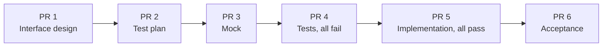
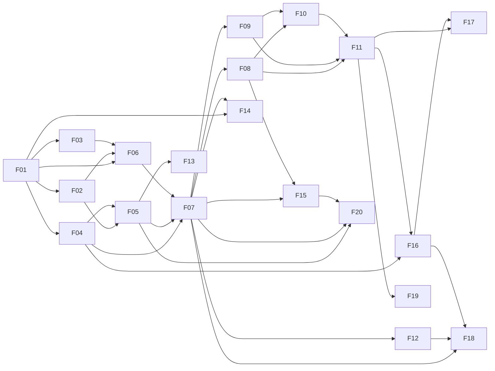

# troy-mode requirements

| | |
| --- | --- |
| Version | 1.64 |
| Date | 2026-11-25 |
| Status | Approved by Troy on 2026-11-05. Later versions add what Troy approved the same day: F01 design D1 and D2 (1.1), the answers to Q1 and Q9 (1.2), and F02 design D10, D11, and D14 plus the Python environment rule (1.3). Version 1.4 updates F02's status, and 1.5 adds the EN/ZH pair check to troy-pstack's CI. Version 1.6 records the F03 design decisions Troy approved: D15, D16, D17, and D20. Version 1.7 adds Troy's rule R21, and 1.8 to 1.12 update F03's status. Version 1.13 records the F04 design decisions Troy approved: D31, D32, and D35, and the answer to Q5, and 1.14 updates F04's status. Version 1.15 records the F05 design decisions Troy approved: D40, D41, D44, and D45, and 1.16 records the F06 design decisions Troy approved: D48, D52, D53, D54, and D55. Versions 1.17 and 1.19 update F06's status, and 1.18 updates F05's status. Version 1.20 records the F07 design decisions Troy approved: D57 to D61, D64, D65, and D67, 1.21 updates the status of F07, F04, and F05, 1.22 updates F07's status, and 1.23 updates F02's status. Version 1.24 records the F08 design decisions Troy approved: D70, D71, D73, D75, and D77, 1.25 records the F09 design decisions Troy approved: D80, D81, and D83, 1.26 records the F10 design decisions Troy approved: D90 and D91, and 1.27 records the F11 design decisions Troy approved: D93 to D97. Version 1.28 updates F08's status, 1.29 updates F09's status, and 1.30 updates F10's status. Version 1.31 updates the status of F01 to F07 and F11 from the pilot. Version 1.32 records what Troy approved on 2026-11-14: F12 to F19, the changes they bring to sections 3, 4.1, 5, and 6 and to Q4, and the proposals for Q11 to Q16. Version 1.33 records the F13 design decisions Troy approved: D121 to D126, and 1.34 records the F14 design decisions Troy approved: D131 to D137. Version 1.35 records the F12 design decisions Troy approved: D102, D103, D105, D107 to D109, and D112. Version 1.36 updates F14's status, 1.37 updates F13's, and 1.38 updates F12's. Version 1.39 records the F15 design decisions Troy approved: D141 to D150, and 1.40 records the F19 design decisions Troy approved: D191 to D199. Version 1.41 updates the statuses of F01 to F14 at the end of the pilot. Version 1.42 records the F16 design decisions Troy approved: D151 to D160, which narrow F16 to the roles that run as subagents. Version 1.43 renames the plugin to tstack outside the history, with F19's build (D197), and 1.44 and 1.45 update F19's status. Version 1.46 records D200, the F05 design decision Troy approved as tstack issue #65, 1.47 updates the status of F05 and F15, 1.48 updates F05's status, and 1.49 updates F16's. Version 1.50 records D223, the F05 design decision Troy approved as tstack issue #64, with the new rule R23, and 1.51 updates F05's status. Version 1.52 records D231 and D232, the F05 design decisions Troy approved as tstack issue #49, and 1.53 updates the status of F05 and F07. Version 1.54 records what Troy approved on 2026-11-22 ("都批准"): the new feature F20, parallel feature teams, the changes it brings to sections 3.3, 3.4, 4, 5, 6, 8, and 9, the new rule R24, Troy's answers to Q17, Q18, and Q22, and the proposals for Q19 to Q21 and Q23 to Q25. Version 1.55 records tstack issue #63, whose rule Troy accepted on 2026-11-16, as F07 design D205 to D207, with the two clauses of section 5.2 that Troy approved on 2026-11-22. Version 1.56 updates F07's status. Version 1.57 updates the status of F07 and F08, and 1.58 the status of F07 and F16. Version 1.59 records the F20 design decisions Troy approved on 2026-11-22: D268 to D279, with D278 changed the same day to three build PRs, and updates F20's status. Version 1.60 updates F20's status. Version 1.61 updates F20's status, 1.62 the status of F04 and F08, and 1.63 the status of F07 and F15. Version 1.64 records the F18 design decisions Troy approved on 2026-11-25 ("全按推荐"): D171 to D180, with the requirement text of proposals P1, P2, P5, and P7. No question is open. |
| Source of truth | This English file. [`requirements.zh-CN.md`](requirements.zh-CN.md) is the Chinese mirror. |

## 1. Goal

troy-mode is Troy's own workflow for Claude Code. It takes a software project from requirements to a released version through a fixed pipeline of roles. Each role works in its own context. A different role reviews its output. Automated checks enforce the rules, so the rules do not depend on Claude remembering them.

It fixes four problems that appear when Claude builds a project in one long conversation:

- Requirements stay implicit and drift.
- Tests are written after the code and shaped to match it.
- Changes are large and hard to review.
- Written rules are forgotten partway through.

troy-mode ships as new files inside the tstack plugin. It changes no upstream pstack file and does not change how poteto-mode behaves.

## 2. User

- One user, Troy, a solo developer.
- Uses Claude Code in the desktop app (Code tab) and in the CLI, on Windows 11.
- Keeps projects on GitHub, mostly in private repositories.
- Reads and writes English and Chinese.

## 3. How Troy uses it

### 3.1 Commands

| Command | When |
| --- | --- |
| `/tstack:troy-mode <request>` | Any work in a troy-mode project: start a project, build the next feature, fix a bug, change a requirement, release a version, or investigate something. |
| `/tstack:troy-init` | Once per project, to add troy-mode's files and checks to it. |

The names are proposals (open question Q4).

### 3.2 troy-mode or poteto-mode

Choose by project, not by task.

| Situation | Use |
| --- | --- |
| A troy-mode project, any change that lands on `main` | troy-mode |
| A troy-mode project, investigating or trying an idea | troy-mode. It takes a light path with no PR pipeline and borrows pstack skills such as `how` and `why`. |
| A project that does not use troy-mode, or a one-off script | poteto-mode when the task needs rigor |
| A quick question or a small edit | No mode |

In a troy-mode project, CI enforces the PR rules whichever mode made the change. A hook there refuses `/poteto-mode` and `/no-comments`, with or without the plugin prefix, because their ways of working break troy-mode's rules (F13 design D122). It has no override: an experiment there takes troy-mode's light path, and a poteto-mode experiment needs a folder that is not a troy-mode project (F13 design D123).

### 3.3 Where Troy takes part

Only these steps wait for Troy's approval:

1. Each project's requirements document.
2. Each project's overall architecture.
3. The interface design PR and the test plan PR of the first features (Q2).
4. Each version, by testing it on Troy's own devices, and which open bugs it may ship with.
5. Every escalation (section 5.7).
6. Rules: which of the retrospective's proposals become rules, each new or changed rule with how existing code meets it, and a rule for every project (5.5, 5.8).

Every other step goes on without asking Troy, and its PR or the progress file says what was done and why. This is pstack's never-block-on-the-human principle with an explicit list, so troy-mode never judges for itself which steps need Troy (F18). The Product Manager's instructions hold this list, with the escalations of 5.7, as the waits W1 to W11, and troy-mode records each wait with its ID (F18 design D171).

Every interface design, test plan, requirements, and architecture PR opens with a one-page summary for Troy, in Chinese and then English: what changes for Troy, each point Troy decides with a recommendation, and the risks. In chat, troy-mode gives Troy the summary in the language Troy writes in (F14 design D132, D135).

Troy approves steps 1 to 3 in chat or by merging the PR on GitHub. After an approval in chat, troy-mode records it in the document's header and change log (F08 design D77) and merges the PR. After a merge on GitHub, troy-mode records the approval in a `[docs]` PR (F07 design D61). Troy can also answer from the phone, with a comment on the PR, which troy-mode reads at its next run as a reply in chat (F15 design D145).

When several feature teams run at once (F20), a wait for Troy stops only its own team and the teams that wait for its feature. troy-mode asks about every waiting PR in one message, starting with the one that holds up the most features, each with its summary, and Troy answers them together or one by one (Q23).

Once real-run acceptance (F12) and the role exam (F16) give enough evidence, Troy can turn the approvals of step 3 into spot checks: Claude merges, and Troy reviews a sample and every PR marked as risky (F18, Q15).

Troy follows progress in the progress file, in the feature status table of the requirements document, and in each feature's progress issue on GitHub (F15 design D142).

### 3.4 Interaction prototypes

These are text mocks. Real wording will differ.

**Prototype A. Starting a project.**

```text
Troy: /tstack:troy-mode I want a small habit tracker for my phone and laptop.
PM:   Your goal as I understand it: log daily habits on two devices and see streaks.
      Before I write the requirements I need these answers.
      1. Must the two devices sync, or is each one separate?
      2. Does it work offline?
      3. ...
Troy: (answers)
PM:   Requirements draft written. docs/requirements.md (English) and
      docs/requirements.zh-CN.md (Chinese mirror).
      14 features. The dependency graph has no cycle. Order: F01, F02, F04, F03, ...
      Prototypes: docs/prototypes/F06-today-screen.html.
      Version plan: v0.1 = F01 to F06, v0.2 = F07 to F14.
      Waiting for your approval.
Troy: Approved.
Architect: Architecture draft written in docs/architecture.md. Waiting for your approval.
```

**Prototype B. The next feature.**

```text
Troy: /tstack:troy-mode next feature
troy-mode: Next in order is F04 "Export history as CSV". It depends on F02 and F03, both accepted.
  [1/6] Interface design PR #41 is open. The Architect approved it in round 2.
        You merge this one (feature 2 of your first 3). Waiting for you.
Troy: Merged.
troy-mode: [2/6] Test plan PR #42 is open. Waiting for you.
Troy: Merged.
troy-mode: [3/6] Mock PR #43 merged. CI green, code review passed.
  [4/6] Test PR #44 merged. 9 new tests. All 9 fail against the mock, as expected.
  [5/6] Implementation PR #45 merged. 9 of 9 new tests pass. 212 existing tests pass.
        Changed-code coverage 94% line, 86% branch. 310 changed lines in 4 files.
  [6/6] Acceptance PR #46 merged. F04 status is now "passes tests on main".
        It has not been checked on your devices yet.
```

**Prototype C. An escalation.**

```text
troy-mode: Stopped on F07. This needs you.
  Why: the Architect rejected the interface design 3 times.
  The disagreement: the Interface Designer wants one sync() call. The Architect wants
  separate push() and pull() calls, so the storage module holds no network code.
  Option A: one sync() call. Simpler for callers. Storage depends on network.
  Option B: push() and pull(). Keeps the module boundary. Callers make two calls.
  Recommendation: B, because the architecture says storage must not depend on network.
```

**Prototype D. The progress file.**

```markdown
# Progress

- Current version: v0.2 (F07 to F14)
- Current feature: F08 Import from CSV
- Stage: 4 of 6. Test PR #48 is in review (Code Reviewer, round 1).
- Waiting on Troy: nothing
- Open issues: F05 has one coverage exclusion (disk-full branch), approved by the Test Manager.
- Last updated: 2026-11-12 14:05
```

**Prototype E. Two teams at once (F20).**

```text
Troy: /tstack:troy-mode the rest of v0.2
troy-mode: v0.2 has 5 features left. F08, F09, and F10 depend only on accepted features.
  The Architect planned the batch: F08 and F10 both change the import interface,
  so F10 waits for F08's interface design PR.
  Team F08 "Import from CSV": started, in its own worktree.
  Team F09 "Weekly report": started, in its own worktree.
  F11 and F12 wait for F08.
  ...
troy-mode: Two PRs wait for you. Each one holds up only its own team.
  1. F08 [1/6] Interface design PR #51. F10, F11, and F12 wait for F08.
     Summary: ...
  2. F09 [2/6] Test plan PR #53. No feature waits for F09.
     Summary: ...
  Reply "approve all", or one at a time.
Troy: approve all
troy-mode: Team F08: [2/6] Test plan PR #54 is open. Team F10 started.
  Team F09: [3/6] Mock PR #55 merged. [4/6] Test PR #56 is in review, round 1.
```

The progress file then lists each team:

```markdown
# Progress

- Current version: v0.2 (F07 to F14)
- Teams: 3
  - F08 Import from CSV: stage 2 of 6. The Test Manager is writing test plan PR #54.
  - F09 Weekly report: stage 4 of 6. Test PR #56 is in review (round 1).
  - F10 Reminders: stage 1 of 6. The Interface Designer is writing the design.
- Waiting for F08: F11, F12.
- Waiting on Troy: nothing
- Last updated: 2026-11-23 10:20
```

## 4. Roles

| Role | Runs as | Owns | Reviews | Must not |
| --- | --- | --- | --- | --- |
| Product Manager | Main session, because only it can talk with Troy | Requirements document, feature list, dependency graph, feature order, prototypes, version plan, status table, acceptance, change requests | Each finished feature, against the requirements | Write code or tests |
| Architect | Subagent | Overall architecture, coding rules, module dependency rules, architecture decision records (ADRs), approval of new third-party dependencies | Each interface design, against a checklist | Design a feature's interfaces itself |
| Interface Designer | Subagent | Each feature's external interface design | Nothing. It answers the Test Manager's questions. | Edit the architecture. It asks the Architect instead. |
| Test Manager | Subagent | Each feature's test plan, each version's test plan, triage of coverage gaps, bugs, disputed tests, and the mismatches of a real run (F12) | Each test PR, against the test plan | Write test code |
| Developer | Subagent | Mock PRs, implementation PRs, bug fix PRs | Nothing | Edit tests. Add a third-party dependency without the Architect. |
| Test Engineer | Subagent | Test code, bug reproduction tests, test fixes the Test Manager orders | Nothing | Edit source code |
| Code Reviewer | Subagent | Nothing | Mock, test, and implementation PRs, for quality and security, using Claude Code's `/code-review` and `/security-review` | Edit the code it reviews |

The main session also does the project manager's work. It picks the next feature, starts each role, passes reviews between roles, keeps the progress file, and escalates to Troy. With parallel feature teams (F20), the one main session coordinates every team: it picks the features that may start, starts a team for each in its own worktree, and runs every team's roles (5.11).

Each role's model is set in its agent file and can be overridden per project in `.troy-mode/config.toml` (Q3, [F04 design](design/F04-role-definitions.md) D32).

### 4.1 pstack skills troy-mode reuses

troy-mode calls these tstack skills where they fit, without changing them.

| Skill | Used for |
| --- | --- |
| `how`, `why` | Understanding existing code during investigations and before design |
| `interrogate` | Adversarial review of a contested design |
| `benchmark-checklist` | Checking performance numbers before trusting them |
| `technical-writing` | Writing requirements, design, and test plan documents |
| `correct` | Turning repeated mistakes into rules and checks after a version |
| `reflect` | Reviewing a version's sessions at the retrospective for lessons to put into skills. Listed here since 1.0, but the retrospective does not call it yet. F17 adds it. |
| `create-verification-skill`, `maintain-verification-skill` | Making and keeping current a project's tool that drives the real program as a user does, with its feature map (F12) |
| `principle-prove-it-works` | Checking the real program, not a proxy, before a feature is accepted (F12) |
| The `eval` and `hillclimb` playbooks of `poteto-mode` | Testing role instructions blind, and improving them against the score (F16) |

F17 adds more of pstack where the pilot shows the need, when the same mistake shows up twice. troy-mode reads these skills and playbooks and follows them. It borrows from `poteto-mode` and never changes it, so upstream updates keep merging cleanly.

Where a pstack rule conflicts with a troy-mode rule, troy-mode's rule wins inside a troy-mode project. The comment rule is one example. pstack keeps comments only for a non-obvious reason. troy-mode requires a Google-style doc comment on every function.

## 5. Process

### 5.1 Project setup (once per project)

1. **Requirements.** The Product Manager talks with Troy until the requirements are clear. It writes the requirements document in English with a Chinese mirror. The document holds the goal, users, interaction, non-functional requirements (performance targets included), out of scope, open questions, and these parts:
   - Features, broken down finely, each with an ID.
   - A dependency graph. Each dependency is hard (B cannot be built without A) or soft (B can be built against A's mock).
   - A topological order. A cycle means the breakdown is wrong. The Product Manager breaks it down again, usually by moving the shared part into its own feature.
   - Prototypes.
   - A version plan.

   A feature whose implementation would pass the PR size limit (R03) is split. Troy approves the document.
2. **Init.** `troy-init` adds the marker folder, document templates, the rules table, the progress file, and troy-check's CI workflow.
3. **Architecture.** The Architect writes the overall architecture: tech stack, modules and the allowed dependency directions between them (no cycles), data model, error handling, logging, naming, and coding rules. Troy approves it.
4. **Checks.** `troy-init` adds the language-specific checks and their CI job for the chosen stack.

### 5.2 Feature loop

Features are built in topological order. Until F20, they are built one at a time. With F20, features that do not depend on each other are built at the same time, each by its own team (5.11). Each feature takes six PRs, merged in order. Each PR has exactly one commit and holds one stage's output only.



| PR | Content | Author | Reviewer | Merge condition | Merged by |
| --- | --- | --- | --- | --- | --- |
| 1 | Interface design (English and Chinese). For each external interface: name, purpose, parameters, return value, errors, and a performance target when the requirements set one. The PR description opens with a one-page summary for Troy, in Chinese and then English: what changes for Troy, the points Troy must decide with a recommendation for each, and the risks (F14 design D132, D135). | Interface Designer | Architect, against the checklist below, at most 3 rounds | Document checks pass | Troy for the first features (Q2), or Claude after Troy approves in chat (R18). Then Claude. |
| 2 | Test plan (English and Chinese). Unit, functional, integration, and performance cases. Each case says what it tests. The PR description opens with the same kind of summary for Troy (F14 design D132). | Test Manager | Agreed with the Interface Designer, at most 3 rounds | Document checks pass | Troy for the first features (Q2), or Claude after Troy approves in chat (R18). Then Claude. |
| 3 | Mock. Signatures and full Google-style doc comments, no bodies. Where the mock does less than a doc comment says, a mock note in the brief's fixed words says so, as a paragraph of its own ([F07 design](design/F07-entry-skill.md) D205). | Developer | Code Reviewer | Checks pass. Existing tests pass. | Claude |
| 4 | Test code, each test tagged with the feature ID. | Test Engineer | Test Manager (matches the plan) and Code Reviewer | Every new test fails against the mock. Existing tests pass. | Claude |
| 5 | Implementation. The mock notes are deleted, and the rest of a doc comment changes only where the code makes it untrue (F07 design D207). | Developer | Code Reviewer | New and existing tests pass. Performance tests pass where a target exists. Coverage meets R11. Size rules hold. | Claude |
| 6 | Acceptance. Status update in English and Chinese. The feature's tests become must-pass. First the Product Manager runs the real program, the way Troy types it, through every command of the prototypes of this feature and of every accepted feature, with one engine command ([F12 design](design/F12-real-run.md) D102, D105). A run file next to each prototype, committed in this PR, says how each section's data starts (D103). The real output, compared with the prototype, goes in the PR description (D108). The Test Manager rules on each mismatch, and a bug goes to the bug flow (5.3) before acceptance (D107). The feature gets "ran for real on Troy's PC" when every command of its own prototypes ran and matched, apart from those that wait for a later feature, and otherwise "passes tests on main", with the reason in the PR (D109). | Product Manager | None | Checks pass | Claude |

**Architect's interface checklist.**

- Fits the module layout and the data model.
- Follows the error handling and naming conventions.
- Does not duplicate an existing interface.
- Depends only on features earlier in the order.
- Adds no hidden coupling between modules.
- Changes an implemented interface only through the change flow (5.4).
- The summary for Troy says what the design says, and lists every point Troy decides (F14 design D134).

**Disputed tests.** The Developer raises it. The Test Manager rules. If the test is wrong, the Test Engineer fixes it in its own test PR and states the reason. A test change never shares a commit with source code.

**Coverage gaps.** When R11 fails, the Test Manager decides what the uncovered code is. Tests are added only from the design, never by aiming at uncovered lines.

| Uncovered code | Cause | Fixed by |
| --- | --- | --- |
| Code nothing needs (an unused branch, a feature written early) | Developer wrote too much | Developer deletes it |
| Behavior in the design that the test plan missed | Incomplete test plan | Test Manager adds cases. Test Engineer adds them in a test PR. |
| Behavior not in the design | Either the design missed it or the Developer overreached | Interface Designer decides. A missed design gets a design update, then tests. Overreach is deleted. |
| Code that cannot be tested in practice (for example a full disk) | Hard to set up | Excluded with a written reason, approved by the Test Manager |

### 5.3 Bug fix

1. The Test Manager triages the report. A misunderstood requirement goes to the Product Manager as a change (5.4). A bug from a real run is already triaged by the Test Manager's ruling on its mismatch (F12 design D107).
2. PR A. The Test Engineer adds a test that reproduces the bug, tagged with the bug ID. It fails.
3. PR B. The Developer fixes the bug. The test passes and stays as a regression test.

The Code Reviewer reviews both PRs.

### 5.4 Requirement change

1. Troy asks for the change, in chat or in an idea issue: an issue with the `idea` label or with no label. troy-mode takes in a new idea issue at the next natural stop, before a new feature, a release, or a version test plan starts, never between two stages, and the change PR closes it (F15 design D143). The Product Manager updates the requirements document, and Troy approves it.
2. The Product Manager lists the affected features from the dependency graph: the changed feature and every feature that depends on it.
3. The Architect decides which interfaces, tests, and parts of the architecture change. An architecture change gets an ADR.
4. A change to a feature that is already accepted becomes a new feature with a hard dependency on the old one. Its tests PR retires the old tests that the change makes wrong and adds new ones, and its mock PR is skipped when it adds no interface (F07 design D65).
5. The changes go through the feature loop PRs as usual. All existing tests run as regression.

While feature teams run (F20), the main session takes in a new idea or change request before it starts the next team, and the running teams go on. A team whose feature the change affects stops after its current stage PR until the change merges (Q24).

### 5.5 Version release

1. The version plan groups consecutive features in the order into versions. Each version is usable on its own.
2. The Test Manager writes the version test plan when the version is planned, not at the end: before the version's first feature starts (F08 design D70).
3. The release test runs end-to-end tests of the user scenarios in the requirements, stress tests, and performance tests, on Troy's devices. It also runs the real program through every command of the prototypes of every accepted feature, and a mismatch fails it (F12 design D112). Each scenario says who runs it. The Test Engineer writes the ones Claude runs as version tests, which run on Troy's PC at release only. Troy runs the ones that need Troy's devices (F08 design D71), from a checklist issue for the version, which appears after the release test passes and which Troy ticks while testing. Troy accepts the version by ticking every box of it, the last one included, or in chat (F15 design D144).
4. Bugs found go through the bug flow (5.3).
5. After acceptance, `main` gets a tag `vMAJOR.MINOR.PATCH`, made as a GitHub release whose notes are the version's changelog section (F08 design D73), and the changelog is updated in English and Chinese.
6. A retrospective turns problems that repeated during the version into new rules or checks (5.8).

A patch release, such as v0.1.1, releases the bug fixes merged since the version's last tag. It is possible only while no code of a later version's feature has merged since that tag (F08 design D75).

With feature teams (F20), the release starts once every feature of the version is accepted. Teams for the next version's features may write their design and test plan PRs before then, but none of their code PRs merges until the version's tag exists, so a patch release stays possible (Q24).

### 5.6 When tests run

| When | What runs | Who |
| --- | --- | --- |
| Each stage | The current feature's tests | Automatic |
| Each PR | All unit, functional, and integration tests, as regression. Target: a few minutes. | CI |
| Each acceptance PR, and each release test | The real program, through every command of the prototypes of the feature being accepted and of every accepted feature, on Troy's PC (F12 design D105, D112) | Claude runs it. The Test Manager rules on mismatches. |
| Each version | End-to-end, performance, and stress tests, on Troy's devices | Test Manager designs, Test Engineer implements, Product Manager and Troy accept |

**Performance.** Targets come from the requirements. The Interface Designer copies them into the interface design. The Test Manager plans performance cases in the test plan. They run after implementation, because a mock always returns at once. Only interfaces with a target get performance tests. Stress tests need the whole system, so they run only at version level.

### 5.7 Escalation

troy-mode stops and asks Troy when:

- A change needs the requirements or the architecture to change.
- An author's work still fails its checks after 3 attempts (F07 design D64), and after one more attempt that first tests the premise the failed attempts share (F18).
- A new third-party dependency is needed. The Architect reviews it first.
- An irreversible action falls outside the merge rights, for example a force push or deleting data.
- Claude Code refuses a step troy-mode needs, such as a permission, which troy-mode never works around.
- troy-mode's own checks find a fault it cannot repair, such as a role that moved its branch, a write scope broken twice, or CI that fails twice outside the authors' files.

Each escalation says what stopped, why, the options, and a recommendation (Prototype C). With feature teams (F20), an escalation stops only its own team and the teams that wait for its feature, and the others go on (Q23).

When a review loop reaches 3 rounds without agreement, troy-mode does not stop. The Architect decides, or the Product Manager when the loop is the Architect's own review, and writes the reason in the PR. Troy can overturn the decision later (F18). Until F18 is built, troy-mode stops and asks Troy after a review loop's third round and after an author's third attempt.

### 5.8 Adding or changing a rule

1. Troy states the rule and whether it applies to every troy-mode project or to one.
2. troy-mode picks the strongest enforcement that works. In order: an architecture that makes the mistake impossible, a lint or CI check, a test, and last, written role instructions. A rule of one project gets no test yet: its levels are the architecture, a check of a tool the project already runs or of troy-check, and its row in the rules table (F09 design D80).
3. One PR updates the rules table in English and Chinese, the check config, and the role instructions. Role instructions are prompts for Claude and are in English only (F04 design D35). For a rule of one project, its row in the rules table is the role instruction, because every role reads that table. An architecture change comes first, in its own PR (F09 design D80).
4. If existing code breaks the new rule, Troy chooses: fix it all now in separate cleanup PRs, or apply the rule only to new and changed code. Either way, the rule's PR exempts today's violations in a baseline, so CI stays green, and the cleanup PRs remove that baseline (F09 design D81).

A rule for every project lives in tstack and ships in a new plugin version. On Troy's yes, troy-mode writes its proposal as an issue in tstack (F09 design D83). A rule for one project lives in that project's rules table.

While feature teams run (F20), the main session runs the rule change. Its PR merges like any other, and each team rebases on it before its next PR (Q24).

### 5.9 Work outside the pipeline

Investigations, questions, and experiments in a troy-mode project open no PR to `main`. Experiment code stays on a throwaway branch or folder. A throwaway branch does not turn off the mode guard of 3.2 (F13 design D123). Code worth keeping goes through the feature loop.

### 5.10 Continuing across sessions

The progress file (Prototype D) records the current version, feature, stage, open PRs, what waits on Troy, and open issues. With feature teams (F20), it records each team's feature and stage instead (Prototype E). A new session reads it first and continues without the old conversation. Each feature's progress issue on GitHub is a view of the same state, rebuilt after every step, so a write that failed is repaired by the next one (F15 design D142, D147).

With feature teams, a new session rebuilds every team's state from git, GitHub, and the teams' worktrees, and goes on with every team.

### 5.11 Parallel feature teams (F20)

On 2026-11-22 Troy asked that whatever can run in parallel should, in troy-mode too: when several features can go ahead at once, troy-mode splits them across several teams at the same time, instead of one team building them all in series. The same day Troy decided three points: one main session coordinates every team (Q17), there is no limit on how many teams run at once (Q18), and whoever finishes first merges first, while the other teams go on from the merged `main` (Q22). Troy then approved this section on 2026-11-22 with the proposals for Q19 to Q21 and Q23 to Q25.

- **Which features run at once.** A feature may start once every feature it depends on, hard or soft, is accepted (Q19), and once the Architect's plan of the batch lets it (Q20). Features that do not depend on each other then run at the same time, as the dependency graph already shows. In `ZJUCao/recipe-menu`'s v0.1, this rule turns 13 features in a row into 6 waves, with at most 4 features at once.
- **A team.** The role runs of one feature, from PR 1 to PR 6, in its own git worktree and on that feature's branches. The main session creates the worktree with an engine command. Each team runs the feature loop of 5.2 unchanged: one writing role at a time within the team, with its own reviews, rounds, attempts, checks after each run, and merges. Roles of different teams run at the same time.
- **The main session.** One main session, where Troy types `/tstack:troy-mode`, coordinates every team (Q17). It starts a team for each feature that may start, with no limit on how many (Q18), runs every team's roles, and talks with Troy for all of them. It keeps the work that spans features: the requirements, the architecture, the rules, idea issues, and releases. It acts as the Product Manager for each feature's acceptance (PR 6).
- **Conflicts between teams.** Before a batch of teams starts, the Architect plans it: for each feature, the modules, interfaces, and shared documents it will touch. Where two features overlap, the plan orders them, so two features that change the same interface never run at once, or one waits for the other's interface design PR. The Architect checks again whenever a team's design PR changes a shared interface or document (Q20). Only the main session and the Architect's planning step change the requirements' text, the architecture, its ADRs, and the rules table.
- **Hooks and checks.** Each team's roles write only in that team's worktree, within their role's write scope there. F05's records name each role's team, and F07's `snapshot` and `check-run` look only at that team's worktree and records, so no team is blamed for another team's files or held up by another team's running roles (Q21).
- **Merges.** Whoever finishes first merges first (Q22). The other teams then rebase onto the new `main` and run their checks again before they merge (R24). A conflict at a rebase goes back to the team's author whose write scope holds the conflicting files, the Developer for source, or escalates (5.7). When the rebase changed a PR's diff, the Code Reviewer reviews the rebased diff.
- **Usage limits.** When Troy's 5-hour usage limit stops the session, every team pauses, and every team resumes from git, GitHub, and its worktree after the limit resets, as F16's exams do ([F16 design](design/F16-role-exam.md) section 10.1). Having no cap on teams means the limit comes sooner, not that work is lost.
- **Waits.** A wait for Troy or an escalation stops only its own team and the teams that wait for its feature. Several waits reach Troy in one message (3.3, 5.7, Q23).
- **Progress.** Each feature that a team builds keeps its progress issue (F15), and the progress file lists every team (Prototype E, 5.10).
- **One team.** When only one feature may start, troy-mode works as it does today.

## 6. Rules

**Hard** blocks the merge. **Soft** allows the PR when its description gives a reason. **Review** is checked by a role. **Process** is followed by troy-mode itself. Troy's GitHub plan is free, and it has no branch protection for private repositories. So troy-mode's merge step enforces Hard rules: it never merges a PR whose checks fail (F02 design D14).

| ID | Rule | Type | Enforced by |
| --- | --- | --- | --- |
| R01 | Each PR has exactly one commit, and its subject line equals the PR title (F03 design D17). Review fixes amend that commit, or the PR is squash-merged. | Hard | CI |
| R02 | Each PR holds one stage's output only: documents, source, or tests. | Hard | CI |
| R03 | A source PR changes at most 500 lines (added plus deleted, not counting lock files or generated files) in at most 5 files. Test PRs have no limit. A PR that only splits a file may pass the limit and says so. | Soft | CI |
| R04 | A function body has at most 50 lines, not counting comments, doc comments, or blank lines. A complex external interface calls single-purpose internal functions. | Hard | Lint |
| R05 | Doc comments follow Google style. Code comments are in English only. | Hard | Lint |
| R06 | A source file has at most 500 lines in total, comments included. Larger files are split. | Soft | Lint |
| R07 | Modules depend on each other only in the directions the architecture allows, only through external interfaces, and never in a cycle. | Hard | Dependency checker |
| R08 | The Developer never edits test files. | Hard | Hook and CI |
| R09 | Every new test in a test PR fails against the mock. | Hard | CI |
| R10 | Every test is tagged with its case ID or bug ID: the test's own name starts with it, for example `test_f04_t07_writes_header` (F03 design D16). Tests of features not yet accepted and of bugs not yet fixed count as expected failures. Every other test must pass. | Hard | Test runner config and CI |
| R11 | In an implementation PR, the changed code has at least 90% line coverage and 80% branch coverage. 95% is a target, not a gate. An excluded line needs a written reason and the Test Manager's approval. | Hard | CI |
| R12 | English documents are the source of truth. A PR that changes an English document also updates its Chinese mirror. The mirror's header names the English version it matches. | Hard | CI |
| R13 | A status label says how far a feature really goes, for example "passes tests on main" versus "usable on Troy's devices". | Review | Product Manager |
| R14 | Only interfaces with a performance target get performance tests. They run on a fixed machine, with a margin, against the previous baseline. | Review | Test Manager |
| R15 | Every fixed bug keeps its reproduction test. | Review | Test Manager |
| R16 | A new third-party dependency needs the Architect's approval. | Review | Architect. CI flags every change to dependency files. |
| R17 | A review loop stops at 3 rounds and escalates. After F18, the Architect, or the Product Manager when the loop is the Architect's own review, decides instead and records the reason (5.7). | Process | troy-mode |
| R18 | Troy approves PR 1 and PR 2 of the first features (Q2), in chat or by merging them. After an approval in chat, Claude merges them (F07 design D61). Claude merges every other PR once its checks and reviews pass. Troy decides when Claude merges everything. | Process | troy-mode |
| R19 | Commits use the email in Troy's global CLAUDE.md. Commit messages, PR titles and descriptions, PR comments and reviews, issues, and release notes carry no Claude attribution and, by default, do not mention Claude or Anthropic at all (F02 design D10). Text for GitHub is checked before it is posted, because GitHub keeps the history of every edit (F05 design D200). | Hard | Hook and CI. Only the hook checks comments, reviews, issues, and release notes, before they are posted. |
| R20 | A merged document or PR description holds no template markers or template guidance (F01 design D2, F02 design D11). | Hard | CI |
| R21 | Every change reaches `main` through a PR from its own branch. Never commit on `main`, push `main`, or open a PR from `main`. | Hard | Hook and CI |
| R22 | The description of every interface design, test plan, requirements, and architecture PR opens with a summary for Troy, in Chinese and then English: what changes for Troy, each point Troy decides with a recommendation, and the risks. Each language has at most 2,000 characters and holds no internal IDs (F14 design D133, D134). | Hard | CI |
| R23 | In a command that troy-mode runs, Python never reads its program from standard input: no `python -`, no `python -i`, and no `python` without a script, `-c`, or `-m`, whatever feeds standard input (a heredoc, a pipe, `/dev/null`, or nothing). Such a run can hang at Python's interactive prompt. Write the script to a file in the scratchpad and run that file with the project's Python (F05 design D223). | Hard | Hook (refuses the command before it starts) |
| R24 | A PR merges only when its branch holds the latest `origin/main` and its checks passed on that head commit. When `main` has moved since the push, troy-mode rebases, pushes, and waits for the checks again, so two PRs that pass alone never break `main` together (F20, Q22). | Process | troy-mode |

## 7. Features

### 7.1 Status labels

| Label | Meaning |
| --- | --- |
| Not started | Nothing exists yet. |
| Written | The files exist but have never run. |
| Runs on a sample project | It ran on a throwaway sample project. |
| Used on a real project | Troy used it on one of their own projects. |

### 7.2 Feature list

The IDs are already in topological order.

| ID | Feature | Depends on | Status |
| --- | --- | --- | --- |
| F01 | Templates and rules table. Templates for the requirements, architecture, interface design, test plan, ADR, progress file, changelog, and escalation message. The English and Chinese pair format with its sync header. The rules table, seeded from section 6. PR title and description templates ([F01 design](design/F01-templates.md) D1). | None | Used on a real project: troy-mode wrote the documents of `ZJUCao/recipe-menu` from its templates, in English and Chinese: the requirements, the architecture with ten ADRs, the v0.1 test plan, the design and test plan of each feature, F01 to F13, and the changelog. troy-init seeded its rules table and PR template, and the rule change flow added P01 to the table. No escalation message was needed. |
| F02 | Language-independent checks for R01, R02, R03, R12, R16, R19, and R20, a GitHub Actions workflow that runs them, and a `commit` subcommand that F05's hooks call for R19. The checks read each PR's stage from its title (F01 design D1). R20 rejects documents and PR descriptions that still hold template markers (F01 design D2). R21's check, which fails when the PR's branch is `main`, came after F02 merged and is not built yet. | F01 | Used on a real project: troy-check's `pr` command passed in CI on all 97 PRs of `ZJUCao/recipe-menu`'s v0.1 and its rule P01, and its `commit` command checked the commits there through the git hooks. |
| F03 | Language packs. A language-independent engine in troy-check for R04, R05, R06, R07, R09, R10, and R11, which reads JUnit and Cobertura XML, plus one thin pack per language with its environment, tool config, commands, and CI job ([F03 design](design/F03-language-packs.md) D15). Built in four PRs. Python and C/C++ come first. TypeScript/JavaScript is wanted too, at lower priority (Q1). The Python pack follows the Python environment rule in section 8. | F01 | Python pack used on a real project: its CI job, which ends in `troy-check code`, passed on every PR of `ZJUCao/recipe-menu` from its language step on, including the mock, tests, and implementation PRs of F01 to F13 and the version tests, and its steps ran in the v0.1.0 release test on Troy's PC. Its `ruff format` check also reads the python examples in design documents, which the Interface Designer cannot run (tstack issue #51). The C/C++ pack runs on a sample project only: it takes its sample through the pack's CI job in tstack's CI on Linux and on Troy's PC. TypeScript/JavaScript is not started |
| F04 | Role definitions. Six subagents and the Product Manager's instructions for the main session, each with its instructions, tool limits, model, and write scope ([F04 design](design/F04-role-definitions.md)). | F01 | Used on a real project: troy-mode ran every role on `ZJUCao/recipe-menu`, the Architect, the Interface Designer, the Test Manager, the Developer, the Test Engineer, and the Code Reviewer, with the Product Manager as the main session, through the setup, F01 to F13, the v0.1.0 release, and the rule P01: 263 role runs, the Developer and the Test Engineer on sonnet and the others on opus. The security review once per release and on the PRs that add a risk (F04 design D280 to D283, tstack #75, plugin 0.16.0) is written, checked by tests and by the role exam of the Code Reviewer's two cases, and not yet used on a real project. |
| F05 | Hooks. A marker-folder gate so they do nothing outside troy-mode projects. Claude Code hooks in the plugin keep each role inside its write scope, Developer edits to tests (R08) among them. They check Write and Edit before the call, and compare the working tree with the role's starting state after each shell call and when the role stops (F05 design D41). Every other subagent is read-only (D40). Roles may run only read-only git and GitHub commands (F04 design D31) and the skills they need, and may read the plugin's own files without a permission rule (D45). Git hooks in troy-check's folder, turned on by `core.hooksPath`, refuse commits that break R19, commits on `main`, and pushes of `main` (R21), whoever runs git, and Claude cannot skip them (D44). Before the main session posts a PR, comment, review, issue, or release note, they check its text for R19 and refuse text they cannot read (D200). For every caller, they refuse a command that runs Python reading its program from standard input, before it starts (R23, D223). They record each command that a role leaves running in the background, so that troy-mode ends it before the next run, and refuse every call of a role that has already stopped (D231, D232). A local log records each block for F07. | F02, F04 | Used on a real project: the hooks were on in every session of `ZJUCao/recipe-menu`, through v0.1 and its rule P01. They blocked two commands, both PR descriptions holding a word that R19's strict mode refuses, which troy-mode then rewrote. Since plugin 0.7.2, `hooks.log` keeps its lines for `[hooks] log_days` days, 30 by default, so the retrospective can see a whole version (D219, tstack issue #66). That change is written, with its tests passing, and has not run on a sample or real project yet. The check of comments, reviews, issues, and release notes before they are posted (D200, tstack #65, plugin 0.6.1) runs on a sample project: in F15's trial on `ZJUCao/troy-mode-trial` it checked every post, and refused two whose body file was named by `$(...)`. It has not run on a real project yet. The refusal of Python that reads its program from standard input (R23, D223, tstack #64, plugin 0.9.0) is written: its tests pass, and it has not run on a sample or real project yet. Its PR's role exam graded anchors only, so no role ran under it, and `ZJUCao/recipe-menu`'s `hooks.log` holds no `python-stdin` line. The refusal starts in every troy-mode project's sessions as soon as the plugin updates, before troy-init's upgrade adds the R23 row to the project's rules table. The record of each command a role leaves running in the background, and the refusal of a stopped role's calls (D231, D232, tstack #49, plugin 0.10.0), run on a sample project: in the build's trial on a copy of F03's Python sample, with commands moved to the background after 5 seconds, the hooks recorded each one, refused the call of a Test Engineer woken after its report, and closed its record when `TaskStop` ended the run, when the command ended on its own, and when the session exited. They have not run on a real project yet. The first real run also checks two facts only the desktop app shows: the notice that a role waits on its own background work, and whether auto mode lets the main session's `TaskStop` through. |
| F06 | Project init (`troy-init`). Setup adds the marker folder, document skeleton, rules table, progress file, and troy-check's CI job, and never overwrites a file it did not write (F06 design D48). After the architecture is approved, the language step adds the language pack, its CI job, the build file, the environment, and the lock. Upgrade replaces troy-mode's own files that nobody edited (D54). Each step lands as one `[rules]` PR, which troy-init merges when its checks pass (D53). When the folder has no GitHub repository, troy-init asks Troy once and creates a private one (D52). | F01, F02, F03 | Used on a real project: troy-init set up `ZJUCao/recipe-menu` from an empty folder, created its private GitHub repository, and added the Python pack with the project's own environment. Its upgrade later brought the project from troy-mode 0.2.0 to 0.5.0 in one `[rules]` PR, with no conflict. All three PRs passed CI and merged. In the desktop app's sandbox, the lock's first compile failed because uv could not write its default cache; it passed when troy-mode ran the step again with uv's cache in the session's temporary folder (tstack issue #48). |
| F07 | Entry skill (`troy-mode`). Routes each request to a flow (5.1 to 5.10), runs the feature loop, passes reviews between roles, escalates, applies the merge rights, and keeps the progress file. Starts each role with the model and effort in the `[roles]` table of `.troy-mode/config.toml` (F04 design D32), and checks after each run that the role changed only files in its write scope (D31), and that nothing the role started still runs, which it then ends (F05 design D231). The skill holds the judgment, and an engine that uses the standard library does the exact jobs: the state, the briefs, the check after each run, and approvals (F07 design D57). The state lives in git and on GitHub, and the progress file is a view rebuilt from it (D58). When a role changed a file outside its scope and F05's hooks did not get it undone, F07 undoes the run and runs the role once more (D59). Authors check their own work with `troy-check code --worktree` (D60). It lands in two parts: routing, setup, the feature loop's main path, and continuing; then side PRs, bug fixes, and requirement changes (D67). | F04, F05, F06 | Used on a real project: troy-mode took `ZJUCao/recipe-menu` from an empty folder through its setup, requirements, architecture, and v0.1 test plan, then F01 to F13 through their six PRs each, with side PRs, three architecture changes, a requirement change, and an upgrade, to the v0.1.0 release, its retrospective, and the rule P01: 97 PRs merged, with CI passing on each, in one session across 15 context compactions and 5 usage-limit pauses. Troy chose to approve the design and test plan of every feature. troy-mode stopped twice for Troy's yes: auto mode refused `git commit --amend` and `git push --force-with-lease` until Troy allowed them, and a hung background Developer run had re-applied an old edit, which troy-mode restored. One PR merged before its CI had reported (tstack issue #68); the pilot report lists the other problems. The `running` problem for work a role leaves running (F05 design D231, tstack #49, plugin 0.10.0) runs on a sample project: in the same trial, `check-run` named the Test Engineer whose command still ran, the main session ended it with `TaskStop` as the skill says, and `check-run` and `snapshot` then passed. It has not run on a real project yet. Counting attempts from failed CI runs too (F07 design D261 to D263, tstack #73, plugin 0.11.0) is written and tested: `retro`, reading the pilot's PRs from GitHub again, counted the four failed pushes of ZJUCao/recipe-menu#52 and #59 and no attempt for the checkout failure on #87. It has not been used while a project runs. The report of role runs and their cost (F07 design D264 to D267, tstack #74, plugin 0.12.0) is written and checked on the pilot's transcripts: `costs --tag v0.1.0` gave the pilot report's runs and cost for every role. It has not been used while a project runs. The fixed mock-note sentences in the DV1, DV2, and CR1 briefs (F07 design D205 to D207, tstack #63, plugin 0.12.1) run on a sample project: they passed the role exam on scratch copies of the pilot's states, where dv-mock-notes rose from 2 of 5 runs to 5 of 5 and cr-mock-review from 0 of 5 to 5 of 5. They have not run on a real project yet. Notes for later features (F07 design D284 to D287, tstack #67, plugin 0.17.0) live on the progress issues and reach those features' design and implementation briefs, as tests and a trial on `ZJUCao/troy-mode-trial` checked; they are not yet used on a real project. |
| F08 | Version release flow (5.5). The Test Manager writes each version's test plan before the version's first feature starts ([F08 design](design/F08-release.md) D70). At release, the Test Engineer writes the version tests that Claude runs on Troy's PC, and Troy tests the scenarios that need Troy's devices (D71). A release PR holds the changelog, the release test reports, and Troy's answers (D72). The tag is a GitHub release (D73). Open bugs are fixed first (D74), patch releases are possible (D75), and a retrospective proposes rules for Troy to pick (D76). F07's `approve` also adds a change-log row (D77). | F07 | Used on a real project: troy-mode wrote the v0.1 test plan of `ZJUCao/recipe-menu` before its first feature, and released its v0.1.0: 29 version tests, a release test on Troy's PC with 583 tests and a real run in which all 48 prototype commands matched, Troy's test of three scenarios on Troy's devices and acceptance, the GitHub release on the release PR's merge commit, and a retrospective that proposed four rules. No bug was open, so deferring a bug and a patch release have not run. The report of role runs and their cost (F07 design D264 to D267, tstack #74, plugin 0.12.0) is written and checked on the pilot's transcripts: `costs --tag v0.1.0` gave the pilot report's runs and cost for every role. It has not been used while a project runs. The security review once per release and on the PRs that add a risk (F04 design D280 to D283, tstack #75, plugin 0.16.0) is written, checked by tests and by the role exam of the Code Reviewer's two cases, and not yet used on a real project. |
| F09 | Rule change flow (5.8). The Architect picks the strongest enforcement that works and finds the existing code that breaks the rule ([F09 design](design/F09-rule-change.md) D79). A project rule is enforced by the architecture, a tool the project already runs, a troy-check limit, a step in the project's own workflow, or its row in the rules table (D80). Its `[rules]` PR carries a baseline of today's violations, which cleanup PRs remove when Troy chooses to fix them now (D81). Troy approves each rule in one message (D82). A rule for every project becomes an issue in tstack (D83). Project rules can be changed and retired, and troy-mode rules adjusted only through troy-check's config (D84). | F07 | Used on a real project: Troy picked all four rules that the v0.1.0 retrospective of `ZJUCao/recipe-menu` proposed. The project rule P01 went through the rule change flow, with the Architect's enforcement and cleanup PRs, and the three rules for every project became tstack issues #63 to #65. No rule has been changed or retired yet. |
| F10 | tstack documentation. A troy-mode section in `README.md`, in English, and a usage guide in English and Chinese in `docs/troy-mode/guide/`, covering install, project setup, every flow, where Troy takes part, and work on troy-mode itself ([F10 design](design/F10-docs.md) D86, D87, D92). A note in both, and in the plugin's descriptions, says that troy-mode is Troy's own work and not part of Lauren Tan's pstack (D88). The plugin version rises to 0.2.0, so an installed tstack receives troy-mode (D89). The pair check, a link check in CI, a facts review, and a reader test in both languages check the documents (D90). Built after F09 and before the pilot (D91). | F08, F09 | Used on a real project: Troy followed the guide in the pilot of `ZJUCao/recipe-menu`, and the problems the pilot found in it are fixed (https://github.com/ZJUCao/troy-pstack/pull/69). |
| F11 | Pilot. Take one small real project through one version with troy-mode. The project is a new Python command-line project for recipes, a week's menu, and its shopping list, with Chinese and English text ([F11 design](design/F11-pilot.md) D93). One version is its v0.1, with 4 or 5 features, released, accepted on Troy's devices, and its retrospective done (D94). Troy types the requests in a desktop session in the pilot folder (D95). A problem that blocks the pilot pauses it until tstack fixes it through its own process and a new plugin version (D96). A pilot report in tstack, and an issue with the `pilot` label for each problem, record what the pilot found (D97). | F08, F09, F10 | Used on a real project: troy-mode took `ZJUCao/recipe-menu` from requirements to v0.1.0, which Troy accepted on Troy's devices on 2026-11-16. v0.1 had 13 features, which Troy chose over D94's 4 or 5. The [pilot report](pilot/recipe-menu-v0.1.md) lists 20 problems: 1 fixed, 13 open as issues, and 6 that need no fix. |
| F12 | Real-run acceptance. Before a feature's acceptance PR, the Product Manager runs the real program the way Troy would, through every command of the feature's prototype, and puts the real output and its comparison with the prototype in the PR (5.2). Command-line projects come first: their prototypes' terminal transcripts are the script. The main session runs it with one engine command, `real-run`, and no hook changes ([F12 design](design/F12-real-run.md) D101, D102). A run file next to each prototype, committed in the acceptance PR, says how each section's data folder starts (D103). The comparison is exact after five fixed normalizations, and a word that depends on the day, such as `next`, is replaced only in the command (D104). Each acceptance runs the prototypes of every accepted feature again (D105), and a command that needs a later feature waits for it (D106). A new Test Manager task, TM8, rules on each mismatch, and a bug goes to the bug flow (5.3) before acceptance (D107). The evidence goes in the PR description (D108), and the feature gets the new label "ran for real on Troy's PC" when all its own commands ran and matched (D109). The run starts the command Troy types, with this commit's code, in a scratch home folder, so Troy's own folders and install stay untouched (D110). It runs through pipes, not a console, and the PR lists what that cannot prove (D111). The release test runs the prototypes too (D112). Projects with a graphical or web interface come later, with a verification tool and feature map from `create-verification-skill` (4.1, Q13). Built during the pilot, before its v0.1 release (Q11): a new minor plugin version, which the pilot takes through its upgrade at a natural stop (D113). Tried first on a scratch clone of the pilot and on `ZJUCao/troy-mode-trial` (D114). | F07 | Used on a real project: the acceptance PRs of F12 and F13 of `ZJUCao/recipe-menu` carried real runs on Troy's PC. F12's first run matched 41 commands, with 6 waiting for F13, and the Test Manager ruled on its mismatches; F13's matched all 48, and F13 was the first feature labeled "Ran for real on Troy's PC". The v0.1.0 release test's real run also matched all 48. |
| F13 | Mode guard. In a troy-mode project, a hook refuses `/poteto-mode` and `/no-comments` typed by Troy, and says to use troy-mode instead (3.2). A trial showed that a `UserPromptExpansion` hook gets each command's full name, such as `tstack:poteto-mode`, whether Troy types the prefix or not, and stops the command before any turn runs ([F13 design](design/F13-mode-guard.md) D121). It refuses these two commands from any plugin prefix, so it still works after the rename (F19), and no other command (D122). It refuses with no override, on a throwaway branch too (D123). Its message, in English and Chinese, says why and points to `/tstack:troy-mode` (D124). It is one more entry in F05's `hooks.json` that runs `troy_hook.py`, with F05's gate and error rule and no `hooks.log` line (D125). Unit tests, planted bugs, and the design's trial run again with the built hook check it (D126). | F05 | Used on a real project: the hook was on in every session of `ZJUCao/recipe-menu` from its upgrade to plugin 0.5.0 to the end of the pilot. It refused no command: neither `/poteto-mode` nor `/no-comments` was typed there. |
| F14 | Summary for Troy. Every interface design, test plan, requirements, and architecture PR, whoever merges it, opens with a one-page summary for Troy, in Chinese and then English: what changes for Troy as a user, each point Troy decides with a recommendation, and the risks (3.3, 5.2, [F14 design](design/F14-summary.md) D132, D135). In the pilot, one feature's design and test plan hold 60,000 to 185,000 characters of English, so Troy needs a short way in. The role that writes the document writes the summary in its report, and the main session puts it into the PR and the chat (D131). One page is at most 2,000 characters in each language, in plain words, with no internal IDs such as rule or decision numbers (D133). A new Hard rule R22 checks the summary in CI, and the Architect checks that a design's summary matches the design (D134). Tests, planted bugs, and a dry run on the pilot's F09 and F10 documents check F14 before the pilot gets it (D136). Its build raises the plugin's minor version, and the pilot takes it in with `upgrade troy-mode` without pausing (D137). | F01, F07 | Used on a real project: the design and test plan PRs of F12 and F13 of `ZJUCao/recipe-menu`, and its requirement change, opened with a summary for Troy, which CI checked (R22), and Troy approved each of them from its summary. |
| F15 | Issues for Troy. troy-mode uses GitHub issues where Troy reads or writes from a phone, and documents stay in the repository: the checks and the hooks read them as files, and 12 of the pilot's 44 English documents are longer than GitHub's 65,536-character limit for an issue ([F15 design](design/F15-issues.md)). A new engine command, `issues`, renders each progress issue and checklist from the state, and the main session checks and posts them at every start and after every step; `status` reads Troy's ideas, comments, and ticks (D141). Each feature has a progress issue from the moment it is next or has a stage PR until its acceptance, with its six PRs as boxes; each stage PR names it, and PR 6 closes it (D142). An issue from the "Idea" template, which adds the `idea` label, or with no label is an idea, which the Product Manager takes in at the next natural stop, never between two stages, as a requirement change whose PR closes it, a bug, a rule, an answer, or "later" (D143). Each version has a device-test checklist, created after the release test passes, with one box per scenario Troy runs and its steps; every box ticked, the last one included, accepts the version (D144). Troy's comment on a PR that waits for Troy counts as a reply in chat (D145). The labels are `idea`, `progress`, and `device-test`, and bodies are Chinese first, English folded, under 60,000 characters (D146). A failed write is repaired by the next sync, and Troy's ticks are never guessed (D147). tstack issue #65's check of text before `gh` posts it lands first, and F15 adds the issue and label commands to it and refuses deleting them (D148). The next minor plugin version brings it, and the first run after the update makes the labels and the progress issue, with no backfill (D149). Tests, planted bugs, and a trial on `ZJUCao/troy-mode-trial` that releases its v0.2.0 from a ticked checklist check it (D150). | F07, F08 | Runs on a sample project: on a scratch GitHub project, `ZJUCao/troy-mode-trial`, troy-mode kept F02's progress issue through its six PRs, turned two issues Troy opened into a requirement change and an answer, and accepted v0.2.0 from a checklist that Troy's ticks filled in (tstack PR #83, plugin 0.7.0). Not yet used on a real project. Notes for later features (F07 design D284 to D287, tstack #67, plugin 0.17.0) live on the progress issues and reach those features' design and implementation briefs, as tests and a trial on `ZJUCao/troy-mode-trial` checked; they are not yet used on a real project. |
| F16 | Role exam. Trap tasks for each role that runs as a subagent, run in a scratch project, and graded blind by a fresh session that did not do the task and cannot tell which version of the instructions it grades. A change to a role's instructions passes the exam before it merges. The cases come from the pilot's real mistakes. Runs on Troy's PC only, not in CI. Follows poteto-mode's `eval` and `hillclimb` playbooks (4.1). The Product Manager's cases come with a later design, once a main-session case can run without GitHub ([F16 design](design/F16-role-exam.md) D151). A case is one role task in a project rebuilt from the pilot's history, with the engine's brief, fixed checks, a rubric, and the pilot's fail and pass outputs as anchors, and it counts only once the exam has proved that it tells them apart (D152). The cases are mistakes that repeated and that a role's instructions can prevent, two to four per role, starting with twelve from `ZJUCao/recipe-menu` (D153). Each role runs exactly as in a real session, from two plugin copies that cannot be told apart, and a fresh opus judge with no plugin grades every run of both versions in one pass, under shuffled labels (D154). Each version runs 5 times per case. A case fails when the head passes at least 2 fewer of 5 runs than the base, and then at least 3 fewer of 10; a claimed fix passes at 4 of 5 or 8 of 10, and above the base. Troy can accept a failed exam in chat (D155). The exam compares the PR's base with its head, and reuses the base's runs for 14 days while nothing they depend on has changed; a hillclimb uses the same exam (D156). Every instruction file counts: the agent files, the common rules, the briefs, the templates, the skills that roles read, and the entry skill's role sections. Only the cases a change touches run, and the PR carries the result and an instruction hash, which a CI step checks on every PR (D157). An exam of up to $60 at list prices starts without asking, a larger one waits for Troy's yes to its estimate, and the build's trial has a cap of $300 (D158). The exam lives in `troy-mode/exam/`, with `troy_exam.py` on the standard library; its results go in `D:\Troy\troy-mode-work`, and each run is a non-interactive session of the bundled CLI (D159). Tests from the design, planted bugs, and a trial that proves all twelve cases and tells a planted improvement from a planted harm check it. It is built after F19's build, and the role-instruction fixes of tstack issues #63 and #75 wait for it (D160). | F04, F11 | Used on a real project: the exam gated its first change to tstack's role instructions, https://github.com/ZJUCao/tstack/pull/116 (tstack #63, plugin 0.12.1). Exam 2026-11-22-3 ran the three affected cases against a fresh base for $39.12: dv-mock-notes passed as fixed, from 2 of 5 runs to 5 of 5, cr-mock-review (0 of 5 to 5 of 5) and dv-impl-notes (0 of 5 on both) were not worse, and CI's check passed on the PR's exam section. Before that, the build, https://github.com/ZJUCao/tstack/pull/82 (plugin 0.7.3), proved all twelve cases on their anchors at its own instruction hash, on scratch copies of the pilot's states, and made 50 base runs of eight cases, in which six traps are live. A change that renders the same briefs affected no case and cost nothing, and CI's check passed on the build's own exam section. The trial's steps 2 and 3 ran again in a follow-up PR, https://github.com/ZJUCao/tstack/pull/90: the exam measured a planted improvement below its target rule's bar, and did not see a weak planted harm. Every head run of a stronger harm failed in the first round, but the budget guard stopped the second round, so the not-worse rule gave no verdict: that step is open, with strong evidence that the exam catches a real harm. So by its own rules the exam has told a better version from the base, in #116, but has not yet failed a worse one. The Interface Designer's base runs are not made yet. |
| F17 | More pstack in troy-mode. Adds a pstack skill where the pilot showed the same mistake twice. The candidates: principle cards in the role instructions, for example `principle-test-behavior-not-implementation` for the Test Manager and `principle-fix-root-causes` for bug fixes; `blast-radius` in code review and requirement changes; `reflect` in the retrospective; poteto-mode's investigation playbooks in bug triage; and `interrogate` for designs that change a data format or several modules. Each addition passes the role exam (F16) first. | F11, F16 | Not started |
| F18 | Fewer stops. The Product Manager's instructions list the only steps that wait for Troy, the approvals in 3.3 and the escalations in 5.7, as the waits W1 to W11; the engine refuses a wait recorded without one, and the retrospective lists any that has none ([F18 design](design/F18-fewer-stops.md) D171). Every other step goes on and reports in its PR: a feature-loop request reaches the rest of the version up to Troy's device test unless Troy names where to stop, a question no instruction asks for is decided and reported, a role's question goes to Troy only when a document must change, a CI failure outside the authors' files is re-run once, and a change PR whose idea Troy closed is closed (D172). A review loop's third round no longer stops: the Architect rules on each open finding, or the Product Manager when the loop is the Architect's own review, and Troy can overturn a ruling on the feature's progress issue until its acceptance (5.7, R17, D173, D174). An author's third failed attempt gets a fourth that first tests the premise the failed attempts share, then escalates with the evidence (D175). Once F12 and F16 give enough evidence, Troy can turn the approvals of design and test plan PRs into spot checks, per project: one feature in three, reviewed after the merge and before the version ships, while every PR that the engine, the Architect, or Troy marks as risky waits (D176, D177). The bar is Troy's last 6 approvals unchanged, no real-run mismatch from a design or test plan, and the exam cases of PR 1's and PR 2's roles at 4 of 5, not met yet (D178). Any overturn turns spot checks off (3.3, Q15, D179). It lands in two PRs, checked by tests, planted bugs, and a trial of each part (D180). | F07, F12, F16 | Not started |
| F19 | Rename to tstack. The plugin `troy-pstack` becomes `tstack`, Troy's own stack, as Lauren Tan's `pstack` is named after poteto. Commands become `/tstack:troy-mode` and `/tstack:troy-init`, and the skill, agent, and folder names inside stay. The hooks' agent-name match, the tests, the documents, and the GitHub repository change with it. The README and the plugin descriptions say that most skills come from Lauren Tan's pstack under its MIT license, and that troy-mode is Troy's own work. The GitHub repository becomes `ZJUCao/tstack` ([F19 design](design/F19-rename.md) D191). A new clone at `D:\Troy\Projects\tstack` takes over from the old folder, which stays until no session needs it (D192). The marketplace is `tstack`, and the version is the next free minor version, 0.6.0 (D193). Troy's PC uninstalls troy-pstack before it installs `tstack@tstack`, because each plugin's hooks refuse the other's roles (D194). Projects move with `upgrade troy-mode`, which also rewrites two comment lines that troy-init wrote, when nobody changed them (D195). The mamba env becomes `tstack` (D196). Approved designs, change logs, the pilot report, and links keep the old name, and all other text changes (D197). Tests, a name check in CI on every PR, planted bugs, and a trial on `ZJUCao/troy-mode-trial` check it (D198). The build starts once the F11 wrap-up's PRs, the F15 design PR, and every other open PR have merged (D199). Done in one PR after the pilot's v0.1 release and before a second project adopts troy-mode (Q4). | F11 | Used on a real project: Troy's PC runs tstack 0.6.0, and `ZJUCao/recipe-menu` upgraded to it (its PR 100) and ran troy-mode under the new names: the Interface Designer wrote F14's design (PR 102), and the Test Manager wrote F14's test plan (PR 103). |
| F20 | Parallel feature teams. Features that do not depend on each other are built at the same time, each by its own team, instead of one after another (5.11). A feature may start once every feature it depends on is accepted (Q19). A team is one feature's role runs, from PR 1 to PR 6, in its own git worktree, which an engine command creates, and on that feature's branches, and it runs the feature loop unchanged. One main session coordinates every team and runs every team's roles, as Troy decided (Q17), with no limit on how many teams run at once (Q18). The Architect plans each batch of teams, so features that change the same interface or shared document never run at once or wait for each other's design (Q20). F05's records name each role's team and worktree, a role writes only in its team's worktree, and F07's `snapshot` and `check-run` look only at that team, so no team blames or holds up another (Q21). Whoever finishes first merges first, and the other teams rebase onto the new `main` and run their checks again (R24, Q22). At Troy's usage limit every team pauses and later resumes. A wait for Troy or an escalation stops only its own team, and troy-mode asks Troy about every waiting PR in one message (Q23). Requirement changes, rule changes, and releases stop only the teams they touch (Q24). F07's state, `status`, and progress file, and F15's progress issues, learn to show several features at once. When only one feature may start, troy-mode works as it does today. Built before F17 and F18 (Q25). | F05, F07, F15 | Runs on a sample project (F20 design 8.4, plugin 0.15.0): on the scratch GitHub project ZJUCao/troy-mode-trial, troy-mode built two features of one version at the same time as two teams, each in its own worktree, from a requirement change to acceptance: the Architect's plan ordered them, since both change one command line, the two teams' roles ran at once, every PR merged after a rebase onto the latest main with its checks passing, two conflicts were redone on the new main by the Developer, and a rebase that changed a diff got a second review. The real 5-hour usage limit stopped the session while both teams' roles ran, and a new session continued both teams. No team was blamed for the other's files. Parts 1a (plugin 0.13.0) and 1b (plugin 0.14.0) hold the hooks, team start and team end, and the team's brief; part 2 holds the plan (AR7), merge-check, status and the progress file for several teams, and the skill's loop. Not yet used on a real project. |



F02, F03, and F04 depend only on F01, so they can be built in parallel. F12 to F15 do not depend on each other either, nor do F17, F18, and F20.

## 8. Non-functional requirements

- **No side effects on tstack.** troy-mode edits no upstream file. The only shared files it touches are `README.md`, `.claude-plugin/plugin.json`, and `.claude-plugin/marketplace.json`. Every new skill, agent, and script name starts with `troy-`. Every new skill runs only when Troy types it (`disable-model-invocation: true`). Hooks exit at once outside troy-mode projects.
- **Upstream merges stay easy.** The upstream merge steps in the README keep working unchanged.
- **Platform.** Windows 11 first, through Git Bash and PowerShell. CI runs on GitHub-hosted Linux runners. Scripts also run on macOS and Linux. Files use LF line endings.
- **Speed.** A hook adds no delay Troy notices, with a target under 200 ms per call. The per-PR regression run takes a few minutes.
- **Cost.** Each role's model can be set. Checks also run locally before a push, so CI rarely fails and private-repository Actions minutes last. In tstack, a role exam of up to $60 at list prices starts without asking, and a larger one waits for Troy's yes to its estimate ([F16 design](design/F16-role-exam.md) D158).
- **Parallel teams (F20).** There is no limit on how many teams run at once (Q18): every feature that may start gets a team.
  - *Usage limits.* Every team's role runs count against Troy's usage limit, so with several teams the 5-hour limit comes sooner; the pilot reached it 5 times with one team. When the limit stops the session, every team pauses with its state in git, GitHub, and its worktree, and every team resumes after the limit resets, as F16's exams do. Nothing is lost or redone.
  - *Cost.* A feature costs at most 10% more than in a serial run, measured in F20's trial and on the next real project. Rebases add CI runs and review rounds. The one main session holds every team's reports, and the pilot's single main session already cost $301, 28% of the total, so the design keeps what each team's step adds to it short.
  - *Troy's PC.* Several teams' tests and real runs share it, so performance cases (R14) run only while no other team runs checks, or at the release.
  - *Code under test.* Each team's checks run its own worktree's code, also in a Python series' shared environment (Q20).
- **Privacy.** troy-mode uses no service beyond GitHub and Anthropic. No secret goes into a document, a log, the progress file, or an issue (F15 design D146).
- **Resumable.** Any new session continues from the progress file.
- **Language.** Documents are written in English with a Chinese mirror. Code and code comments are in English. In tstack, CI checks every PR that changes a document: each English document and its mirror must have the same headings, tables, code blocks, markers, and version (`troy-mode/dev/check_pairs.py`). CI also checks that the relative links and anchors in tstack's README and troy-mode documents resolve (`troy-mode/dev/check_links.py`). After F19, CI also checks on every PR that text outside history no longer names the old plugin `tstack` (`troy-mode/dev/check_name.py`, [F19 design](design/F19-rename.md) D198).
- **Python environments.** In a Python project, mamba creates and manages the environment, and uv installs packages into it. Projects that will run together on one platform form a series and share one environment, named after the series. A project in no series has its own. Each series has one lock file, `requirements-dev.lock`, compiled from all members' `pyproject.toml` and committed in each member (F03 design D20). troy-mode never creates a `.venv` folder. F03's Python pack sets this up on Troy's PC and in CI. troy-mode's own checks (F02) use only the standard library and need no environment.
- **Auditable.** Every role's output is a PR or a review comment, so the history shows who changed what.

## 9. Out of scope (version 1)

- Teams of people: more than one human, or roles assigned to people. F20's feature teams are sets of role runs, not people.
- Feature teams on more than one machine, or in the cloud. Every team runs on Troy's PC.
- Hosts other than GitHub.
- Changing upstream pstack skills or poteto-mode.
- Deployment to production, app stores, or servers. troy-mode ends at a tagged, accepted version.
- A graphical dashboard. State lives in Markdown files.
- Languages other than Python, C/C++, and TypeScript/JavaScript (Q1).
- Rewriting the git history of existing projects.

## 10. Open questions

Troy approved this document on 2026-11-05. That approval accepts the proposals for Q2 to Q10. Troy answered Q1 and extended Q9 the same day (version 1.2). Troy approved version 1.32 on 2026-11-14, which accepts the proposals for Q11 to Q16. Version 1.54 adds Q17 to Q25, for F20. Troy decided Q17, Q18, and Q22 on 2026-11-22, and approved version 1.54 the same day ("都批准"), which accepts the proposals for Q19 to Q21 and Q23 to Q25.

| ID | Question | Proposal |
| --- | --- | --- |
| Q1 | Which languages come first? Each needs its own language pack (F03). | Decided by Troy: Python and C/C++ first. TypeScript/JavaScript is wanted too, at lower priority. |
| Q2 | For how many first features does Troy merge PR 1 and PR 2? | 3 per project. Then Troy decides. |
| Q3 | Which model does each role use? | opus for the Architect, Interface Designer, Test Manager, and Code Reviewer. sonnet for the Developer and Test Engineer. The Product Manager uses the main session's model. |
| Q4 | Names. | `troy-mode`, `troy-init`. Agents `troy-architect`, `troy-interface-designer`, `troy-test-manager`, `troy-developer`, `troy-test-engineer`, `troy-code-reviewer`. Marker folder `.troy-mode/` in the project root. Version 1.32 renames the plugin from `troy-pstack` to `tstack`, and these names stay (F19). |
| Q5 | R08 needs a hook to know that the Developer is the one editing. Whether Claude Code tells a hook which subagent made a call has to be checked during design. | Answered by the F04 design (section 9.1): it can. The hook input names the subagent in `agent_type`, so a hook enforces R08, and CI's R02 stays as the backstop. |
| Q6 | When an existing project (for example troy-voice) adopts troy-mode, must old code meet the rules? | No. Only new and changed code. Old code is fixed when it is touched. |
| Q7 | Which machine runs performance tests? | Troy's PC, locally, at version release. Not CI, whose runners are too noisy. |
| Q8 | Is the progress file committed? Committing it means a PR for every update, which R01 and R02 make heavy. | Keep it local and git-ignored. The durable state is the status table, which PR 6 updates. |
| Q9 | What format do project prototypes use? | Clickable HTML wireframes in `docs/prototypes/`, plus Mermaid diagrams in the documents. A command-line project may also write a prototype as a Markdown file in `docs/prototypes/` that holds a terminal session transcript (added by Troy in 1.2). |
| Q10 | How is troy-mode itself built? The pipeline does not exist until F07. | One PR per feature (F01 to F10) on tstack, each with one commit. Check scripts are built test-first. The pilot (F11) is the first full run of the pipeline. F03, F06, and F07 are the exceptions: F03 is built in four PRs (F03 design D15), F06 in two (F06 design D55), and F07 in two (F07 design D67). |
| Q11 | When does real-run acceptance (F12) start? | During the pilot, before its v0.1 release, through a new plugin version as F11 design D96 allows, so the pilot's last features and its release use it. The pilot report says which features had it. |
| Q12 | Does a project get a new status label between "passes tests on main" and "usable on Troy's devices"? | Yes: "ran for real on Troy's PC", set by an acceptance PR that carries real-run evidence (F12). |
| Q13 | How does real-run acceptance work for a project with a graphical or web interface? | `create-verification-skill` makes the project's verification tool and feature map at setup, and `maintain-verification-skill` keeps them current at each release. The details are decided when the first such project adopts troy-mode. |
| Q14 | Does a small feature get a lighter path than six PRs? | Decide from the pilot's numbers in the pilot report. Today only a requirement change that adds no interface skips its mock PR (F07 design D65). |
| Q15 | When approvals become spot checks (F18), how are the PRs picked? | Answered by the F18 design: one feature in three, reviewed after the merge and before the version ships; risky PRs, marked by the engine, the Architect, or Troy, wait; the bar is Troy's last 6 approvals unchanged, no real-run mismatch from a design or test plan, and the cases of PR 1's and PR 2's roles at 4 of 5 (D176 to D178). |
| Q16 | Which PRs get the summary for Troy (F14), and in which language? | Answered by the F14 design: every interface design, test plan, requirements, and architecture PR, whoever merges it, opens with the summary (D132). It is in Chinese and then English, and in chat Troy gets it in the language Troy writes in (D135). |
| Q17 | How do several teams run: one main session that coordinates every team, or a session of its own for each team? | Decided by Troy on 2026-11-22: one main session coordinates every team and runs every team's roles. Each team works in its own worktree (5.11), and the hooks tell the teams apart as Q21 proposes. The pilot's single main session went through 15 compactions and cost $301, so F20's design keeps what each team's step adds to the main session's context short. |
| Q18 | How many teams may run at once? | Decided by Troy on 2026-11-22: no limit; every feature that may start gets a team. At Troy's 5-hour usage limit every team pauses, and every team resumes after the limit resets, as F16's exams do (section 8). In `ZJUCao/recipe-menu`'s v0.1, at most 4 features could have run at once: its 13 features' own hours, waits for Troy included, add up to 107, and with the waves of 5.11 the longest chain of dependent features took about 55, before usage limits. |
| Q19 | When may a feature start: once every feature it depends on is accepted, or once its hard dependencies are accepted and its soft dependencies have a merged mock? | Accepted by Troy on 2026-11-22 ("都批准"): once every dependency, hard or soft, is accepted, which is what the serial loop does today, and once the Architect's plan of the batch lets it (Q20). Starting against a mock, as a soft dependency allows (5.1), lets more features run at once, but a team would build on an interface whose tests and code have not merged. It can come later, if real runs with teams show the need. |
| Q20 | Which role keeps the teams' work from colliding, and how are the files that several teams share kept consistent: the requirements, the architecture and its ADRs, the rules table, the progress file, and a Python series' shared environment? Troy asked for a role that reviews for conflicts, perhaps the Architect. | Accepted by Troy on 2026-11-22 ("都批准"): the Architect. Before a batch of teams starts, it plans the batch: for each feature, the modules, interfaces, and shared documents (the architecture, ADRs, and rules table) it will touch. Where two features overlap, it orders them, so two features that change the same interface never run at once, or one waits for the other's interface design PR. During the run, it checks again whenever a team's design PR changes a shared interface or document. At each merge, the engine checks mechanically: the rebase applies without a conflict, and the checks pass (Q22). Only the main session and the Architect's planning step change the requirements' text, the architecture, its ADRs, and the rules table, one change at a time, and an ADR takes its number when it merges. A team's PR 6 changes only its own row of the status table. The progress file stays local and git-ignored (Q8) and lists every team, rebuilt from git, GitHub, and the worktrees. In a Python series, each team's checks must run its own worktree's code, while today's editable install points the shared environment at one folder. The design keeps one environment per series if it can, for example with the worktree's source first on the import path, and asks Troy before it adds an environment per team, which would change the rule in section 8. |
| Q21 | How do F05's hooks tell the roles of different teams apart, and how do `snapshot` and `check-run` keep working while other teams' roles run? Troy asked for a suggestion. | Accepted by Troy on 2026-11-22 ("都批准"), in five parts. First, its own worktree per team: the main session creates each team's git worktree and branch with an engine command, and every role of that team works only there. Second, the team in each record: the hooks already keep one record per `agent_id` (F05 design 6.1) and get `agent_id`, `agent_type`, `session_id`, and `cwd` in every input, and each record also holds the role's team and worktree. The design probes how the hook learns them: from the subagent's `cwd`, if the Agent tool can start a role in the team's worktree, or from a team tag that the engine writes into the brief and that `SubagentStart` reads. Third, writes stay in the team's worktree: a role may write only inside its team's worktree, within its role's write scope there, and the shared documents change only through the main session or the Architect's planning step. Fourth, checks per team: change detection, `check-run`, and `snapshot` look only at the role's own team's worktree and open records, so team A is never blamed for team B's files, and team A's checks never refuse because a role of team B still runs. Fifth, hook state per worktree: each worktree's own git folder (`git rev-parse --git-dir`, which gives `.git/worktrees/<name>`) keeps its records, so teams share no state file. A worktree's git folder goes when the worktree is removed, so the design also keeps every team's `hooks.log` lines for the retrospective (F08). F20's trial runs two teams' writing roles at the same time and checks that neither team's checks blame or wait for the other's roles. |
| Q22 | In what order do the PRs of different teams merge, and how do rebases work? | Decided by Troy on 2026-11-22: whoever finishes first merges first, and the other teams go on from the merged `main`. The main session merges each PR with `--rebase --match-head-commit`, as F07 does. The other teams then rebase onto the new `main` and run their checks again before they merge (the new rule R24), so two PRs that pass alone never break `main` together. A conflict at a rebase goes back to that team's Developer when the conflicting files are inside its write scope, by the same rule to the Test Engineer for tests or to the author of a document, and otherwise escalates (5.7). When the rebase changed a PR's diff, the Code Reviewer reviews the rebased diff. |
| Q23 | How do Troy's approvals (3.3), the summaries (F14), and escalations work when several teams wait at once? | Accepted by Troy on 2026-11-22 ("都批准"): a wait stops only its own team and the teams that wait for its feature. The main session asks in one message that lists every PR waiting for Troy, starting with the one that holds up the most features, each with its summary and link, and Troy answers them together ("approve all") or one by one, in chat or on the PR (F15). An escalation comes in a message of its own, since each needs its own decision. `troy_approves_first` still counts the first features in the order, whichever team builds them. |
| Q24 | How do requirement changes, idea issues, rule changes, and releases fit with teams that are running? | Accepted by Troy on 2026-11-22 ("都批准"): the main session takes in an idea or a requirement change before it starts the next team. A team whose feature the change affects finishes its current stage PR and waits until the change merges, while the others go on. A rule PR merges like any other PR, and every team rebases on it before its next PR. A release starts once every feature of the version is accepted. Teams for the next version may write their design and test plan PRs before the release, but none of their code PRs merges until the version's tag exists, so a patch release stays possible (F08 design D75). |
| Q25 | Where does F20 go in the build order? | Accepted by Troy on 2026-11-22 ("都批准"): before F17 and F18, right after the work already in progress. First, Troy asked on 2026-11-22 to finish faster, and F20 shortens a version the most (Q18's numbers). Second, it overlaps Troy's waits, 48 hours in the pilot, without changing which steps wait for Troy, so it brings part of F18's gain without F18's change of policy. Third, it changes few role instructions: the Architect gains the planning task (Q20), and the briefs may gain a team tag (Q21), so its role exam runs only the cases those touch, with an estimate in the design (F16 design D157, D158), while F17 and F18 change many roles' instructions, and F16 has not yet shown that it tells a better version from a worse one. Fourth, what it needs, F05, F07, and F15, is built. Its design can start now; its build waits for tstack issue #63 if the two change the same files. |

## 11. Change log

| Version | Date | Change |
| --- | --- | --- |
| 0.1 | 2026-11-05 | First draft, from Troy's discussion with Claude on 2026-11-05. |
| 1.0 | 2026-11-05 | Approved by Troy. Proposals for Q2 to Q10 accepted. Q1 still open. |
| 1.1 | 2026-11-05 | F01 adds PR title and description templates (D1). F02 reads PR stages from titles and rejects leftover template markers (D2). Both approved by Troy with the F01 design. Wording only: names Troy in place of pronouns. |
| 1.2 | 2026-11-05 | Troy answered Q1: Python and C/C++ first, TypeScript/JavaScript at lower priority. Troy extended Q9: a command-line project may use a Markdown terminal transcript as a prototype. The requirements template follows. |
| 1.3 | 2026-11-05 | Troy approved the F02 design. R19 also forbids mentioning Claude or Anthropic by default (D10). New rule R20 for template markers (D11). Section 6 says troy-mode's merge step enforces Hard rules, because Troy's GitHub plan has no branch protection for private repositories (D14). Troy added the Python environment rule: mamba and uv, no `.venv` (section 8). F01 status: Written. |
| 1.4 | 2026-11-05 | F02 status: Written. Its unit tests pass on Troy's PC. It has not yet run on a project's PRs. |
| 1.5 | 2026-11-05 | Troy asked for the EN/ZH pair check in troy-pstack's CI. Section 8, Language, says what it checks. |
| 1.6 | 2026-11-05 | Troy approved the F03 design. F03 takes R09 and is built in four PRs (D15). R10: a test's name starts with its ID (D16). R01: the commit subject equals the PR title (D17). Section 8: one environment and one lock file per series of projects (D20). |
| 1.7 | 2026-11-05 | Troy added R21: every change reaches `main` through a PR from its own branch. F05's hooks and a troy-check branch check will enforce it; neither is built yet. |
| 1.8 | 2026-11-05 | F03 status: Written, part 1 of 4. Its unit tests pass on Troy's PC. |
| 1.9 | 2026-11-05 | F03 status: Written, parts 1 and 2 of 4. Part 2's unit tests pass on Troy's PC. |
| 1.10 | 2026-11-06 | F03 status: Written, parts 1 to 3 of 4. The Python pack takes its sample project through lint, types, tests, coverage, and `troy-check code` on Troy's PC. |
| 1.11 | 2026-11-06 | F03 status: Written, all 4 parts. The C/C++ pack takes its sample project through build, format, lint, tests, coverage, Doxygen, and `troy-check code` on Troy's PC. |
| 1.12 | 2026-11-06 | F03 status: Runs on a sample project. After part 4 merged, both sample projects pass their pack's CI job in troy-pstack's CI on Linux, as they do on Troy's PC. |
| 1.13 | 2026-11-06 | Troy approved the F04 design. F05 enforces every role's write scope and blocks git and GitHub writes by roles, and F07 checks the scope after each run (D31). Each role's model can be overridden per project (D32). Role instructions are in English only (D35). Q5 is answered: a hook can tell which subagent makes a call. |
| 1.14 | 2026-11-06 | F04 status: Runs on a sample project. In the trial of F04 design 10.3, each role ran once on a copy of the Python sample, started by hand from a brief. troy-mode (F07) does not start them yet. |
| 1.15 | 2026-11-06 | Troy approved the F05 design. The F05 row now describes the hooks as the design builds them: every subagent other than the roles is read-only (D40), changes made through the shell are found by comparing the working tree (D41), git hooks turned on by `core.hooksPath` enforce R19 and R21 for every commit and push (D44), and roles read the plugin's files through a hook rather than a permission rule (D45). |
| 1.16 | 2026-11-06 | Troy approved the F06 design. Setup brings troy-check's CI job and never overwrites a file it did not write (D48), so 5.1 steps 2 and 4 now say which CI job arrives when. troy-init creates a private GitHub repository when there is none (D52), merges its own `[rules]` PRs when their checks pass (D53), and gains an upgrade step (D54). Q10: F06 is built in two PRs (D55). |
| 1.17 | 2026-11-07 | F06 status: Written, part 1 of 2: setup and upgrade. Its unit tests pass on Troy's PC. The language step, part 2, is not built yet. |
| 1.18 | 2026-11-07 | F05 status: Runs on a sample project. In the trial of F05 design 13.3, the hooks refused or reported every probe on a copy of the Python sample, with roles started by hand. troy-mode (F07) does not start them yet. |
| 1.19 | 2026-11-07 | F06 status: Runs on a sample project. In the trial of F06 design 11.4, troy-init created the private repository `ZJUCao/troy-mode-trial` and merged its setup PR and its Python language PR, with green CI. Upgrade found nothing to change, and a fresh clone got its git hooks. troy-mode (F07) does not run troy-init yet. |
| 1.20 | 2026-11-07 | Troy approved the F07 design. The F07 row says how it is built: a skill and an engine (D57), the state in git and on GitHub (D58), the check after each run (D59), and `troy-check code --worktree` (D60). Troy approves in chat or by merging, and Claude merges after an approval in chat (D61), so 3.3, the merge column of the 5.2 table, and R18 change. 5.7's attempt limit covers every author (D64). 5.4: a change to an accepted feature becomes a new feature (D65). Q10: F07 is built in two PRs (D67). |
| 1.21 | 2026-11-07 | F07 status: Runs on a sample project, part 1 of 2. In the trial of F07 design 14.3, troy-mode upgraded the scratch project `ZJUCao/troy-mode-trial`, wrote its requirements, and took F01 through its six PRs with green CI. After a break, a new session rebuilt the state from GitHub and went on. Bug fixes, requirement changes, and the loop's side PRs come in part 2. F04 and F05: troy-mode now starts the roles, and the hooks caught the one file a role wrote outside its scope. |
| 1.22 | 2026-11-07 | F07 status: Runs on a sample project, as part 1 plus a bug fix and a requirement change. In the trial of F07 design 14.3, part 2, troy-mode opened a bug issue on `ZJUCao/troy-mode-trial`, merged the bug's test PR and fix PR, and stopped to ask Troy about a new dependency, which Troy refused. A requirement change on the accepted F01 became the new feature F03, whose design and test plan merged. The local checks left a test that runs on Linux only to CI (F07 design D69). |
| 1.23 | 2026-11-08 | F02 status: Runs on a sample project. Its `pr` command ran as the `troy-mode checks` job on all 17 PRs of `ZJUCao/troy-mode-trial`, from the setup PR to F03's test plan, and passed on each. In F05's trial (F05 design 13.3), its `commit` command refused a commit with an attribution trailer through the `commit-msg` hook. R21's branch check is still not built. |
| 1.24 | 2026-11-08 | Troy approved the F08 design. The F08 row says what it builds (D70 to D77). 3.3: an approval in chat is recorded in the document's header and change log (D77). 5.5: the version test plan comes before the version's first feature (D70), each scenario says whether Claude or Troy runs it (D71), the tag is a GitHub release (D73), and patch releases (D75). |
| 1.25 | 2026-11-08 | Troy approved the F09 design. The F09 row says what it builds (D79 to D84). 5.8: a rule of one project gets no test yet, and its row in the rules table is its role instruction, with an architecture change in its own PR first (D80); a baseline keeps CI green while existing code breaks the rule (D81); and a rule for every project becomes an issue in troy-pstack (D83). |
| 1.26 | 2026-11-08 | Troy approved the F10 design. The F10 row says what it builds (D86 to D90). F10 now depends on F08 and F09, and F11 also depends on F10, in the table and the graph (D91). Section 8, Language: CI also checks the links and anchors in troy-pstack's README and troy-mode documents (D90). |
| 1.27 | 2026-11-08 | Troy approved the F11 design. The F11 row says how the pilot runs: a new Python command-line project for recipes and menus (D93), its v0.1 with 4 or 5 features (D94), Troy's requests in a desktop session (D95), blockers fixed through troy-pstack's own process (D96), and the pilot report and issues (D97). |
| 1.28 | 2026-11-08 | F08 status: Runs on a sample project. F08's trial (F08 design 11.3) on `ZJUCao/troy-mode-trial` wrote v0.1's version test plan, finished F03, and released v0.1.0 across a session break: version tests by the Test Engineer, a release test on Troy's PC, Troy's acceptance given in the trial's prompt, the GitHub release `v0.1.0`, and a retrospective that found nothing repeated. |
| 1.29 | 2026-11-08 | F09 status: Runs on a sample project. F09's trial (F09 design 10.3) on `ZJUCao/troy-mode-trial` added P01 (ruff EM102) with one baseline line, removed it in a cleanup PR that a new session found through `status`, added the review rule P02 and retired it, and proposed R22 for every project, for which Troy declined the issue. Troy's answers were given in the trial's messages. |
| 1.30 | 2026-11-09 | F10 status: Written. F10's PR added the guide in English and Chinese (`docs/troy-mode/guide/`, version 0.1), the README section, plugin version 0.2.0, and the link check in CI (F10 design 9). The pair and link checks pass, a facts review found no open mismatch, and a reader test answered all 19 questions from the guide alone in each language. The guide has not yet been followed on a real project; the pilot (F11) is its first use. |
| 1.31 | 2026-11-13 | Status of F01 to F07 and F11: Used on a real project, from the pilot's first status PR (F11 design 9). On `ZJUCao/recipe-menu`, troy-mode set up the project and accepted F01 to F08 of v0.1, whose 13 features Troy chose to keep, rather than F11 design D94's 4 or 5. F08, F09, and F10 keep their statuses: no version is released yet, no rule has been added, and the guide's fixes come at the end of the pilot. |
| 1.32 | 2026-11-14 | Approved by Troy, from Troy's comparison of troy-mode with Lauren Tan's pstack. New features F12 to F19: real-run acceptance, a mode guard, a summary for Troy on each design PR, issues for Troy, a role exam, more pstack skills, fewer stops, and the rename to tstack. 3.2: the mode guard. 3.3: every other step goes on without asking, design PRs open with a summary, approvals can become spot checks, and progress issues. 4.1: the skills that F12 and F16 borrow, and `reflect`, which the retrospective does not call yet. 5.2: PR 1's summary and PR 6's real run. 5.4: idea issues. 5.5: the release checklist issue. 5.7 and R17: a review loop's third round and an author's third attempt (F18). Q4: the plugin's new name. New questions Q11 to Q16, with their proposals accepted. |
| 1.33 | 2026-11-14 | Troy approved the F13 design. The F13 row says what it builds (D121 to D126). 3.2: the guard refuses the two commands with or without the plugin prefix (D122), and it has no override, so a poteto-mode experiment needs a folder that is not a troy-mode project (D123). 5.9: a throwaway branch does not turn the guard off (D123). |
| 1.34 | 2026-11-14 | Troy approved the F14 design. The F14 row says what it builds (D131 to D137). 3.3 and 5.2: every interface design, test plan, requirements, and architecture PR opens with the summary for Troy, Chinese first (D132, D135), and the Architect's interface checklist gains a seventh item (D134). New Hard rule R22 checks the summary in CI (D133, D134). Q16 is answered (D132, D135). |
| 1.35 | 2026-11-14 | Troy approved the F12 design. The F12 row says what it builds (D101 to D114). 4: the Test Manager also rules on the mismatches of a real run (D107). 5.2, PR 6: the run file (D103), the real run of the prototypes of the feature and of every accepted feature with one engine command (D102, D105), the Test Manager's ruling on each mismatch (D107), the evidence in the PR description (D108), and when the new label applies (D109). 5.3: a bug from a real run is triaged by that ruling (D107). 5.5: the release test runs the prototypes too (D112). 5.6: the real run at each acceptance and each release test. |
| 1.36 | 2026-11-14 | F14 status: Written. F14's build PR added R22 to troy-check, with `[summary] max_chars` read from the merge-base commit like the other limits, the summary-for-troy template, the For Troy field in the reports of the Architect, Interface Designer, and Test Manager, the Architect's seventh checklist item, and plugin version 0.3.0 (F14 design 9). R22's tests pass, all 29 planted bugs were caught, and summaries that the new instructions wrote for the pilot's F09 and F10 designs and test plans pass R22. Comparing those summaries with their documents found one factual error and decision points that showed too few of the new texts, so the template's guidance now says more. F14 has not yet been used on a real project. |
| 1.37 | 2026-11-14 | F13 status: Runs on a sample project. F13's PR https://github.com/ZJUCao/troy-pstack/pull/57 added the mode guard in plugin version 0.4.0. Its trial (F13 design 11.3) loaded the built plugin into nested sessions in two scratch git repositories. In the one with `.troy-mode/`, the hook refused `/no-comments`, `/troy-pstack:no-comments`, `/poteto-mode`, and `/troy-pstack:poteto-mode` before any turn ran, also from a subfolder and from stream-json input, with the message in English and Chinese. In the one without, `/poteto-mode` and `/no-comments` ran as before. `/troy-pstack:bro` and `/troy-pstack:troy-mode` did not start the hook. The pilot gets the guard when Troy next updates the plugin. |
| 1.38 | 2026-11-15 | F12 status: Runs on a sample project. F12's PR https://github.com/ZJUCao/troy-pstack/pull/61 added `real-run`, the run files, TM8, `release-test --real-run`, the label "Ran for real on Troy's PC", and plugin version 0.5.0. All 43 planted bugs were caught. Its trial (F12 design 15.3) replayed the prototypes of the pilot's accepted features on a scratch clone: 32 of 35 commands matched, Chinese columns included, a planted message change showed as a mismatch with its diff, and an unmapped `D:\OneDrive` path was refused. On `ZJUCao/troy-mode-trial`, troy-mode added a `wordcount` command through a requirement change and its six PRs. PR 6's first real run found exit code 2 where the prototype showed 1, the Test Manager ruled it a prototype change because the design Troy approved chose 2, and the PR merged with a real run of 2 commands and the new label. The pilot gets F12 when Troy updates the plugin and runs `upgrade troy-mode`. |
| 1.39 | 2026-11-16 | Troy approved the F15 design. The F15 row says what it builds (D141 to D150). 3.3: Troy can answer a PR from the phone with a comment, which troy-mode reads at its next run (D145), and each feature's progress issue (D142). 5.4 step 1: troy-mode takes in an idea issue at the next natural stop, and the change PR closes it (D143). 5.5 step 3: the checklist issue appears after the release test passes, and ticking every box accepts the version (D144). 5.10: the progress issue is a view rebuilt from the state (D142, D147). Section 8, Privacy: no secret goes into an issue (D146). |
| 1.40 | 2026-11-16 | Troy approved the F19 design. The F19 row says what it builds (D191 to D199). Section 8, Language: after F19, CI also checks on every PR that text outside history no longer names the old plugin (D198). |
| 1.41 | 2026-11-16 | Status of F01 to F14 at the end of the pilot (F11 design section 9, item 2). On `ZJUCao/recipe-menu`, troy-mode took v0.1, 13 features, to its v0.1.0 release, which Troy accepted on Troy's devices on 2026-11-16, and on through the retrospective and the project rule P01. F08, F09, F10, F11, F12, F13, and F14 move to Used on a real project, and F01 to F07 keep it, with the whole version in their text. F12 to F14 are not in F11 design 9's table; each moved by its own design's condition, at Troy's choice. The C/C++ pack stays at Runs on a sample project. The pilot report is `docs/troy-mode/pilot/recipe-menu-v0.1.md`, and the guide's fixes are https://github.com/ZJUCao/troy-pstack/pull/69. |
| 1.42 | 2026-11-16 | Troy approved the F16 design. The F16 row says what it builds (D151 to D160). Requirement change, approved by Troy on 2026-11-16 with D151: F16's trap tasks cover each role that runs as a subagent, not each role, and the Product Manager's cases come with a later design. Section 8, Cost: a role exam of up to $60 at list prices starts without asking, and a larger one waits for Troy (D158). F16 stays Not started. |
| 1.43 | 2026-11-16 | F19's build renames the plugin to tstack in the living text of this document, as F19 design section 9 and D197 say: the commands `/tstack:troy-mode` and `/tstack:troy-init`, and every other mention outside the header's Status row, this change log, and links. No requirement changes. F19 stays Not started. |
| 1.44 | 2026-11-16 | F19 status: Runs on a sample project. F19's PR https://github.com/ZJUCao/tstack/pull/78 renamed the plugin to tstack 0.6.0, added the name check `check_name.py` to CI on every PR, and taught the upgrade to rewrite troy-init's two comment lines. All 38 planted bugs were caught. Its trial (F19 design 11.4) loaded tstack alone on `ZJUCao/troy-mode-trial`, with troy-pstack turned off: the upgrade PR to 0.6.0 merged, `tstack:troy-test-manager` wrote F02's test plan with its writes allowed, the mode guard pointed to `/tstack:troy-mode`, and the installed plugin was confirmed to run from its folder. Troy's move followed the same day (design section 7): the repository is `ZJUCao/tstack`, the main folder `D:\Troy\Projects\tstack`, the env `tstack`, and Troy's PC runs `tstack@tstack` 0.6.0. The pilot gets the new names when Troy runs `/tstack:troy-mode upgrade troy-mode` there. |
| 1.45 | 2026-11-17 | F19 status: Used on a real project (F19 design 11.5, second row). `ZJUCao/recipe-menu` upgraded to tstack 0.6.0 in https://github.com/ZJUCao/recipe-menu/pull/100, and then ran troy-mode's roles under the new names: the Interface Designer wrote F14's design (https://github.com/ZJUCao/recipe-menu/pull/102), and the Test Manager wrote F14's test plan (https://github.com/ZJUCao/recipe-menu/pull/103). Troy's PC runs only `tstack@tstack` 0.6.0, so these runs used the `tstack:` roles. |
| 1.46 | 2026-11-17 | Troy approved tstack issue #65 on 2026-11-16, recorded as F05 design D200: R19 in section 6 now covers PR comments and reviews, issues, and release notes, and says that text for GitHub is checked before it is posted; only the hook checks those, before they are posted. The F05 row says so. F05's status for this change follows in its own PR. |
| 1.47 | 2026-11-17 | Status of F15: Runs on a sample project (F15 design 13.4). Its build, https://github.com/ZJUCao/tstack/pull/83, brought plugin 0.7.0; its trial on `ZJUCao/troy-mode-trial` kept F02's progress issue #49 through its six PRs, turned idea #51 into change PR #58 and answered idea #52, and released v0.2.0 after Troy's ticks on checklist #62 accepted it. F05's status gains D200's check of text before it is posted (https://github.com/ZJUCao/tstack/pull/81): Runs on a sample project, in the same trial. |
| 1.48 | 2026-11-19 | F05 status: the one-day `hooks.log` caveat of tstack issue #66 is gone. Its fix, F05 design D219 in https://github.com/ZJUCao/tstack/pull/86 (plugin 0.7.2), keeps the log's lines for `[hooks] log_days` days, 30 by default, so the retrospective can see a whole version. The fix is Written: its tests pass, and it has not run on a sample or real project yet. |
| 1.49 | 2026-11-20 | Status of F16: Runs on a sample project, short of the first row of F16 design 14.4. Its build, https://github.com/ZJUCao/tstack/pull/82, brought plugin 0.7.3; its trial proved all twelve cases' anchors and ran steps 1, 4, and 5 of design 14.3. Steps 2 and 3, moved to a follow-up PR by Troy on 2026-11-19, ran again in https://github.com/ZJUCao/tstack/pull/90 (F16 design 14.7): the planted improvement scored base 1 of 8 against head 4 of 7, below the target rule's 8 of 10. On the improved branch, a weak harm scored base 4 of 5 against head 3 of 5, which the not-worse rule passes, and a stronger harm scored base 4 of 5 against head 0 of 5 in the first round, with no verdict because the budget guard stopped the second round and Troy chose not to spend more, so that step is open. The status says so. |
| 1.50 | 2026-11-20 | Troy approved tstack issue #64 on 2026-11-16, recorded as F05 design D223: the new rule R23 in section 6, Hard and enforced by the hook, says that in a command troy-mode runs, Python never reads its program from standard input. The F05 row says that the hooks refuse such a command for every caller before it starts. F05's status for this change follows in its own PR. |
| 1.51 | 2026-11-21 | F05 status: the refusal of Python that reads its program from standard input (R23, F05 design D223), from https://github.com/ZJUCao/tstack/pull/97 (plugin 0.9.0), is Written: its tests pass, and it has not run on a sample or real project yet. The refusal starts with the plugin update, before troy-init's upgrade adds the R23 row. |
| 1.52 | 2026-11-21 | Troy approved tstack issue #49 on 2026-11-21 ("全按推荐"), recorded as F05 design D231 and D232. The F05 row says that the hooks record each command a role leaves running in the background, so that troy-mode ends it before the next run, and refuse every call of a role that has already stopped. The F07 row says that the check after each run also finds anything the role started that still runs, and ends it. No R row changes. The statuses of F05 and F07 for this change follow in the build's PR. |
| 1.53 | 2026-11-21 | Statuses of F05 and F07: Runs on a sample project, for the record of commands a role leaves running and the `running` problem (F05 design D231 and D232, F07 design 1.10), from https://github.com/ZJUCao/tstack/pull/100 (plugin 0.10.0). The build's trial passed all four steps of F05 design 13.3 on a copy of F03's Python sample. They have not run on a real project yet. This status update is its own PR after the build, as F05 design 13.4 says, not part of the build's PR as 1.52 said. |
| 1.54 | 2026-11-22 | Approved by Troy on 2026-11-22 ("都批准"), from Troy's request of the same day: whatever can run in parallel should, troy-mode included, so features that can go ahead at once get several teams at the same time, instead of one team in series. New feature F20, parallel feature teams, which depends on F05, F07, and F15 in the table and the graph. 3.3: a wait for Troy stops only its own team, and several waits come in one message. 3.4: Prototype E. 4: the one main session coordinates every team. 5.2: features that do not depend on each other are built at the same time. 5.4, 5.5, 5.7, 5.8, and 5.10: how each works while teams run. New section 5.11. New rule R24: a PR merges only on the latest `main`. Section 8: no limit on teams, and what that means for usage limits, cost, and Troy's PC. Section 9: teams of people, and teams on other machines. New questions Q17 to Q25. Troy decided three of them on 2026-11-22: one main session coordinates every team (Q17), no limit on how many teams run at once (Q18), and whoever finishes first merges first while the other teams rebase onto the merged `main` (Q22). With the whole version, Troy accepted the proposals for the others, among them the Architect as the role that keeps teams from colliding (Q20), how the hooks tell teams apart (Q21), and F20 before F17 and F18 (Q25). F20 is Not started. |
| 1.55 | 2026-11-22 | Troy accepted tstack issue #63 on 2026-11-16 (ZJUCao/recipe-menu#94, AR6 option A), recorded as F07 design D205 to D207, whose choices follow the recommended options under Troy's standing yes of 2026-11-22. Troy approved the two clauses of section 5.2 as written on 2026-11-22 ("都批准"). In section 5.2, PR 3's mock gives each place where it does less than a doc comment says a mock note in the brief's fixed words, as a paragraph of its own, and PR 5 deletes the notes and changes the rest of a doc comment only where the code makes it untrue. Section 6 gets no new row: the briefs carry the rule (F07 design 6.4). F07's status for this change follows in its own PR. |
| 1.56 | 2026-11-22 | F07 status: counting attempts from failed CI runs too (F07 design D261 to D263, approved under Troy's standing yes of 2026-11-22 for tstack issue #73), from its build PR (plugin 0.11.0), is Written and checked on the pilot's data: `retro` on a fresh clone of ZJUCao/recipe-menu counted the four failed pushes of #52 and #59 as Interface Designer attempts, one of them through #59's comment, and the checkout failure on #87 as no attempt. This status comes in the build PR, as F07 design 14.4 says for this change. |
| 1.57 | 2026-11-22 | Statuses of F07 and F08: the report of role runs and their cost at list prices (F07 design D264 to D267, approved under Troy's standing yes of 2026-11-22 for tstack issue #74), from its build PR (plugin 0.12.0), is Written and checked on the pilot's transcripts, read only: `costs --tag v0.1.0` on a fresh clone of ZJUCao/recipe-menu gave the pilot report's role runs and cost for every role, and a total within $1 of the report's. This status comes in the build PR, as F07 design 14.4 says for this change. |
| 1.58 | 2026-11-22 | Statuses of F07 and F16 after tstack #63's build, https://github.com/ZJUCao/tstack/pull/116 (plugin 0.12.1). F07: the fixed mock-note sentences (F07 design D205 to D207) run on a sample project, since they passed the role exam on scratch copies of the pilot's states (F07 design 14.4). F16: Used on a real project, by the second row of F16 design 14.4, since its exam 2026-11-22-3 gated that change, the first to tstack's role instructions: dv-mock-notes fixed, from 2 of 5 runs to 5 of 5, and the other two cases not worse. The first row of that table, the trial's planted harm, is still open, and the status says so. |
| 1.59 | 2026-11-22 | Troy approved the F20 design on 2026-11-22 ("全按推荐"), with D268 to D279, and the same day changed D278 to three build PRs ("现在开始"). The F20 row already says what it builds, so no requirement text changes. F20 status: Written, part 1a of 3 (F20 design 8.4, plugin 0.13.0): the hooks read a role's team from its brief, run its commands in the team's worktree, keep its record and log lines in that worktree's git folder with locks, refuse its writes outside the worktree and to the shared documents, and refuse the main session's writes in a team's worktree while its roles run (`team-busy`); the engine's `team start` and `team end` make and remove the worktree, and `snapshot` and `check-run` with `--repo` look at one team only. Checked by 83 new tests and 26 planted bugs. Briefs do not name a team yet, and troy-mode does not run teams. It comes in part 1a's build PR, as F20 design 8.4 says. |
| 1.60 | 2026-11-23 | F20 status: Written, part 1b of 3 (F20 design 8.4). Part 1a (plugin 0.13.0): the hooks read a role's team from its brief, run its commands in the team's worktree, keep its record and log lines in that worktree's git folder with locks, refuse its writes outside the worktree and to the shared documents, and refuse the main session's writes in a team's worktree while its roles run (`team-busy`); the engine's `team start` and `team end` make and remove the worktree, and `snapshot` and `check-run` with `--repo` look at one team only. Checked by 83 new tests and 26 planted bugs. Part 1b (plugin 0.14.0): a team's brief names its checkout in the sentence that the hooks read, gives its Read first paths in the worktree, and puts a Python team's source first on `PYTHONPATH`, with the series' one environment; checked by 32 new tests and 13 planted bugs, and the role exam found no case affected. troy-mode does not run teams yet. It comes in part 1b's build PR, as F20 design 8.4 says. |
| 1.61 | 2026-11-23 | F20 status: Runs on a sample project (F20 design 8.4, plugin 0.15.0): on the scratch GitHub project ZJUCao/troy-mode-trial, troy-mode built two features of one version at the same time as two teams, each in its own worktree, from a requirement change to acceptance: the Architect's plan ordered them, since both change one command line, the two teams' roles ran at once, every PR merged after a rebase onto the latest main with its checks passing, two conflicts were redone on the new main by the Developer, and a rebase that changed a diff got a second review. The real 5-hour usage limit stopped the session while both teams' roles ran, and a new session continued both teams. No team was blamed for the other's files. Parts 1a (plugin 0.13.0) and 1b (plugin 0.14.0) hold the hooks, team start and team end, and the team's brief; part 2 holds the plan (AR7), merge-check, status and the progress file for several teams, and the skill's loop. Not yet used on a real project. It comes in part 2's build PR, as F20 design 8.4 says. |
| 1.62 | 2026-11-24 | F04 and F08 status: the security review once per release and on the PRs that add a risk (F04 design D280 to D283, tstack #75, https://github.com/ZJUCao/tstack/pull/123, plugin 0.16.0) is written, checked by tests and by the role exam of the Code Reviewer's two cases (exam 2026-11-24-1, passed), and not yet used on a real project. |
| 1.63 | 2026-11-24 | F07 and F15 status: notes for later features (F07 design D284 to D287, tstack #67, https://github.com/ZJUCao/tstack/pull/125, plugin 0.17.0) live on the progress issues and reach those features' design and implementation briefs, as tests and a trial on `ZJUCao/troy-mode-trial` checked; they are not yet used on a real project (F07 design 14.4). |
| 1.64 | 2026-11-25 | Troy approved the F18 design on 2026-11-25 ("全按推荐"), with D171 to D180 and the requirement text proposals P1 to P7 as written (F18 design section 12). This version lands P1, P2, P5, and P7: 3.3 lists the rules as a sixth step that waits for Troy, adds the open bugs a version may ship with to step 4, and says that the Product Manager's instructions hold the waits W1 to W11; 5.7 gains two triggers, a refusal troy-mode must not work around and a fault in its own checks that it cannot repair; Q15 is answered; and the F18 row says what F18 builds. P3 (5.7 and R17), P4 (3.3 and R18), and P6 (Prototype C) land with F18's builds. F18 stays Not started: the build's costs wait for Troy's own yes. |
