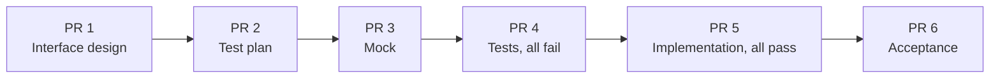
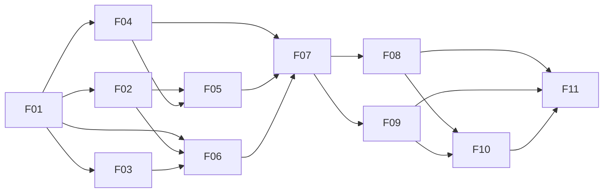

# troy-mode requirements

| | |
| --- | --- |
| Version | 1.31 |
| Date | 2026-11-13 |
| Status | Approved by Troy on 2026-11-05. Later versions add what Troy approved the same day: F01 design D1 and D2 (1.1), the answers to Q1 and Q9 (1.2), and F02 design D10, D11, and D14 plus the Python environment rule (1.3). Version 1.4 updates F02's status, and 1.5 adds the EN/ZH pair check to troy-pstack's CI. Version 1.6 records the F03 design decisions Troy approved: D15, D16, D17, and D20. Version 1.7 adds Troy's rule R21, and 1.8 to 1.12 update F03's status. Version 1.13 records the F04 design decisions Troy approved: D31, D32, and D35, and the answer to Q5, and 1.14 updates F04's status. Version 1.15 records the F05 design decisions Troy approved: D40, D41, D44, and D45, and 1.16 records the F06 design decisions Troy approved: D48, D52, D53, D54, and D55. Versions 1.17 and 1.19 update F06's status, and 1.18 updates F05's status. Version 1.20 records the F07 design decisions Troy approved: D57 to D61, D64, D65, and D67, 1.21 updates the status of F07, F04, and F05, 1.22 updates F07's status, and 1.23 updates F02's status. Version 1.24 records the F08 design decisions Troy approved: D70, D71, D73, D75, and D77, 1.25 records the F09 design decisions Troy approved: D80, D81, and D83, 1.26 records the F10 design decisions Troy approved: D90 and D91, and 1.27 records the F11 design decisions Troy approved: D93 to D97. Version 1.28 updates F08's status, 1.29 updates F09's status, and 1.30 updates F10's status. Version 1.31 updates the status of F01 to F07 and F11 from the pilot. No question is open. |
| Source of truth | This English file. [`requirements.zh-CN.md`](requirements.zh-CN.md) is the Chinese mirror. |

## 1. Goal

troy-mode is Troy's own workflow for Claude Code. It takes a software project from requirements to a released version through a fixed pipeline of roles. Each role works in its own context. A different role reviews its output. Automated checks enforce the rules, so the rules do not depend on Claude remembering them.

It fixes four problems that appear when Claude builds a project in one long conversation:

- Requirements stay implicit and drift.
- Tests are written after the code and shaped to match it.
- Changes are large and hard to review.
- Written rules are forgotten partway through.

troy-mode ships as new files inside the troy-pstack plugin. It changes no upstream pstack file and does not change how poteto-mode behaves.

## 2. User

- One user, Troy, a solo developer.
- Uses Claude Code in the desktop app (Code tab) and in the CLI, on Windows 11.
- Keeps projects on GitHub, mostly in private repositories.
- Reads and writes English and Chinese.

## 3. How Troy uses it

### 3.1 Commands

| Command | When |
| --- | --- |
| `/troy-pstack:troy-mode <request>` | Any work in a troy-mode project: start a project, build the next feature, fix a bug, change a requirement, release a version, or investigate something. |
| `/troy-pstack:troy-init` | Once per project, to add troy-mode's files and checks to it. |

The names are proposals (open question Q4).

### 3.2 troy-mode or poteto-mode

Choose by project, not by task.

| Situation | Use |
| --- | --- |
| A troy-mode project, any change that lands on `main` | troy-mode |
| A troy-mode project, investigating or trying an idea | troy-mode. It takes a light path with no PR pipeline and borrows pstack skills such as `how` and `why`. |
| A project that does not use troy-mode, or a one-off script | poteto-mode when the task needs rigor |
| A quick question or a small edit | No mode |

In a troy-mode project, CI enforces the PR rules whichever mode made the change.

### 3.3 Where Troy takes part

Only these steps wait for Troy's approval:

1. Each project's requirements document.
2. Each project's overall architecture.
3. The interface design PR and the test plan PR of the first features (Q2).
4. Each version, by testing it on Troy's own devices.
5. Every escalation (section 5.7).

Troy approves steps 1 to 3 in chat or by merging the PR on GitHub. After an approval in chat, troy-mode records it in the document's header and change log (F08 design D77) and merges the PR. After a merge on GitHub, troy-mode records the approval in a `[docs]` PR (F07 design D61).

Troy follows progress in the progress file and in the feature status table of the requirements document.

### 3.4 Interaction prototypes

These are text mocks. Real wording will differ.

**Prototype A. Starting a project.**

```text
Troy: /troy-pstack:troy-mode I want a small habit tracker for my phone and laptop.
PM:   Your goal as I understand it: log daily habits on two devices and see streaks.
      Before I write the requirements I need these answers.
      1. Must the two devices sync, or is each one separate?
      2. Does it work offline?
      3. ...
Troy: (answers)
PM:   Requirements draft written. docs/requirements.md (English) and
      docs/requirements.zh-CN.md (Chinese mirror).
      14 features. The dependency graph has no cycle. Order: F01, F02, F04, F03, ...
      Prototypes: docs/prototypes/F06-today-screen.html.
      Version plan: v0.1 = F01 to F06, v0.2 = F07 to F14.
      Waiting for your approval.
Troy: Approved.
Architect: Architecture draft written in docs/architecture.md. Waiting for your approval.
```

**Prototype B. The next feature.**

```text
Troy: /troy-pstack:troy-mode next feature
troy-mode: Next in order is F04 "Export history as CSV". It depends on F02 and F03, both accepted.
  [1/6] Interface design PR #41 is open. The Architect approved it in round 2.
        You merge this one (feature 2 of your first 3). Waiting for you.
Troy: Merged.
troy-mode: [2/6] Test plan PR #42 is open. Waiting for you.
Troy: Merged.
troy-mode: [3/6] Mock PR #43 merged. CI green, code review passed.
  [4/6] Test PR #44 merged. 9 new tests. All 9 fail against the mock, as expected.
  [5/6] Implementation PR #45 merged. 9 of 9 new tests pass. 212 existing tests pass.
        Changed-code coverage 94% line, 86% branch. 310 changed lines in 4 files.
  [6/6] Acceptance PR #46 merged. F04 status is now "passes tests on main".
        It has not been checked on your devices yet.
```

**Prototype C. An escalation.**

```text
troy-mode: Stopped on F07. This needs you.
  Why: the Architect rejected the interface design 3 times.
  The disagreement: the Interface Designer wants one sync() call. The Architect wants
  separate push() and pull() calls, so the storage module holds no network code.
  Option A: one sync() call. Simpler for callers. Storage depends on network.
  Option B: push() and pull(). Keeps the module boundary. Callers make two calls.
  Recommendation: B, because the architecture says storage must not depend on network.
```

**Prototype D. The progress file.**

```markdown
# Progress

- Current version: v0.2 (F07 to F14)
- Current feature: F08 Import from CSV
- Stage: 4 of 6. Test PR #48 is in review (Code Reviewer, round 1).
- Waiting on Troy: nothing
- Open issues: F05 has one coverage exclusion (disk-full branch), approved by the Test Manager.
- Last updated: 2026-11-12 14:05
```

## 4. Roles

| Role | Runs as | Owns | Reviews | Must not |
| --- | --- | --- | --- | --- |
| Product Manager | Main session, because only it can talk with Troy | Requirements document, feature list, dependency graph, feature order, prototypes, version plan, status table, acceptance, change requests | Each finished feature, against the requirements | Write code or tests |
| Architect | Subagent | Overall architecture, coding rules, module dependency rules, architecture decision records (ADRs), approval of new third-party dependencies | Each interface design, against a checklist | Design a feature's interfaces itself |
| Interface Designer | Subagent | Each feature's external interface design | Nothing. It answers the Test Manager's questions. | Edit the architecture. It asks the Architect instead. |
| Test Manager | Subagent | Each feature's test plan, each version's test plan, triage of coverage gaps, bugs, and disputed tests | Each test PR, against the test plan | Write test code |
| Developer | Subagent | Mock PRs, implementation PRs, bug fix PRs | Nothing | Edit tests. Add a third-party dependency without the Architect. |
| Test Engineer | Subagent | Test code, bug reproduction tests, test fixes the Test Manager orders | Nothing | Edit source code |
| Code Reviewer | Subagent | Nothing | Mock, test, and implementation PRs, for quality and security, using Claude Code's `/code-review` and `/security-review` | Edit the code it reviews |

The main session also does the project manager's work. It picks the next feature, starts each role, passes reviews between roles, keeps the progress file, and escalates to Troy.

Each role's model is set in its agent file and can be overridden per project in `.troy-mode/config.toml` (Q3, [F04 design](design/F04-role-definitions.md) D32).

### 4.1 pstack skills troy-mode reuses

troy-mode calls these troy-pstack skills where they fit, without changing them.

| Skill | Used for |
| --- | --- |
| `how`, `why` | Understanding existing code during investigations and before design |
| `interrogate` | Adversarial review of a contested design |
| `benchmark-checklist` | Checking performance numbers before trusting them |
| `technical-writing` | Writing requirements, design, and test plan documents |
| `correct`, `reflect` | Turning repeated mistakes into rules and checks after a version |

Where a pstack rule conflicts with a troy-mode rule, troy-mode's rule wins inside a troy-mode project. The comment rule is one example. pstack keeps comments only for a non-obvious reason. troy-mode requires a Google-style doc comment on every function.

## 5. Process

### 5.1 Project setup (once per project)

1. **Requirements.** The Product Manager talks with Troy until the requirements are clear. It writes the requirements document in English with a Chinese mirror. The document holds the goal, users, interaction, non-functional requirements (performance targets included), out of scope, open questions, and these parts:
   - Features, broken down finely, each with an ID.
   - A dependency graph. Each dependency is hard (B cannot be built without A) or soft (B can be built against A's mock).
   - A topological order. A cycle means the breakdown is wrong. The Product Manager breaks it down again, usually by moving the shared part into its own feature.
   - Prototypes.
   - A version plan.

   A feature whose implementation would pass the PR size limit (R03) is split. Troy approves the document.
2. **Init.** `troy-init` adds the marker folder, document templates, the rules table, the progress file, and troy-check's CI workflow.
3. **Architecture.** The Architect writes the overall architecture: tech stack, modules and the allowed dependency directions between them (no cycles), data model, error handling, logging, naming, and coding rules. Troy approves it.
4. **Checks.** `troy-init` adds the language-specific checks and their CI job for the chosen stack.

### 5.2 Feature loop

Features are built one at a time, in topological order. Each feature takes six PRs, merged in order. Each PR has exactly one commit and holds one stage's output only.



| PR | Content | Author | Reviewer | Merge condition | Merged by |
| --- | --- | --- | --- | --- | --- |
| 1 | Interface design (English and Chinese). For each external interface: name, purpose, parameters, return value, errors, and a performance target when the requirements set one. | Interface Designer | Architect, against the checklist below, at most 3 rounds | Document checks pass | Troy for the first features (Q2), or Claude after Troy approves in chat (R18). Then Claude. |
| 2 | Test plan (English and Chinese). Unit, functional, integration, and performance cases. Each case says what it tests. | Test Manager | Agreed with the Interface Designer, at most 3 rounds | Document checks pass | Troy for the first features (Q2), or Claude after Troy approves in chat (R18). Then Claude. |
| 3 | Mock. Signatures and full Google-style doc comments, no bodies. | Developer | Code Reviewer | Checks pass. Existing tests pass. | Claude |
| 4 | Test code, each test tagged with the feature ID. | Test Engineer | Test Manager (matches the plan) and Code Reviewer | Every new test fails against the mock. Existing tests pass. | Claude |
| 5 | Implementation. | Developer | Code Reviewer | New and existing tests pass. Performance tests pass where a target exists. Coverage meets R11. Size rules hold. | Claude |
| 6 | Acceptance. Status update in English and Chinese. The feature's tests become must-pass. | Product Manager | None | Checks pass | Claude |

**Architect's interface checklist.**

- Fits the module layout and the data model.
- Follows the error handling and naming conventions.
- Does not duplicate an existing interface.
- Depends only on features earlier in the order.
- Adds no hidden coupling between modules.
- Changes an implemented interface only through the change flow (5.4).

**Disputed tests.** The Developer raises it. The Test Manager rules. If the test is wrong, the Test Engineer fixes it in its own test PR and states the reason. A test change never shares a commit with source code.

**Coverage gaps.** When R11 fails, the Test Manager decides what the uncovered code is. Tests are added only from the design, never by aiming at uncovered lines.

| Uncovered code | Cause | Fixed by |
| --- | --- | --- |
| Code nothing needs (an unused branch, a feature written early) | Developer wrote too much | Developer deletes it |
| Behavior in the design that the test plan missed | Incomplete test plan | Test Manager adds cases. Test Engineer adds them in a test PR. |
| Behavior not in the design | Either the design missed it or the Developer overreached | Interface Designer decides. A missed design gets a design update, then tests. Overreach is deleted. |
| Code that cannot be tested in practice (for example a full disk) | Hard to set up | Excluded with a written reason, approved by the Test Manager |

### 5.3 Bug fix

1. The Test Manager triages the report. A misunderstood requirement goes to the Product Manager as a change (5.4).
2. PR A. The Test Engineer adds a test that reproduces the bug, tagged with the bug ID. It fails.
3. PR B. The Developer fixes the bug. The test passes and stays as a regression test.

The Code Reviewer reviews both PRs.

### 5.4 Requirement change

1. Troy asks for the change. The Product Manager updates the requirements document, and Troy approves it.
2. The Product Manager lists the affected features from the dependency graph: the changed feature and every feature that depends on it.
3. The Architect decides which interfaces, tests, and parts of the architecture change. An architecture change gets an ADR.
4. A change to a feature that is already accepted becomes a new feature with a hard dependency on the old one. Its tests PR retires the old tests that the change makes wrong and adds new ones, and its mock PR is skipped when it adds no interface (F07 design D65).
5. The changes go through the feature loop PRs as usual. All existing tests run as regression.

### 5.5 Version release

1. The version plan groups consecutive features in the order into versions. Each version is usable on its own.
2. The Test Manager writes the version test plan when the version is planned, not at the end: before the version's first feature starts (F08 design D70).
3. The release test runs end-to-end tests of the user scenarios in the requirements, stress tests, and performance tests, on Troy's devices. Each scenario says who runs it. The Test Engineer writes the ones Claude runs as version tests, which run on Troy's PC at release only. Troy runs the ones that need Troy's devices (F08 design D71). Troy accepts the version.
4. Bugs found go through the bug flow (5.3).
5. After acceptance, `main` gets a tag `vMAJOR.MINOR.PATCH`, made as a GitHub release whose notes are the version's changelog section (F08 design D73), and the changelog is updated in English and Chinese.
6. A retrospective turns problems that repeated during the version into new rules or checks (5.8).

A patch release, such as v0.1.1, releases the bug fixes merged since the version's last tag. It is possible only while no code of a later version's feature has merged since that tag (F08 design D75).

### 5.6 When tests run

| When | What runs | Who |
| --- | --- | --- |
| Each stage | The current feature's tests | Automatic |
| Each PR | All unit, functional, and integration tests, as regression. Target: a few minutes. | CI |
| Each version | End-to-end, performance, and stress tests, on Troy's devices | Test Manager designs, Test Engineer implements, Product Manager and Troy accept |

**Performance.** Targets come from the requirements. The Interface Designer copies them into the interface design. The Test Manager plans performance cases in the test plan. They run after implementation, because a mock always returns at once. Only interfaces with a target get performance tests. Stress tests need the whole system, so they run only at version level.

### 5.7 Escalation

troy-mode stops and asks Troy when:

- A review loop reaches 3 rounds without agreement.
- A change needs the requirements or the architecture to change.
- An author's work still fails its checks after 3 attempts (F07 design D64).
- A new third-party dependency is needed. The Architect reviews it first.
- An irreversible action falls outside the merge rights, for example a force push or deleting data.

Each escalation says what stopped, why, the options, and a recommendation (Prototype C).

### 5.8 Adding or changing a rule

1. Troy states the rule and whether it applies to every troy-mode project or to one.
2. troy-mode picks the strongest enforcement that works. In order: an architecture that makes the mistake impossible, a lint or CI check, a test, and last, written role instructions. A rule of one project gets no test yet: its levels are the architecture, a check of a tool the project already runs or of troy-check, and its row in the rules table (F09 design D80).
3. One PR updates the rules table in English and Chinese, the check config, and the role instructions. Role instructions are prompts for Claude and are in English only (F04 design D35). For a rule of one project, its row in the rules table is the role instruction, because every role reads that table. An architecture change comes first, in its own PR (F09 design D80).
4. If existing code breaks the new rule, Troy chooses: fix it all now in separate cleanup PRs, or apply the rule only to new and changed code. Either way, the rule's PR exempts today's violations in a baseline, so CI stays green, and the cleanup PRs remove that baseline (F09 design D81).

A rule for every project lives in troy-pstack and ships in a new plugin version. On Troy's yes, troy-mode writes its proposal as an issue in troy-pstack (F09 design D83). A rule for one project lives in that project's rules table.

### 5.9 Work outside the pipeline

Investigations, questions, and experiments in a troy-mode project open no PR to `main`. Experiment code stays on a throwaway branch or folder. Code worth keeping goes through the feature loop.

### 5.10 Continuing across sessions

The progress file (Prototype D) records the current version, feature, stage, open PRs, what waits on Troy, and open issues. A new session reads it first and continues without the old conversation.

## 6. Rules

**Hard** blocks the merge. **Soft** allows the PR when its description gives a reason. **Review** is checked by a role. **Process** is followed by troy-mode itself. Troy's GitHub plan is free, and it has no branch protection for private repositories. So troy-mode's merge step enforces Hard rules: it never merges a PR whose checks fail (F02 design D14).

| ID | Rule | Type | Enforced by |
| --- | --- | --- | --- |
| R01 | Each PR has exactly one commit, and its subject line equals the PR title (F03 design D17). Review fixes amend that commit, or the PR is squash-merged. | Hard | CI |
| R02 | Each PR holds one stage's output only: documents, source, or tests. | Hard | CI |
| R03 | A source PR changes at most 500 lines (added plus deleted, not counting lock files or generated files) in at most 5 files. Test PRs have no limit. A PR that only splits a file may pass the limit and says so. | Soft | CI |
| R04 | A function body has at most 50 lines, not counting comments, doc comments, or blank lines. A complex external interface calls single-purpose internal functions. | Hard | Lint |
| R05 | Doc comments follow Google style. Code comments are in English only. | Hard | Lint |
| R06 | A source file has at most 500 lines in total, comments included. Larger files are split. | Soft | Lint |
| R07 | Modules depend on each other only in the directions the architecture allows, only through external interfaces, and never in a cycle. | Hard | Dependency checker |
| R08 | The Developer never edits test files. | Hard | Hook and CI |
| R09 | Every new test in a test PR fails against the mock. | Hard | CI |
| R10 | Every test is tagged with its case ID or bug ID: the test's own name starts with it, for example `test_f04_t07_writes_header` (F03 design D16). Tests of features not yet accepted and of bugs not yet fixed count as expected failures. Every other test must pass. | Hard | Test runner config and CI |
| R11 | In an implementation PR, the changed code has at least 90% line coverage and 80% branch coverage. 95% is a target, not a gate. An excluded line needs a written reason and the Test Manager's approval. | Hard | CI |
| R12 | English documents are the source of truth. A PR that changes an English document also updates its Chinese mirror. The mirror's header names the English version it matches. | Hard | CI |
| R13 | A status label says how far a feature really goes, for example "passes tests on main" versus "usable on Troy's devices". | Review | Product Manager |
| R14 | Only interfaces with a performance target get performance tests. They run on a fixed machine, with a margin, against the previous baseline. | Review | Test Manager |
| R15 | Every fixed bug keeps its reproduction test. | Review | Test Manager |
| R16 | A new third-party dependency needs the Architect's approval. | Review | Architect. CI flags every change to dependency files. |
| R17 | A review loop stops at 3 rounds and escalates. | Process | troy-mode |
| R18 | Troy approves PR 1 and PR 2 of the first features (Q2), in chat or by merging them. After an approval in chat, Claude merges them (F07 design D61). Claude merges every other PR once its checks and reviews pass. Troy decides when Claude merges everything. | Process | troy-mode |
| R19 | Commits use the email in Troy's global CLAUDE.md. Commit messages, PR titles, and PR descriptions carry no Claude attribution and, by default, do not mention Claude or Anthropic at all (F02 design D10). | Hard | Hook and CI |
| R20 | A merged document or PR description holds no template markers or template guidance (F01 design D2, F02 design D11). | Hard | CI |
| R21 | Every change reaches `main` through a PR from its own branch. Never commit on `main`, push `main`, or open a PR from `main`. | Hard | Hook and CI |

## 7. Features

### 7.1 Status labels

| Label | Meaning |
| --- | --- |
| Not started | Nothing exists yet. |
| Written | The files exist but have never run. |
| Runs on a sample project | It ran on a throwaway sample project. |
| Used on a real project | Troy used it on one of their own projects. |

### 7.2 Feature list

The IDs are already in topological order.

| ID | Feature | Depends on | Status |
| --- | --- | --- | --- |
| F01 | Templates and rules table. Templates for the requirements, architecture, interface design, test plan, ADR, progress file, changelog, and escalation message. The English and Chinese pair format with its sync header. The rules table, seeded from section 6. PR title and description templates ([F01 design](design/F01-templates.md) D1). | None | Used on a real project: troy-mode wrote the documents of `ZJUCao/recipe-menu` from its templates, in English and Chinese: the requirements, the architecture with seven ADRs, the v0.1 test plan, and the design and test plan of each feature, F01 to F09 so far. troy-init seeded its rules table and PR template. No escalation message has been needed yet. |
| F02 | Language-independent checks for R01, R02, R03, R12, R16, R19, and R20, a GitHub Actions workflow that runs them, and a `commit` subcommand that F05's hooks call for R19. The checks read each PR's stage from its title (F01 design D1). R20 rejects documents and PR descriptions that still hold template markers (F01 design D2). R21's check, which fails when the PR's branch is `main`, came after F02 merged and is not built yet. | F01 | Used on a real project: troy-check's `pr` command passed in CI on all 63 PRs of `ZJUCao/recipe-menu` so far, and its `commit` command checked the commits there through the git hooks. |
| F03 | Language packs. A language-independent engine in troy-check for R04, R05, R06, R07, R09, R10, and R11, which reads JUnit and Cobertura XML, plus one thin pack per language with its environment, tool config, commands, and CI job ([F03 design](design/F03-language-packs.md) D15). Built in four PRs. Python and C/C++ come first. TypeScript/JavaScript is wanted too, at lower priority (Q1). The Python pack follows the Python environment rule in section 8. | F01 | Python pack used on a real project: its CI job, which ends in `troy-check code`, passed on every PR of `ZJUCao/recipe-menu` from its language step on, including the mock, tests, and implementation PRs of F01 to F08. The C/C++ pack runs on a sample project only: it takes its sample through the pack's CI job in troy-pstack's CI on Linux and on Troy's PC. TypeScript/JavaScript is not started |
| F04 | Role definitions. Six subagents and the Product Manager's instructions for the main session, each with its instructions, tool limits, model, and write scope ([F04 design](design/F04-role-definitions.md)). | F01 | Used on a real project: troy-mode ran every role on `ZJUCao/recipe-menu`, the Architect, the Interface Designer, the Test Manager, the Developer, the Test Engineer, and the Code Reviewer, with the Product Manager as the main session, through the setup and F01 to F09 so far. |
| F05 | Hooks. A marker-folder gate so they do nothing outside troy-mode projects. Claude Code hooks in the plugin keep each role inside its write scope, Developer edits to tests (R08) among them. They check Write and Edit before the call, and compare the working tree with the role's starting state after each shell call and when the role stops (F05 design D41). Every other subagent is read-only (D40). Roles may run only read-only git and GitHub commands (F04 design D31) and the skills they need, and may read the plugin's own files without a permission rule (D45). Git hooks in troy-check's folder, turned on by `core.hooksPath`, refuse commits that break R19, commits on `main`, and pushes of `main` (R21), whoever runs git, and Claude cannot skip them (D44). A local log records each block for F07. | F02, F04 | Used on a real project: the hooks were on in every session of `ZJUCao/recipe-menu`, through F01 to F09 so far. They blocked one command: a PR description that held a local folder path with a word R19's strict mode refuses, which troy-mode then rewrote. |
| F06 | Project init (`troy-init`). Setup adds the marker folder, document skeleton, rules table, progress file, and troy-check's CI job, and never overwrites a file it did not write (F06 design D48). After the architecture is approved, the language step adds the language pack, its CI job, the build file, the environment, and the lock. Upgrade replaces troy-mode's own files that nobody edited (D54). Each step lands as one `[rules]` PR, which troy-init merges when its checks pass (D53). When the folder has no GitHub repository, troy-init asks Troy once and creates a private one (D52). | F01, F02, F03 | Used on a real project: troy-init set up `ZJUCao/recipe-menu` from an empty folder, created its private GitHub repository, and added the Python pack with the project's own environment. Both PRs passed CI and merged. In the desktop app's sandbox, the lock's first compile failed because uv could not write its default cache; it passed when troy-mode ran the step again with uv's cache in the session's temporary folder. |
| F07 | Entry skill (`troy-mode`). Routes each request to a flow (5.1 to 5.10), runs the feature loop, passes reviews between roles, escalates, applies the merge rights, and keeps the progress file. Starts each role with the model and effort in the `[roles]` table of `.troy-mode/config.toml` (F04 design D32), and checks after each run that the role changed only files in its write scope (D31). The skill holds the judgment, and an engine that uses the standard library does the exact jobs: the state, the briefs, the check after each run, and approvals (F07 design D57). The state lives in git and on GitHub, and the progress file is a view rebuilt from it (D58). When a role changed a file outside its scope and F05's hooks did not get it undone, F07 undoes the run and runs the role once more (D59). Authors check their own work with `troy-check code --worktree` (D60). It lands in two parts: routing, setup, the feature loop's main path, and continuing; then side PRs, bug fixes, and requirement changes (D67). | F04, F05, F06 | Used on a real project: troy-mode took `ZJUCao/recipe-menu` from an empty folder through its setup, requirements, architecture, and v0.1 test plan, then F01 to F08 through their six PRs each, with side PRs and two architecture changes: 62 PRs merged, all with green CI, in one session across 10 context compactions and two usage-limit pauses. It stopped twice for Troy's yes: auto mode refused `git commit --amend` and `git push --force-with-lease` until Troy allowed them, and a hung background Developer run had re-applied an old edit, which troy-mode restored. |
| F08 | Version release flow (5.5). The Test Manager writes each version's test plan before the version's first feature starts ([F08 design](design/F08-release.md) D70). At release, the Test Engineer writes the version tests that Claude runs on Troy's PC, and Troy tests the scenarios that need Troy's devices (D71). A release PR holds the changelog, the release test reports, and Troy's answers (D72). The tag is a GitHub release (D73). Open bugs are fixed first (D74), patch releases are possible (D75), and a retrospective proposes rules for Troy to pick (D76). F07's `approve` also adds a change-log row (D77). | F07 | Runs on a sample project: troy-mode wrote the version test plan of a scratch GitHub project and released its v0.1.0, with version tests, a release test on Troy's PC, Troy's acceptance given in the trial's prompt, a GitHub release, and a retrospective. Not yet used on a real project. |
| F09 | Rule change flow (5.8). The Architect picks the strongest enforcement that works and finds the existing code that breaks the rule ([F09 design](design/F09-rule-change.md) D79). A project rule is enforced by the architecture, a tool the project already runs, a troy-check limit, a step in the project's own workflow, or its row in the rules table (D80). Its `[rules]` PR carries a baseline of today's violations, which cleanup PRs remove when Troy chooses to fix them now (D81). Troy approves each rule in one message (D82). A rule for every project becomes an issue in troy-pstack (D83). Project rules can be changed and retired, and troy-mode rules adjusted only through troy-check's config (D84). | F07 | Runs on a sample project: troy-mode added two rules to a scratch GitHub project, one checked by a lint with a baseline and a cleanup PR, one checked in review, retired one, and proposed a rule for every project, with Troy's answers given in the trial's messages. Not yet used on a real project. |
| F10 | troy-pstack documentation. A troy-mode section in `README.md`, in English, and a usage guide in English and Chinese in `docs/troy-mode/guide/`, covering install, project setup, every flow, where Troy takes part, and work on troy-mode itself ([F10 design](design/F10-docs.md) D86, D87, D92). A note in both, and in the plugin's descriptions, says that troy-mode is Troy's own work and not part of Lauren Tan's pstack (D88). The plugin version rises to 0.2.0, so an installed troy-pstack receives troy-mode (D89). The pair check, a link check in CI, a facts review, and a reader test in both languages check the documents (D90). Built after F09 and before the pilot (D91). | F08, F09 | Written: the README section and the guide in English and Chinese, describing F01 to F09 as built. The pair and link checks pass, a facts review found no open mismatch, and a reader test answered all 19 questions from the guide alone in each language. Not yet followed on a real project. |
| F11 | Pilot. Take one small real project through one version with troy-mode. The project is a new Python command-line project for recipes, a week's menu, and its shopping list, with Chinese and English text ([F11 design](design/F11-pilot.md) D93). One version is its v0.1, with 4 or 5 features, released, accepted on Troy's devices, and its retrospective done (D94). Troy types the requests in a desktop session in the pilot folder (D95). A problem that blocks the pilot pauses it until troy-pstack fixes it through its own process and a new plugin version (D96). A pilot report in troy-pstack, and an issue with the `pilot` label for each problem, record what the pilot found (D97). | F08, F09, F10 | Used on a real project, in progress: troy-mode set up `ZJUCao/recipe-menu` and accepted the first 8 of v0.1's 13 features, F01 to F08 ("Passes tests on main"). F09 is in progress. v0.1 is not released yet. |



F02, F03, and F04 depend only on F01, so they can be built in parallel.

## 8. Non-functional requirements

- **No side effects on troy-pstack.** troy-mode edits no upstream file. The only shared files it touches are `README.md`, `.claude-plugin/plugin.json`, and `.claude-plugin/marketplace.json`. Every new skill, agent, and script name starts with `troy-`. Every new skill runs only when Troy types it (`disable-model-invocation: true`). Hooks exit at once outside troy-mode projects.
- **Upstream merges stay easy.** The upstream merge steps in the README keep working unchanged.
- **Platform.** Windows 11 first, through Git Bash and PowerShell. CI runs on GitHub-hosted Linux runners. Scripts also run on macOS and Linux. Files use LF line endings.
- **Speed.** A hook adds no delay Troy notices, with a target under 200 ms per call. The per-PR regression run takes a few minutes.
- **Cost.** Each role's model can be set. Checks also run locally before a push, so CI rarely fails and private-repository Actions minutes last.
- **Privacy.** troy-mode uses no service beyond GitHub and Anthropic. No secret goes into a document, a log, or the progress file.
- **Resumable.** Any new session continues from the progress file.
- **Language.** Documents are written in English with a Chinese mirror. Code and code comments are in English. In troy-pstack, CI checks every PR that changes a document: each English document and its mirror must have the same headings, tables, code blocks, markers, and version (`troy-mode/dev/check_pairs.py`). CI also checks that the relative links and anchors in troy-pstack's README and troy-mode documents resolve (`troy-mode/dev/check_links.py`).
- **Python environments.** In a Python project, mamba creates and manages the environment, and uv installs packages into it. Projects that will run together on one platform form a series and share one environment, named after the series. A project in no series has its own. Each series has one lock file, `requirements-dev.lock`, compiled from all members' `pyproject.toml` and committed in each member (F03 design D20). troy-mode never creates a `.venv` folder. F03's Python pack sets this up on Troy's PC and in CI. troy-mode's own checks (F02) use only the standard library and need no environment.
- **Auditable.** Every role's output is a PR or a review comment, so the history shows who changed what.

## 9. Out of scope (version 1)

- Teams: more than one human, or roles assigned to people.
- Hosts other than GitHub.
- Changing upstream pstack skills or poteto-mode.
- Deployment to production, app stores, or servers. troy-mode ends at a tagged, accepted version.
- A graphical dashboard. State lives in Markdown files.
- Languages other than Python, C/C++, and TypeScript/JavaScript (Q1).
- Rewriting the git history of existing projects.

## 10. Open questions

Troy approved this document on 2026-11-05. That approval accepts the proposals for Q2 to Q10. Troy answered Q1 and extended Q9 the same day (version 1.2).

| ID | Question | Proposal |
| --- | --- | --- |
| Q1 | Which languages come first? Each needs its own language pack (F03). | Decided by Troy: Python and C/C++ first. TypeScript/JavaScript is wanted too, at lower priority. |
| Q2 | For how many first features does Troy merge PR 1 and PR 2? | 3 per project. Then Troy decides. |
| Q3 | Which model does each role use? | opus for the Architect, Interface Designer, Test Manager, and Code Reviewer. sonnet for the Developer and Test Engineer. The Product Manager uses the main session's model. |
| Q4 | Names. | `troy-mode`, `troy-init`. Agents `troy-architect`, `troy-interface-designer`, `troy-test-manager`, `troy-developer`, `troy-test-engineer`, `troy-code-reviewer`. Marker folder `.troy-mode/` in the project root. |
| Q5 | R08 needs a hook to know that the Developer is the one editing. Whether Claude Code tells a hook which subagent made a call has to be checked during design. | Answered by the F04 design (section 9.1): it can. The hook input names the subagent in `agent_type`, so a hook enforces R08, and CI's R02 stays as the backstop. |
| Q6 | When an existing project (for example troy-voice) adopts troy-mode, must old code meet the rules? | No. Only new and changed code. Old code is fixed when it is touched. |
| Q7 | Which machine runs performance tests? | Troy's PC, locally, at version release. Not CI, whose runners are too noisy. |
| Q8 | Is the progress file committed? Committing it means a PR for every update, which R01 and R02 make heavy. | Keep it local and git-ignored. The durable state is the status table, which PR 6 updates. |
| Q9 | What format do project prototypes use? | Clickable HTML wireframes in `docs/prototypes/`, plus Mermaid diagrams in the documents. A command-line project may also write a prototype as a Markdown file in `docs/prototypes/` that holds a terminal session transcript (added by Troy in 1.2). |
| Q10 | How is troy-mode itself built? The pipeline does not exist until F07. | One PR per feature (F01 to F10) on troy-pstack, each with one commit. Check scripts are built test-first. The pilot (F11) is the first full run of the pipeline. F03, F06, and F07 are the exceptions: F03 is built in four PRs (F03 design D15), F06 in two (F06 design D55), and F07 in two (F07 design D67). |

## 11. Change log

| Version | Date | Change |
| --- | --- | --- |
| 0.1 | 2026-11-05 | First draft, from Troy's discussion with Claude on 2026-11-05. |
| 1.0 | 2026-11-05 | Approved by Troy. Proposals for Q2 to Q10 accepted. Q1 still open. |
| 1.1 | 2026-11-05 | F01 adds PR title and description templates (D1). F02 reads PR stages from titles and rejects leftover template markers (D2). Both approved by Troy with the F01 design. Wording only: names Troy in place of pronouns. |
| 1.2 | 2026-11-05 | Troy answered Q1: Python and C/C++ first, TypeScript/JavaScript at lower priority. Troy extended Q9: a command-line project may use a Markdown terminal transcript as a prototype. The requirements template follows. |
| 1.3 | 2026-11-05 | Troy approved the F02 design. R19 also forbids mentioning Claude or Anthropic by default (D10). New rule R20 for template markers (D11). Section 6 says troy-mode's merge step enforces Hard rules, because Troy's GitHub plan has no branch protection for private repositories (D14). Troy added the Python environment rule: mamba and uv, no `.venv` (section 8). F01 status: Written. |
| 1.4 | 2026-11-05 | F02 status: Written. Its unit tests pass on Troy's PC. It has not yet run on a project's PRs. |
| 1.5 | 2026-11-05 | Troy asked for the EN/ZH pair check in troy-pstack's CI. Section 8, Language, says what it checks. |
| 1.6 | 2026-11-05 | Troy approved the F03 design. F03 takes R09 and is built in four PRs (D15). R10: a test's name starts with its ID (D16). R01: the commit subject equals the PR title (D17). Section 8: one environment and one lock file per series of projects (D20). |
| 1.7 | 2026-11-05 | Troy added R21: every change reaches `main` through a PR from its own branch. F05's hooks and a troy-check branch check will enforce it; neither is built yet. |
| 1.8 | 2026-11-05 | F03 status: Written, part 1 of 4. Its unit tests pass on Troy's PC. |
| 1.9 | 2026-11-05 | F03 status: Written, parts 1 and 2 of 4. Part 2's unit tests pass on Troy's PC. |
| 1.10 | 2026-11-06 | F03 status: Written, parts 1 to 3 of 4. The Python pack takes its sample project through lint, types, tests, coverage, and `troy-check code` on Troy's PC. |
| 1.11 | 2026-11-06 | F03 status: Written, all 4 parts. The C/C++ pack takes its sample project through build, format, lint, tests, coverage, Doxygen, and `troy-check code` on Troy's PC. |
| 1.12 | 2026-11-06 | F03 status: Runs on a sample project. After part 4 merged, both sample projects pass their pack's CI job in troy-pstack's CI on Linux, as they do on Troy's PC. |
| 1.13 | 2026-11-06 | Troy approved the F04 design. F05 enforces every role's write scope and blocks git and GitHub writes by roles, and F07 checks the scope after each run (D31). Each role's model can be overridden per project (D32). Role instructions are in English only (D35). Q5 is answered: a hook can tell which subagent makes a call. |
| 1.14 | 2026-11-06 | F04 status: Runs on a sample project. In the trial of F04 design 10.3, each role ran once on a copy of the Python sample, started by hand from a brief. troy-mode (F07) does not start them yet. |
| 1.15 | 2026-11-06 | Troy approved the F05 design. The F05 row now describes the hooks as the design builds them: every subagent other than the roles is read-only (D40), changes made through the shell are found by comparing the working tree (D41), git hooks turned on by `core.hooksPath` enforce R19 and R21 for every commit and push (D44), and roles read the plugin's files through a hook rather than a permission rule (D45). |
| 1.16 | 2026-11-06 | Troy approved the F06 design. Setup brings troy-check's CI job and never overwrites a file it did not write (D48), so 5.1 steps 2 and 4 now say which CI job arrives when. troy-init creates a private GitHub repository when there is none (D52), merges its own `[rules]` PRs when their checks pass (D53), and gains an upgrade step (D54). Q10: F06 is built in two PRs (D55). |
| 1.17 | 2026-11-07 | F06 status: Written, part 1 of 2: setup and upgrade. Its unit tests pass on Troy's PC. The language step, part 2, is not built yet. |
| 1.18 | 2026-11-07 | F05 status: Runs on a sample project. In the trial of F05 design 13.3, the hooks refused or reported every probe on a copy of the Python sample, with roles started by hand. troy-mode (F07) does not start them yet. |
| 1.19 | 2026-11-07 | F06 status: Runs on a sample project. In the trial of F06 design 11.4, troy-init created the private repository `ZJUCao/troy-mode-trial` and merged its setup PR and its Python language PR, with green CI. Upgrade found nothing to change, and a fresh clone got its git hooks. troy-mode (F07) does not run troy-init yet. |
| 1.20 | 2026-11-07 | Troy approved the F07 design. The F07 row says how it is built: a skill and an engine (D57), the state in git and on GitHub (D58), the check after each run (D59), and `troy-check code --worktree` (D60). Troy approves in chat or by merging, and Claude merges after an approval in chat (D61), so 3.3, the merge column of the 5.2 table, and R18 change. 5.7's attempt limit covers every author (D64). 5.4: a change to an accepted feature becomes a new feature (D65). Q10: F07 is built in two PRs (D67). |
| 1.21 | 2026-11-07 | F07 status: Runs on a sample project, part 1 of 2. In the trial of F07 design 14.3, troy-mode upgraded the scratch project `ZJUCao/troy-mode-trial`, wrote its requirements, and took F01 through its six PRs with green CI. After a break, a new session rebuilt the state from GitHub and went on. Bug fixes, requirement changes, and the loop's side PRs come in part 2. F04 and F05: troy-mode now starts the roles, and the hooks caught the one file a role wrote outside its scope. |
| 1.22 | 2026-11-07 | F07 status: Runs on a sample project, as part 1 plus a bug fix and a requirement change. In the trial of F07 design 14.3, part 2, troy-mode opened a bug issue on `ZJUCao/troy-mode-trial`, merged the bug's test PR and fix PR, and stopped to ask Troy about a new dependency, which Troy refused. A requirement change on the accepted F01 became the new feature F03, whose design and test plan merged. The local checks left a test that runs on Linux only to CI (F07 design D69). |
| 1.23 | 2026-11-08 | F02 status: Runs on a sample project. Its `pr` command ran as the `troy-mode checks` job on all 17 PRs of `ZJUCao/troy-mode-trial`, from the setup PR to F03's test plan, and passed on each. In F05's trial (F05 design 13.3), its `commit` command refused a commit with an attribution trailer through the `commit-msg` hook. R21's branch check is still not built. |
| 1.24 | 2026-11-08 | Troy approved the F08 design. The F08 row says what it builds (D70 to D77). 3.3: an approval in chat is recorded in the document's header and change log (D77). 5.5: the version test plan comes before the version's first feature (D70), each scenario says whether Claude or Troy runs it (D71), the tag is a GitHub release (D73), and patch releases (D75). |
| 1.25 | 2026-11-08 | Troy approved the F09 design. The F09 row says what it builds (D79 to D84). 5.8: a rule of one project gets no test yet, and its row in the rules table is its role instruction, with an architecture change in its own PR first (D80); a baseline keeps CI green while existing code breaks the rule (D81); and a rule for every project becomes an issue in troy-pstack (D83). |
| 1.26 | 2026-11-08 | Troy approved the F10 design. The F10 row says what it builds (D86 to D90). F10 now depends on F08 and F09, and F11 also depends on F10, in the table and the graph (D91). Section 8, Language: CI also checks the links and anchors in troy-pstack's README and troy-mode documents (D90). |
| 1.27 | 2026-11-08 | Troy approved the F11 design. The F11 row says how the pilot runs: a new Python command-line project for recipes and menus (D93), its v0.1 with 4 or 5 features (D94), Troy's requests in a desktop session (D95), blockers fixed through troy-pstack's own process (D96), and the pilot report and issues (D97). |
| 1.28 | 2026-11-08 | F08 status: Runs on a sample project. F08's trial (F08 design 11.3) on `ZJUCao/troy-mode-trial` wrote v0.1's version test plan, finished F03, and released v0.1.0 across a session break: version tests by the Test Engineer, a release test on Troy's PC, Troy's acceptance given in the trial's prompt, the GitHub release `v0.1.0`, and a retrospective that found nothing repeated. |
| 1.29 | 2026-11-08 | F09 status: Runs on a sample project. F09's trial (F09 design 10.3) on `ZJUCao/troy-mode-trial` added P01 (ruff EM102) with one baseline line, removed it in a cleanup PR that a new session found through `status`, added the review rule P02 and retired it, and proposed R22 for every project, for which Troy declined the issue. Troy's answers were given in the trial's messages. |
| 1.30 | 2026-11-09 | F10 status: Written. F10's PR added the guide in English and Chinese (`docs/troy-mode/guide/`, version 0.1), the README section, plugin version 0.2.0, and the link check in CI (F10 design 9). The pair and link checks pass, a facts review found no open mismatch, and a reader test answered all 19 questions from the guide alone in each language. The guide has not yet been followed on a real project; the pilot (F11) is its first use. |
| 1.31 | 2026-11-13 | Status of F01 to F07 and F11: Used on a real project, from the pilot's first status PR (F11 design 9). On `ZJUCao/recipe-menu`, troy-mode set up the project and accepted F01 to F08 of v0.1, whose 13 features Troy chose to keep, rather than F11 design D94's 4 or 5. F08, F09, and F10 keep their statuses: no version is released yet, no rule has been added, and the guide's fixes come at the end of the pilot. |
