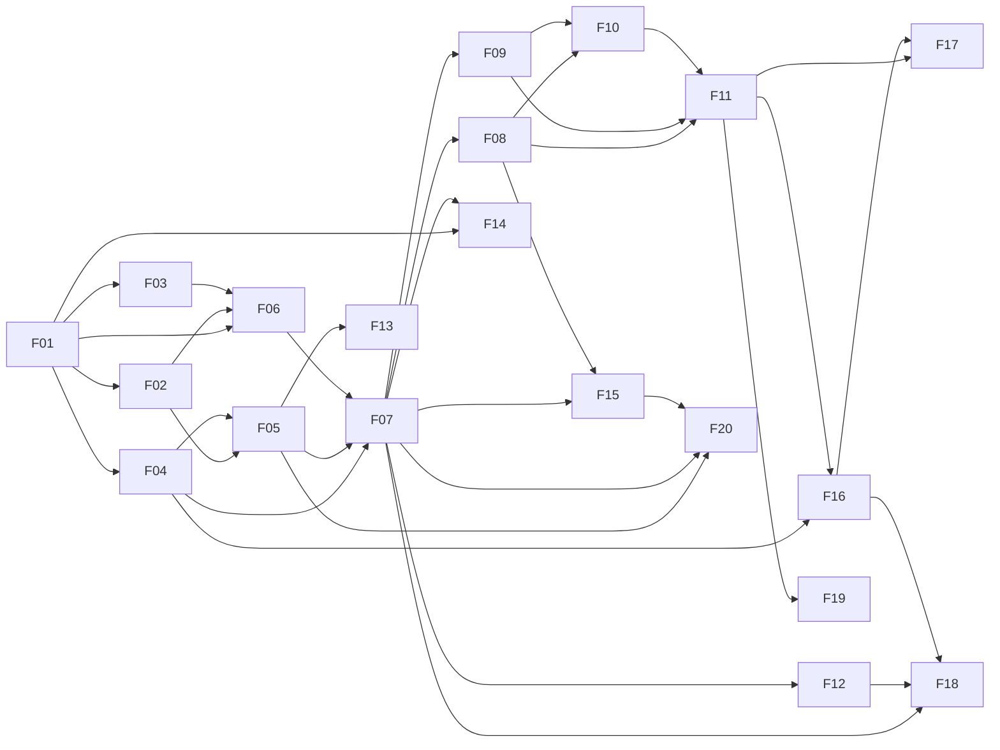

# troy-mode 需求文档

> 本文件是 [`requirements.md`](requirements.md) 的中文镜像，同步自英文版 1.71（2026-11-28）。两者如有出入，以英文版为准。

| | |
| --- | --- |
| 版本 | 1.71 |
| 日期 | 2026-11-28 |
| 状态 | Troy 已于 2026-11-05 批准。之后的版本加入了 Troy 同日批准的内容：F01 设计的 D1 和 D2（1.1），Q1 和 Q9 的回答（1.2），F02 设计的 D10、D11、D14 以及 Python 环境规则（1.3）。1.4 版更新了 F02 的状态，1.5 版把中英文对照检查加进了 troy-pstack 的 CI。1.6 版记录了 Troy 批准的 F03 设计决定：D15、D16、D17 和 D20。1.7 版加入了 Troy 提出的规则 R21，1.8 到 1.12 版更新了 F03 的状态。1.13 版记录了 Troy 批准的 F04 设计决定：D31、D32 和 D35，以及 Q5 的答案，1.14 版更新了 F04 的状态。1.15 版记录了 Troy 批准的 F05 设计决定：D40、D41、D44 和 D45，1.16 版记录了 Troy 批准的 F06 设计决定：D48、D52、D53、D54 和 D55。1.17 版和 1.19 版更新了 F06 的状态，1.18 版更新了 F05 的状态。1.20 版记录了 Troy 批准的 F07 设计决定：D57 到 D61、D64、D65 和 D67，1.21 版更新了 F07、F04 和 F05 的状态，1.22 版更新了 F07 的状态，1.23 版更新了 F02 的状态。1.24 版记录了 Troy 批准的 F08 设计决定：D70、D71、D73、D75 和 D77，1.25 版记录了 Troy 批准的 F09 设计决定：D80、D81 和 D83，1.26 版记录了 Troy 批准的 F10 设计决定：D90 和 D91，1.27 版记录了 Troy 批准的 F11 设计决定：D93 到 D97。1.28 版更新了 F08 的状态，1.29 版更新了 F09 的状态，1.30 版更新了 F10 的状态。1.31 版根据试点更新了 F01 到 F07 和 F11 的状态。1.32 版记录了 Troy 于 2026-11-14 批准的内容：F12 到 F19，它们给第 3、4.1、5、6 节和 Q4 带来的修改，以及 Q11 到 Q16 的提议。1.33 版记录了 Troy 批准的 F13 设计决定：D121 到 D126，1.34 版记录了 Troy 批准的 F14 设计决定：D131 到 D137。1.35 版记录了 Troy 批准的 F12 设计决定：D102、D103、D105、D107 到 D109 以及 D112。1.36 版更新了 F14 的状态，1.37 版更新了 F13 的状态，1.38 版更新了 F12 的状态。1.39 版记录了 Troy 批准的 F15 设计决定：D141 到 D150，1.40 版记录了 Troy 批准的 F19 设计决定：D191 到 D199。1.41 版更新了试点结束时 F01 到 F14 的状态。1.42 版记录了 Troy 批准的 F16 设计决定：D151 到 D160，它们把 F16 收窄到以子代理运行的角色。1.43 版随 F19 的构建把历史之外的插件名改为 tstack（D197），1.44 版和 1.45 版更新了 F19 的状态。1.46 版记录了 Troy 以 tstack issue #65 批准的 F05 设计决定 D200，1.47 版更新了 F05 和 F15 的状态，1.48 版更新了 F05 的状态，1.49 版更新了 F16 的状态。1.50 版记录 Troy 作为 tstack issue #64 批准的 F05 设计决定 D223，以及新规则 R23，1.51 版更新了 F05 的状态。1.52 版记录 Troy 作为 tstack issue #49 批准的 F05 设计决定 D231 和 D232，1.53 版更新了 F05 和 F07 的状态。1.54 版记录了 Troy 于 2026-11-22 批准（"都批准"）的内容：新功能 F20（并行功能团队），它给第 3.3、3.4、4、5、6、8、9 节带来的修改，新规则 R24，Troy 对 Q17、Q18 和 Q22 的回答，以及 Q19 到 Q21、Q23 到 Q25 的提议。1.55 版记录 Troy 于 2026-11-16 接受的 tstack issue #63，记为 F07 设计 D205 到 D207，以及 Troy 于 2026-11-22 批准的第 5.2 节的两个子句。1.56 版更新了 F07 的状态。1.57 版更新了 F07 和 F08 的状态，1.58 版更新了 F07 和 F16 的状态。1.59 版记录了 Troy 于 2026-11-22 批准的 F20 设计决定：D268 到 D279，其中 D278 当天改为分三个构建 PR，并更新了 F20 的状态。1.60 版更新了 F20 的状态。1.61 版更新了 F20 的状态，1.62 版更新了 F04 和 F08 的状态，1.63 版更新了 F07 和 F15 的状态。1.64 版记录 Troy 于 2026-11-25 批准的 F18 设计决定（"全按推荐"）：D171 到 D180，以及提议 P1、P2、P5 和 P7 的需求文字。所有问题都已决定。 1.65 版落地 F18 第 1 部分：F18 的状态，以及提议 P3 和 P6，其中 P6 的选项由 Troy 于 2026-11-25 批准（"换"）。1.66 版落地 F18 第 2 部分：F18 的状态，以及提议 P4。1.67 版记录 Troy 于 2026-11-26 批准的 F17 设计决定（"全按推荐"）：D161 到 D170，以及提议 P1 和 P2 的需求文字。1.68 版落地 F17 第 1 步和提议 P4，1.69 版落地 F17 第 2 步和提议 P3 里 `principle-prove-it-works` 那一行。1.70 版更新 F17 的状态。1.71 版记录 Troy 于 2026-11-28 的决定：R21 在服务器端由 GitHub 分支规则执行，而不是 CI 检查，并由 troy-init 在初始化时加上这条规则。它还更正了第 6 节，那里原来说 Troy 的套餐在私有仓库上没有分支保护。 |
| 事实来源 | 英文版 [`requirements.md`](requirements.md)。本文件是中文镜像。 |

## 1. 目标

troy-mode 是 Troy 自己的 Claude Code 工作流。它让一个软件项目经过一条固定的角色流水线，从需求一直走到发布版本。每个角色在自己独立的上下文里工作，产出由另一个角色审查。规则由自动检查来执行，不依赖 Claude 记住它们。

它解决的是 Claude 在一个长对话里做完整个项目时常见的四个问题：

- 需求一直是隐含的，而且会悄悄变。
- 测试在代码之后才写，写成迎合代码的样子。
- 改动很大，难以审查。
- 写下的规则做到一半就被忘了。

troy-mode 作为新增文件放进 tstack 插件。它不改任何 pstack 上游文件，也不改变 poteto-mode 的行为。

## 2. 用户

- 只有一个用户：Troy，独立开发者。
- 在 Windows 11 上使用 Claude Code 桌面应用（Code 标签页）和命令行。
- 项目放在 GitHub 上，大多是私有仓库。
- 中英文都能读写。

## 3. Troy 怎么使用

### 3.1 命令

| 命令 | 什么时候用 |
| --- | --- |
| `/tstack:troy-mode <请求>` | troy-mode 项目里的任何工作：启动项目、做下一个功能、修 bug、改需求、发布版本，或者调查问题。 |
| `/tstack:troy-init` | 每个项目运行一次，把 troy-mode 的文件和检查加进项目。 |

命令名是提议（待定问题 Q4）。

### 3.2 用 troy-mode 还是 poteto-mode

按项目选，不按任务选。

| 情况 | 用什么 |
| --- | --- |
| troy-mode 项目里，任何要合入 `main` 的改动 | troy-mode |
| troy-mode 项目里，调查问题或试一个想法 | troy-mode。它走轻量路径，不走 PR 流水线，借用 `how`、`why` 等 pstack 技能。 |
| 没用 troy-mode 的项目，或一次性脚本 | 任务需要严谨时用 poteto-mode |
| 简单问题或小改动 | 不用任何 mode |

在 troy-mode 项目里，不管改动是用哪种 mode 做的，CI 都会检查 PR 规则。在这样的项目里，一个 hook 会拒绝 `/poteto-mode` 和 `/no-comments`，带不带插件前缀都一样，因为它们的工作方式违反 troy-mode 的规则（F13 设计 D122）。它没有例外：在这样的项目里做试验，走 troy-mode 的轻量路径；要用 poteto-mode 做试验，需要一个不是 troy-mode 项目的文件夹（F13 设计 D123）。

### 3.3 Troy 参与的环节

Troy 批准以下几项，其他环节都不等 Troy：

1. 每个项目的需求文档。
2. 每个项目的总体架构。
3. 前几个功能（Q2）的接口设计 PR 和测试方案 PR。
4. 每个版本，方式是在自己的设备上测试，以及这个版本可以带着哪些未修的 bug 发布。
5. 每一次升级上报（第 5.7 节）。
6. 规则：复盘的哪些提议成为规则，每条新增或修改的规则以及现有代码怎样满足它，以及全项目规则（5.5、5.8）。

其他环节都不问 Troy 就继续，并在 PR 或进度文件里写明做了什么、为什么。这就是 pstack 的"不要卡在等人上"（never-block-on-the-human）原则，再加上一张明确的清单，所以哪些环节需要 Troy，troy-mode 从不自己判断（F18）。产品经理的说明书把这份清单连同 5.7 的升级上报写成等待 W1 到 W11，troy-mode 记录每次等待时都带上编号（F18 设计 D171）。

每个接口设计、测试方案、需求和架构 PR 的开头都有一页给 Troy 的摘要，先中文后英文：对 Troy 有什么变化、要 Troy 拍板的每一处（每处附建议）、风险在哪。在聊天里，troy-mode 用 Troy 说话的语言把摘要发给 Troy（F14 设计 D132、D135）。

Troy 批准第 1 到第 3 项的方式是在聊天里回复，或在 GitHub 上合并 PR。在聊天里批准之后，troy-mode 把批准记进文档的文件头和修改记录（F08 设计 D77），并合并 PR。在 GitHub 上合并之后，troy-mode 用一个 `[docs]` PR 记下批准（F07 设计 D61）。Troy 也可以在手机上回复：在 PR 上写评论，troy-mode 下一次运行时把它当作聊天里的回复来读（F15 设计 D145）。

多个功能团队同时运行时（F20），一处等 Troy 只停住它自己的团队，以及在等它这个功能的团队。troy-mode 用一条消息问所有在等的 PR，从卡住功能最多的那个开始，每个附上它的摘要；Troy 可以一起回答，也可以逐个回答（Q23）。

等真跑验收（F12）和角色考试（F16）积累了足够的证据，Troy 可以按项目把第 3 项的审批改成抽查：由 Claude 合并，Troy 在合并后、版本发布前看每三个功能中的一个，所有被标为有风险的 PR 都等 Troy（F18 设计 D176 到 D179）。

Troy 通过进度文件、需求文档里的功能状态表，以及 GitHub 上每个功能的进度 issue 跟进进度（F15 设计 D142）。

### 3.4 交互原型

以下是文字模拟，实际措辞会不同。

**原型 A：启动项目。**

```text
Troy: /tstack:troy-mode 我想做一个手机和电脑都能用的小习惯打卡应用。
产品经理: 我理解的目标：在两台设备上记录每天的习惯，并能看到连续天数。
      写需求之前，需要你回答这几个问题。
      1. 两台设备之间要同步吗，还是各自独立？
      2. 需要离线可用吗？
      3. ……
Troy: （回答）
产品经理: 需求草稿已写好：docs/requirements.md（英文）和
      docs/requirements.zh-CN.md（中文镜像）。
      共 14 个功能，依赖图没有循环。顺序：F01、F02、F04、F03……
      原型：docs/prototypes/F06-today-screen.html。
      版本计划：v0.1 = F01 到 F06，v0.2 = F07 到 F14。
      等待你批准。
Troy: 批准。
架构师: 架构草稿已写在 docs/architecture.md。等待你批准。
```

**原型 B：下一个功能。**

```text
Troy: /tstack:troy-mode 下一个功能
troy-mode: 按顺序下一个是 F04"导出历史记录为 CSV"。它依赖 F02 和 F03，两者都已验收。
  [1/6] 接口设计 PR #41 已开。架构师在第 2 轮审查通过。
        这个由你合并（你负责的前 3 个功能中的第 2 个）。等你处理。
Troy: 已合并。
troy-mode: [2/6] 测试方案 PR #42 已开。等你处理。
Troy: 已合并。
troy-mode: [3/6] mock PR #43 已合并。CI 通过，代码审查通过。
  [4/6] 测试 PR #44 已合并。新增 9 个测试，对着 mock 全部失败，符合预期。
  [5/6] 实现 PR #45 已合并。9 个新测试全部通过，212 个已有测试全部通过。
        改动代码的覆盖率：行 94%，分支 86%。改动 310 行，涉及 4 个文件。
  [6/6] 验收 PR #46 已合并。F04 状态改为"在 main 上通过测试"。
        还没在你的设备上验证。
```

**原型 C：升级上报。**

```text
troy-mode: F07 停下了，需要你决定。
  原因：开发工程师的实现 4 次没通过检查。最后一次检验了前三次共同的假设：
  超时测试写错了。其实没有写错：架构的重试规则让这次调用花了 31 秒。
  方案 A：减少重试次数，让调用在 30 秒的限制内结束。要改架构的重试规则。
  方案 B：允许 35 秒。要改需求里的时间限制。
  建议：A，因为这个限制是你能感觉到的，多出来的重试作用不大。
```

**原型 D：进度文件。**

```markdown
# 进度

- 当前版本：v0.2（F07 到 F14）
- 当前功能：F08 从 CSV 导入
- 阶段：第 4 步（共 6 步）。测试 PR #48 正在审查（代码审查员，第 1 轮）。
- 等 Troy 处理的：无
- 未解决问题：F05 有一处覆盖率排除（磁盘写满的分支），测试经理已批准。
- 最后更新：2026-11-12 14:05
```

**原型 E：两个团队同时进行（F20）。**

```text
Troy: /tstack:troy-mode 把 v0.2 剩下的做完
troy-mode: v0.2 还剩 5 个功能。F08、F09、F10 只依赖已验收的功能。
  架构师规划了这一批：F08 和 F10 都要改导入接口，
  所以 F10 等 F08 的接口设计 PR。
  团队 F08"从 CSV 导入"：已开始，在它自己的工作树里。
  团队 F09"每周报告"：已开始，在它自己的工作树里。
  F11 和 F12 在等 F08。
  ...
troy-mode: 有两个 PR 在等你。每个只卡住它自己的团队。
  1. F08 [1/6] 接口设计 PR #51。F10、F11 和 F12 在等 F08。
     摘要：……
  2. F09 [2/6] 测试方案 PR #53。没有功能在等 F09。
     摘要：……
  回复"全部批准"，或者逐个回复。
Troy: 全部批准
troy-mode: 团队 F08：[2/6] 测试方案 PR #54 已开。团队 F10 已开始。
  团队 F09：[3/6] mock PR #55 已合并。[4/6] 测试 PR #56 正在审查，第 1 轮。
```

这时进度文件列出每个团队：

```markdown
# 进度

- 当前版本：v0.2（F07 到 F14）
- 团队：3 个
  - F08 从 CSV 导入：第 2 步（共 6 步）。测试经理正在写测试方案 PR #54。
  - F09 每周报告：第 4 步（共 6 步）。测试 PR #56 正在审查（第 1 轮）。
  - F10 提醒：第 1 步（共 6 步）。接口设计师正在写设计。
- 在等 F08：F11、F12。
- 等 Troy 处理的：无
- 最后更新：2026-11-23 10:20
```

## 4. 角色

| 角色 | 运行方式 | 负责产出 | 负责审查 | 禁止 |
| --- | --- | --- | --- | --- |
| 产品经理 | 主会话，因为只有主会话能和 Troy 对话 | 需求文档、功能列表、依赖图、功能顺序、原型、版本计划、状态表、验收、需求变更 | 每个完成的功能，对照需求验收 | 写代码或测试 |
| 架构师 | 子代理 | 总体架构、编码规范、模块依赖规则、架构决策记录（ADR）、审批新的第三方依赖 | 每份接口设计，按检查清单审 | 自己设计功能的接口 |
| 接口设计师 | 子代理 | 每个功能的对外接口设计 | 不审查。负责回答测试经理的问题。 | 修改总体架构。需要时向架构师提出。 |
| 测试经理 | 子代理 | 每个功能的测试方案、每个版本的测试方案，以及覆盖率缺口、bug、有争议测试和真跑中不一致之处的分类裁定（F12） | 每个测试 PR，对照测试方案 | 写测试代码 |
| 开发工程师 | 子代理 | mock PR、实现 PR、bug 修复 PR | 不审查 | 修改测试。未经架构师同意引入第三方依赖。 |
| 测试工程师 | 子代理 | 测试代码、bug 重现测试、测试经理要求的测试修正 | 不审查 | 修改源码 |
| 代码审查员 | 子代理 | 不产出 | mock、测试和实现 PR，看代码质量和安全，使用 Claude Code 的 `/code-review` 和 `/security-review` | 修改自己审查的代码 |

主会话同时承担项目经理的工作：挑下一个功能、启动各个角色、在角色之间传递审查意见、维护进度文件、向 Troy 升级上报。有了并行功能团队（F20）之后，唯一的主会话统筹所有团队：它挑出可以开始的功能，为每个功能在它自己的工作树里启动一个团队，并运行所有团队的角色（5.11）。

每个角色的模型写在它的代理文件里，各项目可以在 `.troy-mode/config.toml` 里覆盖（Q3，[F04 设计](design/F04-role-definitions.zh-CN.md) D32）。

### 4.1 troy-mode 复用的 pstack 技能

troy-mode 在合适的地方调用这些 tstack 技能，不修改它们。

| 技能 | 用途 |
| --- | --- |
| `how`、`why` | 调查问题时和设计之前，读懂现有代码 |
| `interrogate` | 对有争议的设计做对抗式评审 |
| `benchmark-checklist` | 在相信性能数字之前先核对 |
| `technical-writing` | 写需求、设计和测试方案文档 |
| `correct` | 版本结束后，把重复出现的错误变成规则和检查 |
| `reflect` | 复盘时回看这个版本的会话，找出该写进技能的经验。从 1.0 版起就列在这里，但复盘还没有调用它。F17 会加上。 |
| `create-verification-skill`、`maintain-verification-skill` | 为项目做一个像用户一样操作真实程序的工具，连同它的功能地图，并让它们保持最新（F12） |
| `principle-prove-it-works` | 功能验收之前，检查真实的程序，而不是替代品（F12）；以及架构师的设计审查，它在设计上运行 CI 会运行的检查（F17） |
| `poteto-mode` 的 `eval` 和 `hillclimb` 打法手册 | 盲测角色说明书，并对照分数改进它们（F16） |

试点证明需要时，也就是同一种错误出现两次时，F17 会从 pstack 借用更多东西。角色从简报读这样的技能，简报点名 tstack 对上游文件的副本；troy-mode 从不修改这个文件，上游更新若改了角色读的文件，就对读它的考题运行角色考试（[F17 设计](design/F17-more-pstack.zh-CN.md) D162、D168）。它只从 `poteto-mode` 借用，从不修改它，所以上游的更新可以一直顺利合并。

pstack 的规则和 troy-mode 的规则冲突时，在 troy-mode 项目里以 troy-mode 为准。注释就是一个例子：pstack 只为不明显的原因保留注释，troy-mode 要求每个函数都有 Google 风格的文档注释。

## 5. 流程

### 5.1 项目初始化（每个项目一次）

1. **需求。** 产品经理和 Troy 对话，直到需求明确。它用英文写需求文档，并附中文镜像。文档包括目标、用户、交互方式、非功能需求（含性能指标）、不做的范围、待定问题，以及以下几部分：
   - 功能点，拆得尽量细，每个有编号。
   - 依赖图。每条依赖分为硬依赖（没有 A 就做不了 B）和软依赖（B 可以先对着 A 的 mock 做）。
   - 拓扑排序。出现循环说明拆分有问题，产品经理要重新拆，通常是把共用部分拆成一个独立的功能点。
   - 原型。
   - 版本计划。

   如果某个功能的实现会超过 PR 规模限制（R03），就把它拆开。需求文档由 Troy 批准。
2. **初始化。** `troy-init` 加入标记文件夹、文档模板、规则表、进度文件和 troy-check 的 CI 工作流。
3. **架构。** 架构师写总体架构：技术栈、模块划分及模块之间允许的依赖方向（不能有循环）、数据模型、错误处理、日志、命名和编码规范。由 Troy 批准。
4. **检查。** `troy-init` 为选定的技术栈加入对应语言的检查和它们的 CI 任务。

### 5.2 功能循环

功能按拓扑顺序开发。F20 之前，一次做一个。有了 F20，互不依赖的功能同时开发，每个由它自己的团队负责（5.11）。每个功能分 6 个 PR，按顺序合入。每个 PR 只有一个 commit，只包含一个阶段的产出。


| PR | 内容 | 作者 | 审查 | 合入条件 | 谁来合并 |
| --- | --- | --- | --- | --- | --- |
| 1 | 接口设计（中英文）。每个对外接口写明：名称、功能、参数、返回值、错误，以及需求规定了性能指标时的指标。PR 描述的开头是一页给 Troy 的摘要，先中文后英文：这个功能对 Troy 有什么变化、哪些地方要 Troy 拍板（每处附建议）、风险在哪（F14 设计 D132、D135）。 | 接口设计师 | 架构师按下方清单审查，最多 3 轮 | 文档检查通过 | 前几个功能（Q2）由 Troy 合并，或在 Troy 于聊天里批准后由 Claude 合并（R18）。之后由 Claude 合并。 |
| 2 | 测试方案（中英文）。单元、功能、集成和性能用例，每个用例写明测什么。PR 描述的开头同样是一页给 Troy 的摘要（F14 设计 D132）。 | 测试经理 | 和接口设计师对齐，最多 3 轮 | 文档检查通过 | 前几个功能（Q2）由 Troy 合并，或在 Troy 于聊天里批准后由 Claude 合并（R18）。之后由 Claude 合并。 |
| 3 | mock。函数签名和完整的 Google 风格文档注释，不写函数体。mock 做得比文档注释说的少的地方，用任务简报的固定句子写一条 mock 说明，单独成段（[F07 设计](design/F07-entry-skill.zh-CN.md) D205）。 | 开发工程师 | 代码审查员 | 检查通过，已有测试全部通过 | Claude |
| 4 | 测试代码，每个测试标上功能编号。 | 测试工程师 | 测试经理（是否符合方案）和代码审查员 | 每个新测试对着 mock 都失败，已有测试全部通过 | Claude |
| 5 | 功能实现。删掉 mock 说明，文档注释的其余部分只在代码让它不成立时才改（F07 设计 D207）。 | 开发工程师 | 代码审查员 | 新测试和已有测试全部通过；有性能指标的接口通过性能测试；覆盖率满足 R11；满足规模规则 | Claude |
| 6 | 验收。中英文状态更新。本功能的测试改为必须通过。验收前，产品经理用一条引擎命令，像 Troy 那样输入命令，按这个功能以及每个已验收功能的原型里的每条命令把真实程序跑一遍（[F12 设计](design/F12-real-run.zh-CN.md) D102、D105）。每个原型旁边有一个运行文件，随这个 PR 提交，写明每一节开始时的数据（D103）。真实输出连同和原型的对比写进 PR 描述（D108）。测试经理对每处不一致作出裁定，bug 先走修 bug 流程（5.3），再验收（D107）。这个功能自己原型里的每条命令都跑过并且对上（等待后续功能的命令除外），就标"在 Troy 的电脑上真跑过"，否则标"在 main 上通过测试"，并在 PR 里写明原因（D109）。 | 产品经理 | 无 | 检查通过 | Claude |

**架构师的接口审查清单。**

- 符合模块划分和数据模型。
- 遵守错误处理和命名约定。
- 不和已有接口重复。
- 只依赖排序在前面的功能。
- 不在模块之间增加隐性耦合。
- 修改已实现的接口时，必须走需求变更流程（5.4）。
- 给 Troy 的摘要和设计说的一致，并列出要 Troy 拍板的每一处（F14 设计 D134）。

**有争议的测试。** 开发工程师提出，测试经理裁定。如果测试确实错了，由测试工程师单独提一个测试 PR 修正，并写明原因。测试改动永远不和源码放在同一个 commit 里。

**覆盖率缺口。** R11 不满足时，由测试经理判断没覆盖到的是什么代码。补测试只能从设计出发，不能对着没覆盖到的代码行凑测试。

| 没覆盖到的代码 | 原因 | 谁来改 |
| --- | --- | --- |
| 用不到的代码（没用的分支、提前写好的功能） | 开发写多了 | 开发工程师删掉 |
| 设计里有、测试方案漏掉的行为 | 测试方案不全 | 测试经理补用例，测试工程师单独提测试 PR 补上 |
| 设计里没有的行为 | 要么设计漏了，要么开发越界 | 接口设计师判断。设计漏了就先补设计再补测试，开发越界就删掉。 |
| 实际上测不了的代码（比如磁盘写满） | 难以构造 | 标记排除并写明原因，测试经理批准 |

### 5.3 修 bug

1. 测试经理对报告分类。如果是需求理解错了，转给产品经理按需求变更处理（5.4）。真跑发现的 bug 已经由测试经理对那处不一致的裁定完成分类（F12 设计 D107）。
2. PR A：测试工程师加一个能重现 bug 的测试，标上 bug 编号。测试失败。
3. PR B：开发工程师修复 bug。测试通过，并作为回归测试永久保留。

两个 PR 都由代码审查员审查。

### 5.4 需求变更

1. Troy 在聊天里或在想法 issue 里提出变更：带 `idea` 标签或没有标签的 issue。troy-mode 在下一个自然停顿处、即新功能、发布或版本测试计划开始之前处理新的想法 issue，从不在两步之间，变更 PR 关闭它（F15 设计 D143）。产品经理更新需求文档，由 Troy 批准。
2. 产品经理根据依赖图列出受影响的功能：被改的功能本身，以及所有依赖它的功能。
3. 架构师决定哪些接口、测试和架构需要改。架构有变化时写一条 ADR。
4. 对已验收功能的变更成为一个新功能，硬依赖旧功能。它的测试 PR 淘汰被变更证明为错的旧测试并加入新测试；没有新接口时跳过它的 mock PR（F07 设计 D65）。
5. 改动照常走功能循环的 PR。所有已有测试作为回归测试运行。

功能团队运行期间（F20），主会话在启动下一个团队之前处理新的想法或变更请求，正在运行的团队照常继续。功能受这项变更影响的团队，做完当前这一步的 PR 后停下，等变更合入再继续（Q24）。

### 5.5 版本发布

1. 版本计划把排序中相邻的功能分组成版本。每个版本自身都能用。
2. 测试经理在规划版本时就写好版本测试方案，而不是到最后才写：在这个版本的第一个功能开始之前（F08 设计 D70）。
3. 版本测试在 Troy 的设备上运行：按需求里的用户场景做端到端测试，加上压力测试和性能测试。它还按每个已验收功能原型里的每条命令把真实程序跑一遍，有一处对不上，这次测试就不通过（F12 设计 D112）。每个场景写明由谁运行。由 Claude 运行的场景，由测试工程师写成版本测试，只在发布时在 Troy 的电脑上运行。需要 Troy 设备的场景由 Troy 运行（F08 设计 D71），这些场景列在这个版本的一个清单 issue 里，它在发布测试通过后出现，Troy 边测边打勾。Troy 勾上它的所有框（包括最后一个），或者在聊天里，验收这个版本（F15 设计 D144）。
4. 发现的 bug 走修 bug 流程（5.3）。
5. 验收后，在 `main` 上打 `vMAJOR.MINOR.PATCH` 标签，标签以 GitHub release 的形式创建，说明取自这个版本在更新日志里的那一节（F08 设计 D73），并更新中英文更新日志。
6. 做一次复盘，把这个版本里重复出现的问题变成新的规则或检查（5.8）。

补丁版本（比如 v0.1.1）发布这个版本最近一次打标签之后合入的 bug 修复。只有在那个标签之后还没有合入后续版本功能的代码时，才能发布补丁版本（F08 设计 D75）。

有了功能团队（F20），等这个版本的每个功能都验收之后才开始发布。下一个版本的功能团队可以在此之前写设计和测试方案 PR，但在这个版本的标签打好之前，它们的代码 PR 一个都不合入，这样仍然可以发布补丁版本（Q24）。

### 5.6 测试什么时候运行

| 时机 | 运行什么 | 谁负责 |
| --- | --- | --- |
| 每个阶段 | 当前功能的测试 | 自动 |
| 每个 PR | 全部单元、功能和集成测试，作为回归。目标是几分钟内跑完。 | CI |
| 每个验收 PR，以及每次发布测试 | 真实程序，按正在验收的功能以及每个已验收功能的原型里的每条命令运行，在 Troy 的电脑上（F12 设计 D105、D112） | Claude 运行。测试经理对不一致之处作出裁定。 |
| 每个版本 | 端到端、性能和压力测试，在 Troy 的设备上运行 | 测试经理设计，测试工程师实现，产品经理和 Troy 验收 |

**性能。** 指标来自需求。接口设计师把指标写进接口设计，测试经理在测试方案里设计性能用例。性能测试在实现之后运行，因为 mock 总是立即返回。只有带指标的接口才写性能测试。压力测试需要整个系统，所以只在版本层面运行。

### 5.7 升级上报

出现以下情况时，troy-mode 停下来找 Troy：

- 某项改动需要修改需求或架构。
- 一个产出方的工作尝试 3 次后仍过不了检查（F07 设计 D64），再先检验这几次失败共同依赖的前提、多试一次之后仍过不了（F18）。
- 需要引入新的第三方依赖。由架构师先审。
- 需要做合并权限之外的不可逆操作，比如强制推送或删除数据。
- Claude Code 拒绝了 troy-mode 需要的一步，比如一项权限；troy-mode 从不绕过拒绝。
- troy-mode 自己的检查发现了它修不了的故障，比如角色移动了分支、两次越出写入范围，或 CI 两次在产出方文件之外失败。

每次上报都写明：哪里停了、为什么、有哪些方案、建议选哪个（原型 C）。有了功能团队（F20），一次上报只停住它自己的团队，以及在等它这个功能的团队，其他团队照常继续（Q23）。

一个审查循环到 3 轮仍未达成一致时，troy-mode 不停下来。由架构师对每条未解决的意见逐条裁定；如果这个循环就是架构师自己的审查，则由产品经理裁定。裁定的理由写进 PR。在功能验收之前，Troy 可以在该功能的进度 issue 上推翻裁定（F18 设计 D173、D174）。

### 5.8 新增或修改规则

1. Troy 说明规则内容，以及它适用于所有 troy-mode 项目还是某一个项目。
2. troy-mode 选最可靠的落实方式，从强到弱依次是：架构上让错误写法根本写不出来、lint 或 CI 检查、测试，最后才是写进角色说明。只适用于一个项目的规则暂不提供测试：它的层级是架构、项目已在运行的工具或 troy-check 的检查，以及它在规则表里的那一行（F09 设计 D80）。
3. 用一个 PR 同时更新规则表（中英文都改）、检查配置和角色说明。角色说明是写给 Claude 的提示词，只用英文（F04 设计 D35）。对只适用于一个项目的规则，它在规则表里的那一行就是角色说明，因为每个角色都会读这张表。架构改动先在它自己的 PR 里合入（F09 设计 D80）。
4. 如果已有代码不符合新规则，由 Troy 选择：在单独的整改 PR 里一次改完，或者只要求新增和修改的代码符合。无论选哪种，规则的 PR 都用一份基线豁免现有的违规，让 CI 保持通过，整改 PR 再把这份基线删掉（F09 设计 D81）。

适用于所有项目的规则放在 tstack 里，随新的插件版本发布。Troy 同意后，troy-mode 把它的提案写成 tstack 里的一个 issue（F09 设计 D83）。只适用于一个项目的规则放在那个项目的规则表里。

功能团队运行期间（F20），由主会话走规则变更流程。它的 PR 像其他 PR 一样合入，每个团队在开下一个 PR 之前 rebase 到它上面（Q24）。

### 5.9 流水线之外的工作

在 troy-mode 项目里调查问题、回答问题、做试验，都不向 `main` 开 PR。试验代码只放在临时分支或单独的目录里。临时分支不会关掉 3.2 的防混用 hook（F13 设计 D123）。值得保留的代码要走功能循环。

### 5.10 跨会话接续

进度文件（原型 D）记录当前版本、当前功能、所处阶段、未合并的 PR、在等 Troy 处理的事项，以及未解决的问题。有了功能团队（F20），它改为记录每个团队的功能和阶段（原型 E）。新会话先读它，不需要旧对话就能接着做。GitHub 上每个功能的进度 issue 是同一状态的视图，每一步之后重新生成，所以一次失败的写入会由下一次修好（F15 设计 D142、D147）。

有了功能团队，新会话从 git、GitHub 和各团队的工作树重建每个团队的状态，然后让每个团队接着做。

### 5.11 并行功能团队（F20）

Troy 在 2026-11-22 提出：能并行的就应该并行，troy-mode 也一样。有多个功能可以同时开展时，troy-mode 同时把它们分给多个团队，而不是由一个团队串行做完全部功能。Troy 同一天决定了三点：一个主会话统筹所有团队（Q17），同时运行的团队数不设上限（Q18），谁先做好谁先合并，其他团队基于合入后的 `main` 继续（Q22）。随后 Troy 于 2026-11-22 批准了本节，连同 Q19 到 Q21 以及 Q23 到 Q25 的提议。

- **哪些功能同时进行。** 一个功能所依赖的每个功能，不论硬依赖还是软依赖，都验收之后（Q19），并且架构师对这一批的规划允许时（Q20），它就可以开始。互不依赖的功能因此同时进行，依赖图本来就表明了哪些是这样。在 `ZJUCao/recipe-menu` 的 v0.1 里，按这条规则，13 个排成一列的功能变成 6 波，同时最多 4 个功能。
- **团队。** 一个功能从 PR 1 到 PR 6 的所有角色运行，在它自己的 git 工作树里、在这个功能的分支上。主会话用一条引擎命令创建这个工作树。每个团队照原样走 5.2 的功能循环：团队内一次一个写文件的角色，有自己的审查、轮次、尝试、每次运行后的检查和合并。不同团队的角色同时运行。
- **主会话。** Troy 输入 `/tstack:troy-mode` 的那一个主会话统筹所有团队（Q17）。它为每个可以开始的功能启动一个团队，个数不设上限（Q18），运行所有团队的角色，并代表所有团队和 Troy 对话。它负责跨功能的工作：需求、架构、规则、想法 issue 和发布。它为每个功能的验收（PR 6）担任产品经理。
- **团队之间的冲突。** 一批团队开始之前，由架构师规划这一批：每个功能会碰哪些模块、接口和共用文档。两个功能有重叠时，规划给它们排好先后：改同一个接口的两个功能绝不同时进行，或者一个等另一个的接口设计 PR。每当某个团队的设计 PR 改动了共用的接口或文档，架构师再检查一遍（Q20）。只有主会话和架构师的规划步骤修改需求的正文、架构、它的 ADR 和规则表。
- **Hook 和检查。** 每个团队的角色只在这个团队的工作树里写文件，并且在那里也限于角色自己的写入范围。F05 的记录写明每个角色属于哪个团队，F07 的 `snapshot` 和 `check-run` 只看这个团队的工作树和记录，所以哪个团队都不会因为别的团队的文件挨骂，也不会被别的团队还在运行的角色卡住（Q21）。
- **合并。** 谁先做好谁先合并（Q22）。其他团队随后 rebase 到新的 `main`，合并前再跑一遍检查（R24）。rebase 时的冲突交回这个团队里写入范围包含冲突文件的产出方（源码交给开发工程师），否则升级上报（5.7）。rebase 改变了 PR 的差异时，代码审查员审查 rebase 之后的差异。
- **用量上限。** Troy 的 5 小时用量上限让会话停下时，每个团队都暂停；上限重置后，每个团队从 git、GitHub 和它的工作树接着做，就像 F16 的考试那样（[F16 设计](design/F16-role-exam.zh-CN.md) 第 10.1 节）。团队数不设上限，只意味着上限来得更早，不会丢掉工作。
- **等待。** 一处等 Troy 或一次上报只停住它自己的团队，以及在等它这个功能的团队。多处等待用一条消息告诉 Troy（3.3、5.7、Q23）。
- **进度。** 团队开发的每个功能都保留它的进度 issue（F15），进度文件列出每个团队（原型 E、5.10）。
- **一个团队。** 只有一个功能可以开始时，troy-mode 和现在一样运行。

## 6. 规则

**硬规则**：不满足就不能合入。**软规则**：PR 描述里写明原因就可以合入。**审查**：由某个角色检查。**流程**：由 troy-mode 自己遵守。硬规则由 troy-mode 的合并步骤执行：检查失败的 PR 一律不合并（F02 设计 D14）。仓库有分支保护时，GitHub 也能执行它们：公开仓库，或者付费套餐下的私有仓库。2026-11-28 GitHub 的回答表明，Troy 的账户在私有仓库上也有分支保护。

| 编号 | 规则 | 类型 | 由什么保证 |
| --- | --- | --- | --- |
| R01 | 每个 PR 只有一个 commit，且它的标题行等于 PR 标题（F03 设计 D17）。审查后的修改通过修改那个 commit 完成，或者用 squash 合并。 | 硬 | CI |
| R02 | 每个 PR 只包含一个阶段的产出：文档、源码或测试之一。 | 硬 | CI |
| R03 | 源码 PR 最多改动 500 行（新增加删除，不算锁文件和自动生成的文件），最多涉及 5 个文件。测试 PR 不限。只拆分文件的 PR 可以超限，但要写明。 | 软 | CI |
| R04 | 函数体最多 50 行，不算注释、文档注释和空行。复杂的对外接口调用多个功能单一的内部函数。 | 硬 | Lint |
| R05 | 文档注释使用 Google 风格。代码注释只用英文。 | 硬 | Lint |
| R06 | 源码文件最多 500 行（总行数，含注释）。超过就拆分文件。 | 软 | Lint |
| R07 | 模块之间只能按架构允许的方向依赖，只通过对外接口调用，不能有循环。 | 硬 | 依赖检查工具 |
| R08 | 开发工程师永远不改测试文件。 | 硬 | Hook 和 CI |
| R09 | 测试 PR 里的每个新测试对着 mock 都失败。 | 硬 | CI |
| R10 | 每个测试都标上它的用例编号或 bug 编号：测试自己的名字以编号开头，例如 `test_f04_t07_writes_header`（F03 设计 D16）。尚未验收的功能、尚未修复的 bug，它们的测试失败记为预期失败。其余测试必须通过。 | 硬 | 测试运行器配置和 CI |
| R11 | 实现 PR 中，改动代码的行覆盖率不低于 90%，分支覆盖率不低于 80%。95% 是目标，不是门槛。排除的代码行必须写明原因，并经测试经理批准。 | 硬 | CI |
| R12 | 英文文档是事实来源。改英文文档的 PR 必须同时更新中文镜像。中文镜像的开头注明它对应的英文版本。 | 硬 | CI |
| R13 | 状态标签要如实说明功能做到哪一步，比如"在 main 上通过测试"和"在 Troy 的设备上可用"要区分开。 | 审查 | 产品经理 |
| R14 | 只有带性能指标的接口才写性能测试。在固定的机器上运行，留出余量，和上一次的基线比较。 | 审查 | 测试经理 |
| R15 | 每个修过的 bug 都保留它的重现测试。 | 审查 | 测试经理 |
| R16 | 引入新的第三方依赖需要架构师批准。 | 审查 | 架构师。CI 会标出所有依赖文件的改动。 |
| R17 | 审查循环到 3 轮仍未达成一致时，由架构师裁定（如果这个循环就是架构师自己的审查，则由产品经理裁定），并把理由记在 PR 里。Troy 可以推翻裁定（5.7）。 | 流程 | troy-mode |
| R18 | 前几个功能（Q2）的 PR 1 和 PR 2 由 Troy 批准，方式是在聊天里回复或合并它们。在聊天里批准之后，由 Claude 合并（F07 设计 D61）。其他 PR 在检查和审查都通过后由 Claude 合并。什么时候全部交给 Claude 合并，由 Troy 决定。开启抽查后，后续功能的 PR 1 和 PR 2 也由 Claude 合并，有风险的除外。 | 流程 | troy-mode |
| R19 | commit 使用 Troy 全局 CLAUDE.md 里规定的邮箱。commit 信息、PR 标题和描述、PR 评论和评审、issue 以及发布说明不带任何 Claude 署名，默认也完全不提 Claude 或 Anthropic（F02 设计 D10）。发到 GitHub 的文字在发出前检查，因为 GitHub 会保留每次编辑的历史（F05 设计 D200）。 | 硬 | Hook 和 CI。评论、评审、issue 和发布说明只由 hook 在发出前检查。 |
| R20 | 合并的文档和 PR 描述里没有模板标记或填写说明（F01 设计 D2、F02 设计 D11）。 | 硬 | CI |
| R21 | 每个改动都通过从单独分支发起的 PR 进入 `main`。永远不要在 `main` 上提交、推送 `main`，或从 `main` 开 PR。 | 硬 | Hook，以及 troy-init 在 GitHub 允许时（公开仓库或付费套餐）给 `main` 加上的分支规则：只能通过 PR 改动，禁止强制推送和删除 |
| R22 | 每个接口设计、测试方案、需求和架构 PR 的描述都以给 Troy 的摘要开头，先中文后英文：对 Troy 有什么变化、要 Troy 拍板的每一处（每处附建议）、风险。每种语言最多 2,000 个字符，不写内部编号（F14 设计 D133、D134）。 | 硬 | CI |
| R23 | 在 troy-mode 运行的命令里，Python 永远不从标准输入读取程序：不用 `python -`，不用 `python -i`，也不在没有脚本、`-c` 或 `-m` 的情况下运行 `python`，无论标准输入来自 heredoc、管道、`/dev/null`，还是什么都没有。这样的运行可能卡在 Python 的交互提示符上。把脚本写到 scratchpad 里的一个文件中，再用项目的 Python 运行这个文件（F05 设计 D223）。 | 硬 | Hook（命令启动前就拒绝） |
| R24 | 只有当 PR 的分支包含最新的 `origin/main`、并且检查在这个头提交上通过时，PR 才能合并。推送之后 `main` 变了的话，troy-mode 先 rebase、推送，再等一遍检查，这样两个各自通过的 PR 合在一起也不会弄坏 `main`（F20、Q22）。 | 流程 | troy-mode |

## 7. 功能点

### 7.1 状态标签

| 标签 | 含义 |
| --- | --- |
| 未开始 | 还什么都没有。 |
| 已编写 | 文件已存在，但从未运行过。 |
| 在示例项目上跑通 | 在一个临时的示例项目上跑过。 |
| 在真实项目上使用 | Troy 在自己的某个项目上用过。 |

### 7.2 功能列表

编号已经按拓扑顺序排好。

| 编号 | 功能 | 依赖 | 状态 |
| --- | --- | --- | --- |
| F01 | 模板和规则表。需求、架构、接口设计、测试方案、ADR、进度文件、更新日志和升级上报消息的模板。中英文成对文件的格式及同步标注。规则表，初始内容取自第 6 节。PR 标题和描述模板（[F01 设计](design/F01-templates.zh-CN.md) D1）。 | 无 | 在真实项目上使用：troy-mode 按自己的模板，用中英文写了 `ZJUCao/recipe-menu` 的文档：需求、带 10 个 ADR 的架构、v0.1 测试方案、F01 到 F13 每个功能的设计和测试方案，以及更新日志。troy-init 写入了它的规则表和 PR 模板，规则变更流程把 P01 加进了规则表。没有用到升级上报消息。 |
| F02 | 与语言无关的检查：R01、R02、R03、R12、R16、R19、R20，运行这些检查的 GitHub Actions 工作流，以及供 F05 的 hook 检查 R19 用的 `commit` 子命令。检查从 PR 标题读取它所属的阶段（F01 设计 D1）。R20 拒绝仍残留模板标记的文档和 PR 描述（F01 设计 D2）。 | F01 | 在真实项目上使用：troy-check 的 `pr` 命令在 `ZJUCao/recipe-menu` 的 v0.1 及其规则 P01 的全部 97 个 PR 的 CI 上都通过了，它的 `commit` 命令通过 git hook 检查了那里的提交。 |
| F03 | 语言包。troy-check 里一个与语言无关的引擎，负责 R04、R05、R06、R07、R09、R10、R11，读取 JUnit 和 Cobertura XML；外加每种语言一个很薄的语言包，包含环境、工具配置、命令和 CI 任务（[F03 设计](design/F03-language-packs.zh-CN.md) D15）。分四个 PR 合入。先做 Python 和 C/C++，TypeScript/JavaScript 也要支持，优先级较低（Q1）。Python 语言包遵守第 8 节的 Python 环境规则。 | F01 | Python 语言包在真实项目上使用：从语言步骤起，`ZJUCao/recipe-menu` 的每个 PR 都通过了它最后一步是 `troy-check code` 的 CI 任务，包括 F01 到 F13 的 mock、测试和实现 PR 以及版本测试；它的各个步骤也在 Troy 电脑上的 v0.1.0 发布测试里跑过。它的 `ruff format` 检查也会读设计文档里的 python 示例，而接口设计师没法运行它（tstack issue #51）。C/C++ 语言包只在示例项目上跑通：它带着示例项目走完语言包的 CI 任务，在 tstack 的 Linux CI 和 Troy 的电脑上都通过。TypeScript/JavaScript 还没开始 |
| F04 | 角色定义。6 个子代理，以及主会话中产品经理的说明，每个都包括职责说明、工具限制、模型和写入范围（[F04 设计](design/F04-role-definitions.zh-CN.md)）。 | F01 | 在真实项目上使用：troy-mode 在 `ZJUCao/recipe-menu` 上运行了每个角色：架构师、接口设计师、测试经理、开发工程师、测试工程师和代码审查员，产品经理是主会话；覆盖初始化、F01 到 F13、v0.1.0 发布和规则 P01，共 263 次角色运行，开发工程师和测试工程师用 sonnet，其余用 opus。每次发布一次、以及在带来风险的 PR 上运行的安全审查（F04 设计 D280 到 D283，tstack #75，插件 0.16.0）已编写，经过测试和代码审查员两道用例的角色考试检查，还没有在真实项目上用过。 |
| F05 | Hooks。用标记文件夹做开关，在非 troy-mode 项目里什么都不做。插件里的 Claude Code hook 让每个角色只在其写入范围之内修改文件（开发工程师修改测试，即 R08，是其中一种）。它们在调用前检查 Write 和 Edit，并在每次 shell 调用后和角色停止时，把工作区和角色开始时的状态比较（F05 设计 D41）。角色之外的其他所有子代理只读（D40）。角色只能运行只读的 git 和 GitHub 命令（F04 设计 D31）和它需要的技能，不用权限规则就能读插件自己的文件（D45）。troy-check 文件夹里的 git hook 通过 `core.hooksPath` 打开，不论谁运行 git，都拒绝违反 R19 的 commit、在 `main` 上的 commit 和推送 `main` 的操作（R21），Claude 不能跳过它们（D44）。主会话发出 PR、评论、评审、issue 或发布说明之前，hook 按 R19 检查其文字，读不到的文字一律拒绝（D200）。对每个调用方，运行从标准输入读取程序的 Python 的命令都会在启动前被拒绝（R23，D223）。它们记下角色留在后台运行的每条命令，让 troy-mode 在下一次运行之前结束它，并拒绝已经停止的角色的每次调用（D231、D232）。本地日志记下每次拦截，供 F07 读取。 | F02、F04 | 在真实项目上使用：`ZJUCao/recipe-menu` 的每个会话都开着 hook，覆盖 v0.1 和它的规则 P01。它们拦下了两条命令，都是 PR 描述里有 R19 严格模式拒绝的词，troy-mode 随后改写了这些文字。从插件 0.7.2 起，`hooks.log` 按 `[hooks] log_days` 天保留日志行，默认 30 天，所以复盘能看到整个版本（D219，tstack issue #66）。这个改动已编写，测试通过，还没有在示例项目或真实项目上运行。评论、评审、issue 和发布说明发出前的检查（D200，tstack #65，插件 0.6.1）在示例项目上跑通：在 F15 于 `ZJUCao/troy-mode-trial` 的试运行里，它检查了每一次发出，并拒绝了两次用 `$(...)` 指定正文文件的发出。它还没有在真实项目上运行。拒绝从标准输入读取程序的 Python（R23，D223，tstack #64，插件 0.9.0）已编写：测试通过，还没有在示例项目或真实项目上运行。它的 PR 的角色考试只验证锚点，没有角色在它之下运行；`ZJUCao/recipe-menu` 的 `hooks.log` 里也没有 `python-stdin` 行。插件一更新，拒绝就在每个 troy-mode 项目的会话里生效，早于 troy-init 的升级把 R23 这一行加进项目的规则表。记下角色留在后台运行的每条命令、拒绝已停止角色的调用（D231、D232，tstack #49，插件 0.10.0）在示例项目上跑通：在构建的试运行里，在 F03 的 Python 示例的副本上，命令 5 秒后转入后台，hook 记下了每一条，拒绝了测试工程师在报告之后被唤醒时的调用，并在 `TaskStop` 结束这次运行、命令自行结束和会话退出时关闭了它的记录。它们还没有在真实项目上运行。第一次真实运行还要检查两件只有桌面应用才看得到的事：角色在等自己后台工作的提示，以及自动模式是否放行主会话的 `TaskStop`。 |
| F06 | 项目初始化（`troy-init`）。初始化加入标记文件夹、文档骨架、规则表、进度文件和 troy-check 的 CI 任务，不覆盖任何不是它写的文件（F06 设计 D48）。架构批准后，语言步骤加入语言包、它的 CI 任务、构建文件、环境和锁文件。升级替换没人改过的 troy-mode 自有文件（D54）。每一步作为一个 `[rules]` PR 合入，检查全部通过后由 troy-init 合并（D53）。文件夹还没有 GitHub 仓库时，troy-init 先问 Troy 一次，再建一个私有仓库（D52）。初始化时，troy-init 在开第一个 PR 之前，还会在 GitHub 允许时给 `main` 加上 R21 的分支规则（第 6 节）。 | F01、F02、F03 | 在真实项目上使用：troy-init 从一个空文件夹搭建了 `ZJUCao/recipe-menu`，创建了它的 GitHub 私有仓库，并加入了 Python 语言包和项目自己的环境。之后它的升级用一个 `[rules]` PR 把项目从 troy-mode 0.2.0 升到 0.5.0，没有冲突。三个 PR 都通过了 CI 并已合并。在桌面应用的沙盒里，锁文件第一次编译失败，因为 uv 写不了它默认的缓存；troy-mode 把 uv 的缓存放到会话的临时文件夹再跑一次后就通过了（tstack issue #48）。初始化时加上 R21 的分支规则，这一项还没有实现。 |
| F07 | 入口技能（`troy-mode`）。把每个请求分到对应流程（5.1 到 5.10），运行功能循环，在角色之间传递审查意见，升级上报，执行合并权限，维护进度文件。按 `.troy-mode/config.toml` 里 `[roles]` 表设置的模型和 effort 启动各角色（F04 设计 D32），并在每次运行后检查角色只改了写入范围内的文件（D31），并检查角色启动的东西都已不再运行，否则就结束它（F05 设计 D231）。技能负责要判断的部分，一个只用标准库的引擎负责要求精确的工作：状态、任务简报、每次运行后的检查和批准（F07 设计 D57）。状态保存在 git 和 GitHub 上，进度文件是从中重建的视图（D58）。角色改了写入范围外的文件、F05 的 hook 又没能让它撤销时，F07 撤销这次运行的改动，让角色再跑一次（D59）。产出方用 `troy-check code --worktree` 检查自己的工作（D60）。分两部分合入：先是分派、项目初始化、功能循环主线和接续，再是旁支 PR、修 bug 和需求变更（D67）。 | F04、F05、F06 | 在真实项目上使用：troy-mode 把 `ZJUCao/recipe-menu` 从一个空文件夹带过初始化、需求、架构和 v0.1 测试方案，然后把 F01 到 F13 每个都做完六个 PR，中间有附带 PR、三次架构变更、一次需求变更和一次升级，一直到 v0.1.0 发布、它的复盘和规则 P01：合并了 97 个 PR，每个的 CI 都通过，全部在一个会话里完成，经过 15 次上下文压缩和 5 次用量上限暂停。Troy 选择批准每个功能的设计和测试方案。它两次停下来等 Troy 同意：自动模式拒绝 `git commit --amend` 和 `git push --force-with-lease`，直到 Troy 允许；一个卡住的后台开发工程师运行重新写入了一处旧改动，troy-mode 把它还原了。有一个 PR 在 CI 报告之前就合并了（tstack issue #68）；其他问题见试点报告。针对角色留在后台运行的工作的 `running` 问题（F05 设计 D231，tstack #49，插件 0.10.0）在示例项目上跑通：在同一次试运行里，`check-run` 指出了命令仍在运行的测试工程师，主会话按技能所说用 `TaskStop` 结束了它，之后 `check-run` 和 `snapshot` 都通过了。它还没有在真实项目上运行。也从失败的 CI 运行统计尝试次数（F07 设计 D261 到 D263，tstack #73，插件 0.11.0）已编写并测试：`retro` 从 GitHub 重新读取试点的 PR，算出了 ZJUCao/recipe-menu#52 和 #59 的四次失败推送，#87 的检出失败没有算作尝试。它还没有在项目运行时用过。角色运行和费用的报告（F07 设计 D264 到 D267，tstack #74，插件 0.12.0）已编写，并在试点的会话记录上检查过：`costs --tag v0.1.0` 给出了试点报告里每个角色的运行次数和费用。它还没有在项目运行时用过。DV1、DV2 和 CR1 任务简报里固定的 mock 说明句子（F07 设计 D205 到 D207，tstack #63，插件 0.12.1）在示例项目上跑通：它们在试点各状态的临时副本上通过了角色考试，dv-mock-notes 从 5 次过 2 次升到 5 次全过，cr-mock-review 从 5 次过 0 次升到 5 次全过。它们还没有在真实项目上运行。给后续功能的备注（F07 设计 D284 到 D287，tstack #67，插件 0.17.0）存在进度 issue 上，并送到这些功能的设计和实现任务简报里，经过测试和 `ZJUCao/troy-mode-trial` 上的试运行检查；还没有在真实项目上用过。 |
| F08 | 版本发布流程（5.5）。测试经理在每个版本的第一个功能开始之前写好这个版本的测试方案（[F08 设计](design/F08-release.zh-CN.md) D70）。发布时，测试工程师写出由 Claude 在 Troy 电脑上运行的版本测试，需要 Troy 设备的场景由 Troy 测试（D71）。发布 PR 包含更新日志、发布测试报告和 Troy 的答复（D72）。标签是一个 GitHub release（D73）。未关闭的 bug 先修好（D74），可以发布补丁版本（D75），复盘提出规则供 Troy 挑选（D76）。F07 的 `approve` 还会加一行修改记录（D77）。 | F07 | 在真实项目上使用：troy-mode 在 `ZJUCao/recipe-menu` 的第一个功能之前写了 v0.1 测试方案，并发布了它的 v0.1.0：29 个版本测试，在 Troy 电脑上的发布测试（583 个测试，以及一次原型里 48 条命令全部一致的真实运行），Troy 在自己设备上测试三个场景并验收，建在发布 PR 合并提交上的 GitHub release，以及提出四条规则的复盘。没有未修的 bug，所以推迟 bug 和补丁版本还没有跑过。角色运行和费用的报告（F07 设计 D264 到 D267，tstack #74，插件 0.12.0）已编写，并在试点的会话记录上检查过：`costs --tag v0.1.0` 给出了试点报告里每个角色的运行次数和费用。它还没有在项目运行时用过。每次发布一次、以及在带来风险的 PR 上运行的安全审查（F04 设计 D280 到 D283，tstack #75，插件 0.16.0）已编写，经过测试和代码审查员两道用例的角色考试检查，还没有在真实项目上用过。 |
| F09 | 规则变更流程（5.8）。架构师选出可行的最强执行方式，并找出违反这条规则的现有代码（[F09 设计](design/F09-rule-change.zh-CN.md) D79）。项目规则可以由架构、项目已在运行的工具、troy-check 的上限、项目自己工作流里的一个步骤，或者它在规则表里的那一行来执行（D80）。它的 `[rules]` PR 带着一份现有违规的基线，Troy 选择现在就修时，由整改 PR 删掉这份基线（D81）。Troy 用一条消息批准每条规则（D82）。适用于所有项目的规则成为 tstack 里的一个 issue（D83）。项目规则可以修改和废止，troy-mode 的规则只能通过 troy-check 的配置来调整（D84）。 | F07 | 在真实项目上使用：`ZJUCao/recipe-menu` 的 v0.1.0 复盘提出的四条规则，Troy 全选了。项目规则 P01 走完了规则变更流程，带架构师给的执行方式和清理 PR；三条适用于所有项目的规则成为 tstack 的 issue #63 到 #65。还没有修改或废止过规则。 |
| F10 | tstack 文档。`README.md` 里新增英文的 troy-mode 一节，`docs/troy-mode/guide/` 里一份中英文使用指南，讲安装、项目初始化、每个流程、Troy 参与的地方，以及改 troy-mode 本身的工作（[F10 设计](design/F10-docs.zh-CN.md) D86、D87、D92）。这两处以及插件的描述里都注明 troy-mode 是 Troy 自己的作品，不属于 Lauren Tan 的 pstack（D88）。插件版本升到 0.2.0，这样已安装的 tstack 能拿到 troy-mode（D89）。文档由中英文对照检查、CI 里的链接检查、事实核对和中英文各一次读者测试来检查（D90）。在 F09 之后、试点之前实现（D91）。 | F08、F09 | 在真实项目上使用：Troy 在 `ZJUCao/recipe-menu` 的试点中照着指南做，试点发现的指南问题已经修好（https://github.com/ZJUCao/troy-pstack/pull/69）。 |
| F11 | 试点。用 troy-mode 带一个小的真实项目走完一个版本。项目是一个新的 Python 命令行项目：菜谱、一周的菜单和对应的购物清单，支持中英文（[F11 设计](design/F11-pilot.zh-CN.md) D93）。一个版本指它的 v0.1，4 到 5 个功能，发布、在 Troy 的设备上验收，并做完复盘（D94）。Troy 在试点文件夹的桌面会话里输入请求（D95）。挡路的问题让试点暂停，直到 tstack 按自己的流程修好并发布新的插件版本（D96）。tstack 里的一份试点报告，以及每个问题一个带 `pilot` 标签的 issue，记录试点的发现（D97）。 | F08、F09、F10 | 在真实项目上使用：troy-mode 把 `ZJUCao/recipe-menu` 从需求做到 v0.1.0，Troy 于 2026-11-16 在自己的设备上验收了它。v0.1 有 13 个功能，是 Troy 选的，而不是 D94 的 4 到 5 个。[试点报告](pilot/recipe-menu-v0.1.zh-CN.md)列出 20 个问题：1 个已修复，13 个作为 issue 待修，6 个不需要修。 |
| F12 | 真跑验收。在一个功能的验收 PR 之前，产品经理像 Troy 那样，按这个功能原型里的每条命令把真实程序跑一遍，把真实输出及其和原型的对比写进 PR（5.2）。先做命令行项目：它们原型里的终端记录就是脚本。主会话用一条引擎命令 `real-run` 来跑，钩子不用改（[F12 设计](design/F12-real-run.zh-CN.md) D101、D102）。每个原型旁边有一个运行文件，随验收 PR 提交，写明每一节开始时数据文件夹里有什么（D103）。比对是逐字的，只做五种固定的规整；`next` 这类跟日期有关的词只在命令里替换（D104）。每次验收都把每个已验收功能的原型再跑一遍（D105），需要后续功能的命令等那个功能做好再跑（D106）。测试经理的新任务 TM8 对每处不一致作出裁定，bug 先走修 bug 流程（5.3），再验收（D107）。证据写进 PR 描述（D108）；这个功能自己的命令全部跑过并且对上，就得到新标签"在 Troy 的电脑上真跑过"（D109）。真跑启动的是 Troy 输入的那条命令，用这次提交的代码，在一个临时的主文件夹里运行，不碰 Troy 自己的文件夹和已安装的程序（D110）。它通过管道运行，不用真正的控制台，PR 里列出管道证明不了的东西（D111）。发布测试也跑这些原型（D112）。有图形界面或网页界面的项目以后再做，用 `create-verification-skill` 生成验证工具和功能地图（4.1、Q13）。在试点期间、试点 v0.1 发布之前做好（Q11）：发布一个新的插件次版本，试点在一个自然的停顿点通过升级用上它（D113）。先在试点的一份临时克隆和 `ZJUCao/troy-mode-trial` 上试运行（D114）。 | F07 | 在真实项目上使用：`ZJUCao/recipe-menu` 的 F12 和 F13 的验收 PR 都带着在 Troy 电脑上的真实运行。F12 的第一次运行有 41 条命令一致、6 条等 F13，测试经理对其中的不一致作了裁定；F13 的 48 条全部一致，F13 是第一个标为“在 Troy 的电脑上真跑过”的功能。v0.1.0 发布测试的真实运行也是 48 条全部一致。 |
| F13 | 防混用。在 troy-mode 项目里，Troy 输入 `/poteto-mode` 或 `/no-comments` 时，一个 hook 会拒绝，并提示改用 troy-mode（3.2）。试运行表明，不论 Troy 带不带前缀，`UserPromptExpansion` hook 拿到的都是命令的全名，比如 `tstack:poteto-mode`，而且能在模型开始工作之前拦下命令（[F13 设计](design/F13-mode-guard.zh-CN.md) D121）。它拒绝带任何插件前缀的这两个命令，所以改名（F19）以后照样有效，其他命令都不拒绝（D122）。它直接拒绝，没有例外，临时分支上也一样（D123）。提示信息中英文各一行，说明原因，并指向 `/tstack:troy-mode`（D124）。它是 F05 的 `hooks.json` 里多出的一个条目，运行 `troy_hook.py`，沿用 F05 的门禁和出错规则，不写 `hooks.log`（D125）。检查方式是单元测试、埋 bug，以及用实现好的 hook 把设计里的试运行再跑一遍（D126）。 | F05 | 在真实项目上使用：从升级到插件 0.5.0 起直到试点结束，`ZJUCao/recipe-menu` 的每个会话都开着这个 hook。它没有拒绝任何命令：那里没有人输入过 `/poteto-mode` 或 `/no-comments`。 |
| F14 | 给 Troy 的摘要。每个接口设计、测试方案、需求和架构 PR，不管谁合并，开头都有一页给 Troy 的摘要，先中文后英文：这个功能对作为用户的 Troy 有什么变化、要 Troy 拍板的每一处（每处附建议）、风险在哪（3.3、5.2、[F14 设计](design/F14-summary.zh-CN.md) D132、D135）。试点里一个功能的设计加测试方案，英文就有 6 万到 18.5 万字符，所以 Troy 需要一个简短的入口。写文档的角色在它的报告里写摘要，主会话把它放进 PR 和聊天（D131）。一页指每种语言最多 2,000 个字符，用平实的话，不写规则编号、决定编号这类内部编号（D133）。一条新的硬规则 R22 在 CI 里检查摘要，架构师核对设计的摘要和设计是否一致（D134）。试点用上 F14 之前，先用测试、埋 bug，以及在试点 F09 和 F10 的文档上演练一次来检查它（D136）。它的实现提高插件的次版本号，试点不暂停，用 `upgrade troy-mode` 把它带进来（D137）。 | F01、F07 | 在真实项目上使用：`ZJUCao/recipe-menu` 的 F12 和 F13 的设计和测试方案 PR，以及它的需求变更，都以给 Troy 的摘要开头，CI 检查了这些摘要（R22），Troy 每次都是根据摘要批准的。 |
| F15 | 给 Troy 的 issue。在 Troy 用手机看或写的地方，troy-mode 用 GitHub issue，文档仍留在仓库里：检查和 hook 都按文件读取它们，而且试点的 44 份英文文档里有 12 份超过了 GitHub issue 65,536 字符的上限（[F15 设计](design/F15-issues.zh-CN.md)）。一个新的引擎命令 `issues` 从状态生成每个进度 issue 和清单，主会话在每次开始时和每一步之后检查并发出；`status` 读取 Troy 的想法、评论和勾选（D141）。每个功能从成为下一个或有了阶段 PR 起，到验收为止，都有一个进度 issue，六个 PR 是六个勾选框；每个阶段 PR 提到它，PR 6 关闭它（D142）。从"Idea"模板开的 issue（模板加上 `idea` 标签）或没有标签的 issue 是想法，产品经理在下一个自然停顿处、从不在两步之间处理它：作为需求变更（由变更 PR 关闭）、bug、规则、回答或"以后再说"（D143）。每个版本有一个设备测试清单，在发布测试通过后创建，Troy 运行的每个场景一个框并附步骤；包括最后一个在内全部勾上就是验收这个版本（D144）。Troy 在等 Troy 的 PR 上的评论，算作在聊天里的回复（D145）。标签是 `idea`、`progress` 和 `device-test`，正文中文在前、英文折叠，少于 60,000 个字符（D146）。一次失败的写入由下一次同步修好，Troy 的勾选从不靠猜（D147）。tstack issue #65 的"`gh` 发出前检查文字"先合入，F15 在上面加上 issue 和标签的命令，并拒绝删除它们（D148）。下一个次版本号的插件带来它，更新后第一次运行就建好标签和进度 issue，不补建旧的（D149）。测试、埋 bug，以及在 `ZJUCao/troy-mode-trial` 上按勾满的清单发布 v0.2.0 的试运行检查它（D150）。 | F07、F08 | 在示例项目上跑通：在临时 GitHub 项目 `ZJUCao/troy-mode-trial` 上，troy-mode 让 F02 的进度 issue 跟着它的六个 PR 更新，把 Troy 开的两个 issue 分别变成一次需求修改和一个回答，并根据 Troy 勾选填好的清单验收了 v0.2.0（tstack PR #83，插件 0.7.0）。还没有在真实项目上使用。给后续功能的备注（F07 设计 D284 到 D287，tstack #67，插件 0.17.0）存在进度 issue 上，并送到这些功能的设计和实现任务简报里，经过测试和 `ZJUCao/troy-mode-trial` 上的试运行检查；还没有在真实项目上用过。 |
| F16 | 角色考试。给每个以子代理运行的角色出陷阱任务，在临时项目里运行，由一个没做过这个任务、也分不出自己评的是哪一版说明书的新会话盲评。对角色说明书的修改，要先通过考试才能合并。考题来自试点里真实犯过的错。只在 Troy 的电脑上运行，不进 CI。按 poteto-mode 的 `eval` 和 `hillclimb` 打法手册来做（4.1）。产品经理的考题留给以后的设计，等主会话的考题不需要 GitHub 也能运行时再做（[F16 设计](design/F16-role-exam.zh-CN.md) D151）。一道考题是一个角色任务，放在从试点历史重建的项目里，配引擎的简报、固定的检查、评分标准，以及试点自己的错误和正确产出作为锚点；考试证明它分得清这两者之后，这道题才算数（D152）。考题选重复出现、角色说明书能防住的错，每个角色 2 到 4 道，第一批是来自 `ZJUCao/recipe-menu` 的 12 道（D153）。每个角色的运行和真实会话一模一样，来自两份分不出彼此的插件副本；一个不装插件的新 opus 评分员，在打乱的标签下，一次评完两个版本的所有运行（D154）。每个版本每道题跑 5 次。head 比 base 少通过至少 5 次中的 2 次，加跑后又少通过至少 10 次中的 3 次，这道题才不通过；声称修好的错，要 5 次中通过 4 次或 10 次中通过 8 次，并且高于 base。不通过的考试，Troy 可以在聊天里接受（D155）。考试比较 PR 的 base 和 head；只要 base 的运行所依赖的东西都没变，它的结果 14 天内重复使用；爬坡也用同一套考试（D156）。所有说明书文件都算：agent 文件、共用规则、简报、模板、角色读的技能，以及入口技能里给角色的部分。只跑改动涉及的考题，PR 里写考试结果和说明书哈希，CI 在每个 PR 上核对（D157）。按标价不超过 $60 的考试直接开始，不问；更大的考试带着估算等 Troy 同意；构建的试运行上限是 $300（D158）。考试放在 `troy-mode/exam/`，`troy_exam.py` 只用标准库；结果放在 `D:\Troy\troy-mode-work`，每次运行是自带 CLI 的一个非交互会话（D159）。按设计写的测试、埋 bug，以及一次证明全部 12 道题、并分得清埋进去的改进和损害的试运行来检查它。它在 F19 的构建之后做，tstack issue #63 和 #75 里修改角色说明书的部分等它（D160）。 | F04、F11 | 在真实项目上使用：考试把关了第一次对 tstack 角色说明书的修改，https://github.com/ZJUCao/tstack/pull/116（tstack #63，插件 0.12.1）。考试 2026-11-22-3 对受影响的三道题和新跑的 base 做了比较，花费 $39.12：dv-mock-notes 判为修好，从 5 次过 2 次升到 5 次全过；cr-mock-review（从 0 次升到 5 次）和 dv-impl-notes（两边都是 0 次）没有变差；CI 的检查在这个 PR 的考试部分上通过。在这之前，构建 https://github.com/ZJUCao/tstack/pull/82（插件 0.7.3）在试点各状态的临时副本上，用它自己的说明书哈希验证了全部 12 道题的锚点，并给其中 8 道题跑了 50 次 base 运行，其中 6 道题的陷阱会触发。一个生成同样简报的修改没有影响任何考题，也没有花费；CI 的检查在构建自己的考试部分上通过。试运行的第 2、3 步在后续 PR https://github.com/ZJUCao/tstack/pull/90 里重跑：考试量出了埋进去的改进，但低于目标规则的标准；它没有看出一个弱的埋进去的损害。一个更强的损害下，第一轮的每次 head 运行都没通过，但预算保护停下了第二轮，所以“不变差”规则没有给出判决：这一步没有结论，但有力地说明考试能抓到真正的损害。所以按考试自己的规则，它已经在 #116 里分出了比 base 更好的版本，但还没有判过一个更差的版本不通过。界面设计师的 base 运行还没跑。 |
| F17 | 在 troy-mode 里借用更多 pstack。试点里同一种错误出现两次的地方，就加一个对应的 pstack 技能；没有两个实例的候选先不加：`blast-radius`、`principle-fix-root-causes` 和 poteto-mode 的调查类打法手册目前都没有实例（[F17 设计](design/F17-more-pstack.zh-CN.md) D161）。角色从简报读技能：引擎的卡片表只给卡片服务的任务在 Read first 里加上卡片的路径，再加一行 troy-mode 的话，说明它用在哪里、以哪条 troy-mode 规则为准，从不复制或修改卡片（D162）。角色考试看得到每张卡片，改一张卡片只运行读它的考题（D163）。`principle-test-behavior-not-implementation` 先给测试工程师的测试和测试经理的测试审查，等有考题能测量时再给测试计划（D164）。当证据显示某个角色重复犯的错误没有合适的 pstack 技能时，F17 用同样的爬坡、由角色考试测量，改这个角色自己的指令：首先是 F18 抽查需要的架构师设计审查，配合 `principle-prove-it-works`（D165）。复盘借助 `reflect` 读版本的会话，依据的是留在 Troy 电脑上的会话记录摘要，把发现变成规则提议或 tstack issue，从不修改技能（D166）。`interrogate` 只有在重放显示它能找到下一阶段找到的问题之后，才加入改变存储文件的设计（D167）。上游 pstack 的更新照旧合并，改动的卡片影响到的考题要运行角色考试（D168）。分四个 PR 和一次探测落地，由测试、植入的缺陷、角色考试和对试点记录的重放检查，每一步的花费都等 Troy（D169）。当复盘、第二个项目或考试显示某个候选的错误出现两次时，它就回来，先有考题（D170）。每一项加入之前，先通过角色考试（F16）。 | F11、F16 | 第 2 部分，共 4 部分（插件 0.20.1）：卡片表和考试对它的视角已建好，由测试检查；架构师的设计审查经爬坡改动，由角色考试检查：ar-error-review 从 5 次中 0 次到 5 次中 5 次，ar-design-review 从 5 次中 0 次到 5 次中 3 次。尚未在真实项目上使用。 |
| F18 | 少停顿。产品经理的说明书把仅有的要等 Troy 的环节，即 3.3 的审批和 5.7 的升级上报，列成等待 W1 到 W11；引擎拒绝记录不带编号的等待，复盘列出所有不带编号的等待（[F18 设计](design/F18-fewer-stops.zh-CN.md) D171）。其他环节都继续做，并在 PR 里汇报：功能循环的请求覆盖版本剩下的部分，直到 Troy 的设备测试，除非 Troy 说明在哪里停；没有说明要求问的问题自己决定并汇报；角色的问题只在必须改文档时才找 Troy；产出方文件之外的 CI 失败先重跑一次；Troy 关掉了想法的变更 PR 就关闭（D172）。审查循环到第 3 轮不再停下：由架构师对每条未解决的意见作出裁定；如果这个循环就是架构师自己的审查，则由产品经理裁定；在功能验收之前，Troy 可以在功能的进度 issue 上推翻裁定（5.7、R17、D173、D174）。产出方第 3 次失败后再试第 4 次，这一次先检验前几次失败共同依赖的前提，之后带着证据升级上报（D175）。等 F12 和 F16 积累了足够的证据，Troy 可以按项目把设计 PR 和测试方案 PR 的审批改成抽查：每三个功能抽一个，在合并后、版本发布前看，而引擎、架构师或 Troy 标为有风险的每个 PR 都要等（D176、D177）。门槛是 Troy 最近 6 次审批没改任何东西、没有来自设计或测试方案的真跑不一致、PR 1 和 PR 2 背后角色的考试用例 5 次通过 4 次，目前还没达到（D178）。任何一次推翻都会关闭抽查（3.3、Q15、D179）。分两个 PR 落地，用测试、植入 bug 和每部分各一次试运行检验（D180）。 | F07、F12、F16 | 在示例项目上运行过（插件 0.19.0）：同第 1 部分，再加上抽查：在临时 GitHub 项目上，前几个功能之后的问题给出了 E1 到 E3，Troy 开启了抽查；被引擎和架构师标为有风险的 PR 等了 Troy；一个抽中的功能的设计和测试计划不等 Troy 就合并了，并带着抽查评论；一次推翻抽查关闭了抽查。Troy 自己标的风险和清单里抽查的框只由测试检查。还没有在真实项目上使用。 |
| F19 | 改名为 tstack。插件 `troy-pstack` 改名为 `tstack`，意思是 Troy 自己的工具栈，就像 Lauren Tan 的 `pstack` 以 poteto 命名一样。命令变成 `/tstack:troy-mode` 和 `/tstack:troy-init`，里面的技能、代理和文件夹名不变。hook 里匹配代理名的规则、测试、文档和 GitHub 仓库随之修改。README 和插件描述写明：大部分技能来自 Lauren Tan 的 pstack，遵循它的 MIT 许可证；troy-mode 是 Troy 自己的作品。GitHub 仓库改名为 `ZJUCao/tstack`（[F19 设计](design/F19-rename.zh-CN.md) D191）。由 `D:\Troy\Projects\tstack` 的一个新克隆接替旧文件夹，旧文件夹留到没有会话需要它为止（D192）。marketplace 叫 `tstack`，版本是下一个空着的次版本号 0.6.0（D193）。Troy 的电脑先卸载 troy-pstack 再安装 `tstack@tstack`，因为两个插件的 hook 会拒绝对方的角色（D194）。项目用 `upgrade troy-mode` 迁移，升级还会在没人改过时改写 troy-init 写的两行注释（D195）。mamba 环境改名为 `tstack`（D196）。已批准的设计、修改记录、试点报告和链接保留旧名字，其他文字都改（D197）。测试、CI 在每个 PR 上运行的名字检查、埋 bug，以及在 `ZJUCao/troy-mode-trial` 上的试运行负责检查（D198）。构建要等 F11 收尾的 PR、F15 设计 PR 和其他所有开着的 PR 都合并后才开始（D199）。在试点 v0.1 发布之后、第二个项目用上 troy-mode 之前，用一个 PR 完成（Q4）。 | F11 | 在真实项目上使用：Troy 的电脑运行 tstack 0.6.0，`ZJUCao/recipe-menu` 已升级到这个版本（它的 PR 100），并用新名字运行了 troy-mode：接口设计师写了 F14 的设计（PR 102），测试经理写了 F14 的测试计划（PR 103）。 |
| F20 | 并行功能团队。互不依赖的功能同时开发，每个由它自己的团队负责，而不是一个接一个（5.11）。一个功能所依赖的每个功能都验收之后，它就可以开始（Q19）。一个团队就是一个功能从 PR 1 到 PR 6 的所有角色运行，在它自己的 git 工作树里（由一条引擎命令创建）、在这个功能的分支上，照原样走功能循环。按 Troy 的决定，一个主会话统筹所有团队、运行所有团队的角色（Q17），同时运行的团队数不设上限（Q18）。架构师规划每一批团队，让改同一个接口或共用文档的功能不同时进行，或者等对方的设计（Q20）。F05 的记录写明每个角色属于哪个团队和工作树，角色只在自己团队的工作树里写文件，F07 的 `snapshot` 和 `check-run` 只看这个团队，所以团队之间不会互相挨骂或互相卡住（Q21）。谁先做好谁先合并，其他团队 rebase 到新的 `main` 再跑一遍检查（R24、Q22）。到了 Troy 的用量上限，每个团队都暂停，之后接着做。一处等 Troy 或一次上报只停住它自己的团队，troy-mode 用一条消息问 Troy 所有在等的 PR（Q23）。需求变更、规则变更和发布只停住它们涉及的团队（Q24）。F07 的状态、`status` 和进度文件，以及 F15 的进度 issue，要能同时显示多个功能。只有一个功能可以开始时，troy-mode 和现在一样运行。在 F17 和 F18 之前开发（Q25）。 | F05、F07、F15 | 在示例项目上跑通（F20 设计 8.4，插件 0.15.0）：在临时 GitHub 项目 ZJUCao/troy-mode-trial 上，troy-mode 把同一版本的两个功能作为两个团队同时开发，各在自己的工作树里，从需求变更一直到验收：架构师的规划为它们定了先后，因为两者改同一个命令行；两个团队的角色同时运行；每个 PR 都在 rebase 到最新 main、检查通过之后才合并；两处冲突由开发工程师在新 main 上重做；一次改变了 diff 的 rebase 得到了再审。真实的 5 小时用量上限在两个团队的角色运行时停下了会话，新会话接着完成了两个团队。没有哪个团队因为对方的文件受指责。第 1a 部分（插件 0.13.0）和第 1b 部分（插件 0.14.0）包含 hook、team start 和 team end，以及团队的简报；第 2 部分包含规划（AR7）、merge-check、多个团队的 status 和进度文件，以及技能的循环。还没有在真实项目上使用。 |



F02、F03、F04 都只依赖 F01，可以并行开发。F12 到 F15 之间也互不依赖，F17、F18 和 F20 之间也是。

## 8. 非功能需求

- **不影响 tstack 原有内容。** troy-mode 不改任何上游文件。它只改动三个共用文件：`README.md`、`.claude-plugin/plugin.json`、`.claude-plugin/marketplace.json`。所有新增的技能、代理和脚本名都以 `troy-` 开头。所有新技能只在 Troy 手动输入时运行（`disable-model-invocation: true`）。在非 troy-mode 项目里，hook 立即退出。
- **继续方便合并上游更新。** README 里合并上游的步骤照常可用，不需要改。
- **平台。** 以 Windows 11 为主，通过 Git Bash 和 PowerShell 运行。CI 在 GitHub 托管的 Linux 机器上运行。脚本在 macOS 和 Linux 上也能运行。文件使用 LF 换行。
- **速度。** hook 不能带来 Troy 能察觉的延迟，目标是每次调用 200 毫秒以内。每个 PR 的回归测试在几分钟内跑完。
- **成本。** 每个角色的模型都可以配置。检查在推送前先在本地跑一遍，这样 CI 很少失败，私有仓库的 Actions 分钟数够用。在 tstack 里，按标价不超过 $60 的角色考试直接开始，不问；更大的考试带着估算等 Troy 同意（[F16 设计](design/F16-role-exam.zh-CN.md) D158）。
- **并行团队（F20）。** 同时运行的团队数不设上限（Q18）：每个可以开始的功能都有一个团队。
  - *用量上限。* 每个团队的角色运行都计入 Troy 的用量上限，所以团队多了，5 小时上限来得更早；试点只有一个团队就到达过 5 次。上限让会话停下时，每个团队都暂停，状态留在 git、GitHub 和它的工作树里；上限重置后，每个团队都接着做，就像 F16 的考试那样。没有工作丢失，也不用重做。
  - *成本。* 一个功能的成本最多比串行运行时高 10%，在 F20 的试运行和下一个真实项目上测量。rebase 会增加 CI 运行和审查轮次。唯一的主会话装着所有团队的报告，而试点唯一的主会话已经花了 $301，占总额的 28%，所以设计要让每个团队的每一步加进主会话的内容保持简短。
  - *Troy 的电脑。* 多个团队的测试和真跑共用这台电脑，所以性能用例（R14）只在没有其他团队运行检查时跑，或者在发布时跑。
  - *被测代码。* 每个团队的检查运行它自己工作树里的代码，在 Python 系列共用的环境里也是如此（Q20）。
- **隐私。** 除 GitHub 和 Anthropic 外不使用任何其他服务。任何密钥都不写进文档、日志、进度文件或 issue（F15 设计 D146）。
- **可接续。** 任何新会话都能从进度文件接着做。
- **语言。** 文档用英文写，附中文镜像。代码和代码注释用英文。在 tstack 里，每个改动文档的 PR 都由 CI 检查：每个英文文档和它的镜像必须有相同的标题、表格、代码块、标记和版本（`troy-mode/dev/check_pairs.py`）。CI 还检查 tstack 的 README 和 troy-mode 文档里的相对链接和锚点都能解析（`troy-mode/dev/check_links.py`）。F19 之后，CI 还在每个 PR 上检查历史之外的文字不再提到旧插件名 `tstack`（`troy-mode/dev/check_name.py`，[F19 设计](design/F19-rename.zh-CN.md) D198）。
- **Python 环境。** Python 项目用 mamba 创建和管理环境，用 uv 往环境里安装包。将来要在同一个平台上一起运行的项目组成一个系列，共用一个以系列命名的环境；不属于任何系列的项目使用自己的环境。每个系列有一个锁文件 `requirements-dev.lock`，由所有成员的 `pyproject.toml` 一起编译生成，每个成员各提交一份（F03 设计 D20）。troy-mode 从不创建 `.venv` 文件夹。F03 的 Python 语言包负责在 Troy 的电脑和 CI 上配好这一套。troy-mode 自己的检查（F02）只用标准库，不需要环境。
- **可追溯。** 每个角色的产出都是一个 PR 或一条审查意见，历史记录能看出谁改了什么。

## 9. 不做的范围（第 1 版）

- 由人组成的团队：多于一个人，或者把角色分配给真人。F20 的功能团队是一组角色运行，不是人。
- 在多台机器上或在云端运行功能团队。每个团队都在 Troy 的电脑上运行。
- GitHub 以外的代码托管平台。
- 修改 pstack 上游技能或 poteto-mode。
- 部署到生产环境、应用商店或服务器。troy-mode 到打好标签、验收通过的版本为止。
- 图形化的仪表盘。状态都记在 Markdown 文件里。
- Python、C/C++、TypeScript/JavaScript 以外的语言（Q1）。
- 改写已有项目的 git 历史。

## 10. 待定问题

Troy 已于 2026-11-05 批准本文档，即接受 Q2 到 Q10 的提议。Troy 于同日回答了 Q1，并扩展了 Q9（1.2 版）。Troy 于 2026-11-14 批准了 1.32 版，即接受 Q11 到 Q16 的提议。1.54 版为 F20 加入 Q17 到 Q25。Troy 于 2026-11-22 决定了 Q17、Q18 和 Q22，并在同一天批准了 1.54 版（"都批准"），即接受 Q19 到 Q21 以及 Q23 到 Q25 的提议。

| 编号 | 问题 | 提议 |
| --- | --- | --- |
| Q1 | 先支持哪些语言？每种语言都需要自己的语言包（F03）。 | Troy 已决定：先做 Python 和 C/C++。TypeScript/JavaScript 也要支持，优先级较低。 |
| Q2 | Troy 负责合并前几个功能的 PR 1 和 PR 2？ | 每个项目前 3 个功能，之后由 Troy 决定。 |
| Q3 | 每个角色用什么模型？ | 架构师、接口设计师、测试经理、代码审查员用 opus。开发工程师和测试工程师用 sonnet。产品经理使用主会话的模型。 |
| Q4 | 命名。 | `troy-mode`、`troy-init`。代理：`troy-architect`、`troy-interface-designer`、`troy-test-manager`、`troy-developer`、`troy-test-engineer`、`troy-code-reviewer`。标记文件夹：项目根目录下的 `.troy-mode/`。1.32 版把插件名从 `troy-pstack` 改为 `tstack`，这些名字不变（F19）。 |
| Q5 | R08 需要 hook 知道当前在改文件的是开发工程师。Claude Code 是否会告诉 hook 是哪个子代理发起的调用，要在设计时核实。 | 已由 F04 设计（第 9.1 节）回答：能。hook 的输入用 `agent_type` 写明是哪个子代理，所以 R08 由 hook 执行，CI 的 R02 仍然作为兜底。 |
| Q6 | 已有项目（比如 troy-voice）接入 troy-mode 时，旧代码也要符合规则吗？ | 不需要。只要求新增和修改的代码符合。旧代码在被改动时再整改。 |
| Q7 | 性能测试在哪台机器上跑？ | 版本发布时在 Troy 的电脑上本地跑。不放在 CI 上，因为 CI 机器的性能波动太大。 |
| Q8 | 进度文件要提交到仓库吗？提交的话每次更新都要一个 PR，在 R01 和 R02 下会很繁琐。 | 只放在本地，加入 git 忽略列表。需要长期保存的状态记在状态表里，由 PR 6 更新。 |
| Q9 | 项目原型用什么格式？ | 可点击的 HTML 线框图，放在 `docs/prototypes/`，文档里再配 Mermaid 图。命令行项目也可以用 Markdown 文件写一段终端交互的文字记录做原型，同样放在 `docs/prototypes/`（Troy 在 1.2 版加入）。 |
| Q10 | troy-mode 本身怎么开发？在 F07 完成之前，流水线还不存在。 | 在 tstack 上每个功能（F01 到 F10）一个 PR，每个 PR 一个 commit。检查脚本先写测试再实现。试点（F11）是流水线的第一次完整运行。F03、F06 和 F07 是例外：F03 分四个 PR 合入（F03 设计 D15），F06 分两个（F06 设计 D55），F07 分两个（F07 设计 D67）。 |
| Q11 | 真跑验收（F12）什么时候开始用？ | 在试点期间、试点 v0.1 发布之前，按 F11 设计 D96 允许的方式发一个新插件版本，让试点的最后几个功能和它的发布用上。试点报告写明哪些功能用了它。 |
| Q12 | 项目要不要在"在 main 上通过测试"和"在 Troy 的设备上可用"之间加一个新状态标签？ | 要："在 Troy 的电脑上真跑过"，由带有真跑证据的验收 PR 设置（F12）。 |
| Q13 | 有图形界面或网页界面的项目，真跑验收怎么做？ | 项目初始化时用 `create-verification-skill` 生成项目的验证工具和功能地图，每次发版时用 `maintain-verification-skill` 让它们保持最新。细节等第一个这样的项目接入 troy-mode 时再定。 |
| Q14 | 小功能能不能走比六个 PR 更轻的路径？ | 在试点报告里根据试点的数据决定。目前只有不新增接口的需求变更会跳过 mock PR（F07 设计 D65）。 |
| Q15 | 审批改成抽查（F18）之后，怎么挑要看的 PR？ | 由 F18 的设计回答：每三个功能抽一个，在合并后、版本发布前看；由引擎、架构师或 Troy 标为有风险的 PR 要等；门槛是 Troy 最近 6 次审批没改任何东西、没有来自设计或测试方案的真跑不一致、PR 1 和 PR 2 背后角色的用例 5 次通过 4 次（D176 到 D178）。 |
| Q16 | 哪些 PR 要有给 Troy 的摘要（F14），用什么语言？ | 由 F14 的设计回答：每个接口设计、测试方案、需求和架构 PR，不管谁合并，开头都有摘要（D132）。先中文后英文，聊天里用 Troy 说话的语言发给 Troy（D135）。 |
| Q17 | 多个团队怎么运行：一个主会话统筹所有团队；还是每个团队一个独立的会话？ | Troy 于 2026-11-22 决定：一个主会话统筹所有团队，并运行所有团队的角色。每个团队在它自己的工作树里工作（5.11），hook 按 Q21 的提议区分团队。试点唯一的主会话压缩了 15 次上下文、花了 $301，所以 F20 的设计要让每个团队的每一步加进主会话上下文的内容保持简短。 |
| Q18 | 同时最多运行几个团队？ | Troy 于 2026-11-22 决定：不设上限，每个可以开始的功能都有一个团队。到了 Troy 的 5 小时用量上限，每个团队都暂停，上限重置后每个团队都接着做，就像 F16 的考试那样（第 8 节）。在 `ZJUCao/recipe-menu` 的 v0.1 里，同时最多能有 4 个功能：13 个功能各自的耗时（包括等 Troy 的时间）加起来是 107 小时，按 5.11 的分波，最长的一串相互依赖的功能大约 55 小时，这还没算用量上限的影响。 |
| Q19 | 一个功能什么时候可以开始：它依赖的每个功能都验收之后；还是硬依赖都验收、软依赖的 mock 已合入之后？ | Troy 于 2026-11-22 接受（"都批准"）：每个依赖（不论硬依赖还是软依赖）都验收之后，这也是现在串行循环的做法，并且要架构师对这一批的规划允许（Q20）。按软依赖允许的那样对着 mock 开始（5.1），能让更多功能同时进行，但团队会建立在测试和代码都还没合入的接口上。如果用团队跑过的真实项目表明有这个需要，以后再加。 |
| Q20 | 由哪个角色防止各团队的工作互相冲突？多个团队共用的文件怎么保持一致：需求、架构和它的 ADR、规则表、进度文件，以及 Python 系列共用的环境？Troy 希望有一个角色负责审核冲突，可能是架构师。 | Troy 于 2026-11-22 接受（"都批准"）：架构师。一批团队开始之前，它先规划这一批：每个功能会碰哪些模块、接口和共用文档（架构、ADR 和规则表）。两个功能有重叠时，它给它们排好先后：改同一个接口的两个功能绝不同时进行，或者一个等另一个的接口设计 PR。运行期间，每当某个团队的设计 PR 改动了共用的接口或文档，它再检查一遍。每次合并时，引擎做机械检查：rebase 没有冲突，检查都通过（Q22）。只有主会话和架构师的规划步骤修改需求的正文、架构、它的 ADR 和规则表，一次一项改动；ADR 在合入时才定编号。团队的 PR 6 只改状态表里它自己那一行。进度文件仍然只放在本地、被 git 忽略（Q8），列出每个团队，从 git、GitHub 和各工作树重建。在 Python 系列里，每个团队的检查都必须运行它自己工作树里的代码，而现在的可编辑安装让共用环境只指向一个文件夹。设计尽量保持每个系列一个环境，比如把工作树的源码放在导入路径的最前面；如果要给每个团队加一个环境，就改变了第 8 节的规则，要先问 Troy。 |
| Q21 | F05 的 hook 怎么区分不同团队的角色？其他团队的角色在运行时，`snapshot` 和 `check-run` 怎么照常工作？Troy 请我们给建议。 | Troy 于 2026-11-22 接受（"都批准"），分五部分。第一，每个团队有自己的工作树：主会话用一条引擎命令为每个团队创建 git 工作树和分支，这个团队的每个角色只在那里工作。第二，每条记录写明团队：hook 已经为每个 `agent_id` 保留一条记录（F05 设计 6.1），每次输入都带有 `agent_id`、`agent_type`、`session_id` 和 `cwd`；每条记录再加上角色所属的团队和工作树。hook 怎么得知这两项，由设计去探测：如果 Agent 工具能让角色在团队的工作树里启动，就从子代理的 `cwd` 得知；否则由引擎在简报里写一个团队标签，由 `SubagentStart` 读出。第三，写入只限团队的工作树：角色只能在自己团队的工作树里写文件，在那里也限于角色自己的写入范围；共用文档只通过主会话或架构师的规划步骤修改。第四，按团队检查：变更检测、`check-run` 和 `snapshot` 只看角色自己团队的工作树和未关闭的记录，所以 A 团队绝不会因为 B 团队的文件挨骂，A 团队的检查也绝不会因为 B 团队还有角色在运行而拒绝。第五，hook 状态按工作树存放：每个工作树自己的 git 文件夹（`git rev-parse --git-dir`，结果是 `.git/worktrees/<name>`）存放它的记录，团队之间不共用状态文件。工作树删除时它的 git 文件夹也随之删除，所以设计还要为复盘（F08）保住每个团队的 `hooks.log` 记录。F20 的试运行让两个团队写文件的角色同时运行，检查哪个团队的检查都不会怪到、也不会等着另一个团队的角色。 |
| Q22 | 不同团队的 PR 按什么顺序合并？rebase 怎么做？ | Troy 于 2026-11-22 决定：谁先做好谁先合并，其他团队基于合入后的 `main` 继续。主会话用 `--rebase --match-head-commit` 合并每个 PR，和 F07 现在一样。其他团队随后 rebase 到新的 `main`，合并前再跑一遍检查（新规则 R24），这样两个各自通过的 PR 合在一起也不会弄坏 `main`。rebase 时的冲突，如果冲突文件在这个团队的开发工程师的写入范围内，就交回开发工程师；按同样的规则，测试文件交给测试工程师，文档交给文档的作者；否则升级上报（5.7）。rebase 改变了 PR 的差异时，代码审查员审查 rebase 之后的差异。 |
| Q23 | 多个团队同时在等时，Troy 的审批（3.3）、摘要（F14）和升级上报怎么处理？ | Troy 于 2026-11-22 接受（"都批准"）：一处等待只停住它自己的团队，以及在等它这个功能的团队。主会话用一条消息列出所有在等 Troy 的 PR，从卡住功能最多的那个开始，每个附上摘要和链接；Troy 可以一起回答（"全部批准"），也可以逐个回答，在聊天里或在 PR 上都行（F15）。每次升级上报单独发一条消息，因为每次都需要单独决定。`troy_approves_first` 仍然按顺序数前几个功能，不管它们由哪个团队开发。 |
| Q24 | 团队运行期间，需求变更、想法 issue、规则变更和发布怎么安排？ | Troy 于 2026-11-22 接受（"都批准"）：主会话在启动下一个团队之前处理想法或需求变更。功能受这项变更影响的团队，做完当前这一步的 PR 后停下，等变更合入，其他团队照常继续。规则 PR 像其他 PR 一样合入，每个团队在开下一个 PR 之前 rebase 到它上面。版本的每个功能都验收之后才开始发布。下一个版本的团队可以在发布之前写设计和测试方案 PR，但在这个版本的标签打好之前，它们的代码 PR 一个都不合入，这样仍然可以发布补丁版本（F08 设计 D75）。 |
| Q25 | F20 排在开发顺序的哪里？ | Troy 于 2026-11-22 接受（"都批准"）：在 F17 和 F18 之前，紧接在正在进行的工作之后。第一，Troy 在 2026-11-22 要求加快进度，而 F20 对缩短一个版本的耗时作用最大（见 Q18 的数字）。第二，它让 Troy 的等待重叠起来（试点里共等了 48 小时），又不改变哪些环节等 Troy，所以不用 F18 那样改规则，就能得到 F18 的一部分好处。第三，它改的角色说明很少：架构师多一项规划任务（Q20），简报可能多一个团队标签（Q21），所以它的角色考试只跑这些改动涉及的用例，设计里给出估算（F16 设计 D157、D158）；而 F17 和 F18 要改很多角色的说明，F16 还没有证明它能分出好版本和坏版本。第四，它需要的 F05、F07 和 F15 都已经做好。它的设计现在就可以开始；如果它和 tstack issue #63 改到同样的文件，它的构建等 #63 合入之后再做。 |

## 11. 修改记录

| 版本 | 日期 | 修改 |
| --- | --- | --- |
| 0.1 | 2026-11-05 | 初稿，根据 Troy 与 Claude 在 2026-11-05 的讨论整理。 |
| 1.0 | 2026-11-05 | Troy 批准。接受 Q2 到 Q10 的提议。Q1 仍待定。 |
| 1.1 | 2026-11-05 | F01 加入 PR 标题和描述模板（D1）。F02 从 PR 标题读取阶段，并拒绝残留的模板标记（D2）。两项都随 F01 设计由 Troy 批准。另有措辞修改：用 Troy 的名字代替代词。 |
| 1.2 | 2026-11-05 | Troy 回答了 Q1：先做 Python 和 C/C++，TypeScript/JavaScript 优先级较低。Troy 扩展了 Q9：命令行项目可以用 Markdown 写终端交互的文字记录做原型。需求模板随之更新。 |
| 1.3 | 2026-11-05 | Troy 批准 F02 设计。R19 默认还禁止提到 Claude 或 Anthropic（D10）。新增规则 R20，检查模板标记（D11）。第 6 节写明硬规则由 troy-mode 的合并步骤执行，因为 Troy 的 GitHub 套餐对私有仓库没有分支保护（D14）。Troy 加入 Python 环境规则：用 mamba 和 uv，不用 `.venv`（第 8 节）。F01 状态：已编写。 |
| 1.4 | 2026-11-05 | F02 状态：已编写。单元测试在 Troy 的电脑上通过，还没在项目的 PR 上运行过。 |
| 1.5 | 2026-11-05 | Troy 要求把中英文对照检查加进 troy-pstack 的 CI。第 8 节"语言"一条写明了检查内容。 |
| 1.6 | 2026-11-05 | Troy 批准 F03 设计。F03 负责 R09，分四个 PR 合入（D15）。R10：测试名以编号开头（D16）。R01：commit 标题行等于 PR 标题（D17）。第 8 节：每个项目系列一个环境、一个锁文件（D20）。 |
| 1.7 | 2026-11-05 | Troy 加入 R21：每个改动都通过从单独分支发起的 PR 进入 `main`。将由 F05 的 hook 和 troy-check 的分支检查执行，两者都还没有实现。 |
| 1.8 | 2026-11-05 | F03 状态：已编写，4 部分中的第 1 部分。单元测试在 Troy 的电脑上通过。 |
| 1.9 | 2026-11-05 | F03 状态：已编写，4 部分中的第 1、2 部分。第 2 部分的单元测试在 Troy 的电脑上通过。 |
| 1.10 | 2026-11-06 | F03 状态：已编写，4 部分中的第 1 到 3 部分。Python 语言包在 Troy 的电脑上带着示例项目走完了代码规范、类型检查、测试、覆盖率和 `troy-check code`。 |
| 1.11 | 2026-11-06 | F03 状态：已编写，4 部分全部完成。C/C++ 语言包在 Troy 的电脑上带着示例项目走完了构建、格式、静态检查、测试、覆盖率、Doxygen 和 `troy-check code`。 |
| 1.12 | 2026-11-06 | F03 状态：在示例项目上跑通。第 4 部分合并后，两个示例项目在 troy-pstack 的 Linux CI 里都走完了各自语言包的 CI 任务，和在 Troy 的电脑上一样通过。 |
| 1.13 | 2026-11-06 | Troy 批准了 F04 设计。F05 执行每个角色的写入范围，并阻止角色对 git 和 GitHub 的写操作；F07 在每次运行后检查范围（D31）。每个角色的模型可以按项目覆盖（D32）。角色说明只用英文（D35）。Q5 已有答案：hook 可以知道是哪个子代理发起的调用。 |
| 1.14 | 2026-11-06 | F04 状态：在示例项目上跑通。在 F04 设计 10.3 的试运行中，每个角色都在 Python 示例的副本上，按简报手动启动跑过一次。troy-mode（F07）还不会启动它们。 |
| 1.15 | 2026-11-06 | Troy 批准了 F05 设计。F05 一行现在按设计的实际做法描述 hook：角色之外的其他所有子代理只读（D40）；通过 shell 做的改动靠比较工作区来发现（D41）；通过 `core.hooksPath` 打开的 git hook 对每次 commit 和推送执行 R19 和 R21（D44）；角色通过 hook 而不是权限规则读插件的文件（D45）。 |
| 1.16 | 2026-11-06 | Troy 批准了 F06 设计。初始化带来 troy-check 的 CI 任务，不覆盖任何不是它写的文件（D48），所以 5.1 第 2 步和第 4 步现在写明哪个 CI 任务在什么时候加入。没有 GitHub 仓库时 troy-init 建一个私有仓库（D52），检查通过后自己合并它的 `[rules]` PR（D53），并多了升级这一步（D54）。Q10：F06 分两个 PR 合入（D55）。 |
| 1.17 | 2026-11-07 | F06 状态：已编写，2 部分中的第 1 部分：初始化和升级。单元测试在 Troy 的电脑上通过。第 2 部分语言步骤还没有实现。 |
| 1.18 | 2026-11-07 | F05 状态：在示例项目上跑通。在 F05 设计 13.3 的试运行中，hook 在 Python 示例的副本上拒绝或报告了每一个探测，角色是按简报手动启动的。troy-mode（F07）还不会启动它们。 |
| 1.19 | 2026-11-07 | F06 状态：在示例项目上跑通。在 F06 设计 11.4 的试运行中，troy-init 创建了私有仓库 `ZJUCao/troy-mode-trial`，合并了它的初始化 PR 和 Python 语言步骤 PR，CI 全部通过。升级没有发现要改的东西，全新克隆也打开了 git hook。troy-mode（F07）还不会运行 troy-init。 |
| 1.20 | 2026-11-07 | Troy 批准了 F07 设计。F07 一行写明了实现方式：技能加引擎（D57）、状态保存在 git 和 GitHub 上（D58）、每次运行后的检查（D59），以及 `troy-check code --worktree`（D60）。Troy 在聊天里批准或通过合并批准，在聊天里批准之后由 Claude 合并（D61），因此 3.3、5.2 表的合并方一栏和 R18 都有改动。5.7 的尝试次数限制适用于每个产出方（D64）。5.4：对已验收功能的变更成为一个新功能（D65）。Q10：F07 分两个 PR 合入（D67）。 |
| 1.21 | 2026-11-07 | F07 状态：在示例项目上跑通，2 部分中的第 1 部分。在 F07 设计 14.3 的试运行中，troy-mode 升级了临时项目 `ZJUCao/troy-mode-trial`，写了它的需求文档，并把 F01 的六个 PR 做完，CI 全绿。中断之后，一个新会话从 GitHub 重建了状态并接着做下去。修 bug、需求变更和循环的旁支 PR 在第 2 部分实现。F04 和 F05：troy-mode 现在会启动各角色，hook 发现了一个角色在写入范围外写出的那一个文件。 |
| 1.22 | 2026-11-07 | F07 状态：在示例项目上跑通，第 1 部分的内容加上修 bug 和需求变更。在 F07 设计 14.3 第 2 部分的试运行中，troy-mode 在 `ZJUCao/troy-mode-trial` 上开了一个 bug issue，合入了这个 bug 的测试 PR 和修复 PR，并停下来就一个新依赖询问 Troy，Troy 拒绝了。对已验收的 F01 的一项需求变更成了新功能 F03，它的设计和测试方案已合入。本地检查把一个只在 Linux 上运行的测试交给了 CI（F07 设计 D69）。 |
| 1.23 | 2026-11-08 | F02 状态：在示例项目上跑通。它的 `pr` 命令作为 `troy-mode checks` 任务，在 `ZJUCao/troy-mode-trial` 从安装 PR 到 F03 测试方案的全部 17 个 PR 上运行，每次都通过。在 F05 的试运行中（F05 设计 13.3），它的 `commit` 命令通过 `commit-msg` hook 拒绝了一个带署名尾注的提交。R21 的分支检查仍未实现。 |
| 1.24 | 2026-11-08 | Troy 批准了 F08 设计。F08 行写明它实现的内容（D70 到 D77）。3.3：在聊天里的批准记进文档的文件头和修改记录（D77）。5.5：版本测试方案在版本的第一个功能之前写（D70），每个场景写明由 Claude 还是 Troy 运行（D71），标签是一个 GitHub release（D73），以及补丁版本（D75）。 |
| 1.25 | 2026-11-08 | Troy 批准了 F09 设计。F09 行写明它实现的内容（D79 到 D84）。5.8：只适用于一个项目的规则暂不提供测试，它在规则表里的那一行就是它的角色说明，架构改动先在它自己的 PR 里合入（D80）；已有代码不符合规则时，用基线让 CI 保持通过（D81）；适用于所有项目的规则成为 troy-pstack 里的一个 issue（D83）。 |
| 1.26 | 2026-11-08 | Troy 批准了 F10 设计。F10 行写明它实现的内容（D86 到 D90）。F10 改为依赖 F08 和 F09，F11 也依赖 F10，表格和依赖图都已更新（D91）。第 8 节"语言"：CI 还检查 troy-pstack 的 README 和 troy-mode 文档里的链接和锚点（D90）。 |
| 1.27 | 2026-11-08 | Troy 批准了 F11 设计。F11 行写明试点怎样运行：一个新的菜谱和菜单 Python 命令行项目（D93），它的 v0.1，4 到 5 个功能（D94），Troy 在桌面会话里输入请求（D95），挡路的问题按 troy-pstack 自己的流程修复（D96），以及试点报告和 issue（D97）。 |
| 1.28 | 2026-11-08 | F08 状态：在示例项目上跑通。F08 在 `ZJUCao/troy-mode-trial` 上的试运行（F08 设计 11.3）写了 v0.1 的版本测试方案，做完了 F03，并跨过一次会话中断发布了 v0.1.0：测试工程师写的版本测试、在 Troy 电脑上的发布测试、由试运行提示给出的 Troy 验收、GitHub release `v0.1.0`，以及没有发现反复问题的复盘。 |
| 1.29 | 2026-11-08 | F09 状态：在示例项目上跑通。F09 在 `ZJUCao/troy-mode-trial` 上的试运行（F09 设计 10.3）加了 P01（ruff EM102）和一行基线，新会话通过 `status` 找到整改并用整改 PR 删掉了这行基线；加了审查规则 P02 又把它废止；还提出了适用于所有项目的 R22，Troy 拒绝开 issue。Troy 的答复由试运行的消息给出。 |
| 1.30 | 2026-11-09 | F10 状态：已编写。F10 的 PR 加入了中英文指南（`docs/troy-mode/guide/`，0.1 版）、README 一节、插件版本 0.2.0 和 CI 里的链接检查（F10 设计第 9 节）。对照检查和链接检查通过，事实核对没有遗留的不一致，读者测试只靠指南就答对了每种语言的全部 19 个问题。指南尚未在真实项目上照着使用，试点（F11）是第一次使用。 |
| 1.31 | 2026-11-13 | F01 到 F07 和 F11 的状态：在真实项目上使用，来自试点的第一个状态 PR（F11 设计第 9 节）。troy-mode 在 `ZJUCao/recipe-menu` 上初始化了项目，并验收了 v0.1 的 F01 到 F08；v0.1 有 13 个功能，是 Troy 选择保留的，而不是 F11 设计 D94 的 4 到 5 个。F08、F09 和 F10 保持原状态：还没有发布版本，没有加规则，指南的修正在试点结束时做。 |
| 1.32 | 2026-11-14 | Troy 批准。来自 Troy 把 troy-mode 和 Lauren Tan 的 pstack 所做的对比。新功能 F12 到 F19：真跑验收、防混用、每个设计 PR 上给 Troy 的摘要、给 Troy 的 issue、角色考试、借用更多 pstack 技能、少停顿、改名为 tstack。3.2：防混用。3.3：其他环节不问就继续，设计 PR 开头有摘要，审批可以改成抽查，以及进度 issue。4.1：F12 和 F16 借用的技能，以及复盘还没有调用的 `reflect`。5.2：PR 1 的摘要和 PR 6 的真跑。5.4：idea issue。5.5：发版清单 issue。5.7 和 R17：审查循环的第 3 轮和产出方的第 3 次尝试（F18）。Q4：插件的新名字。新增问题 Q11 到 Q16，接受它们的提议。 |
| 1.33 | 2026-11-14 | Troy 批准了 F13 设计。F13 行写明它实现的内容（D121 到 D126）。3.2：防混用 hook 拒绝这两个命令，带不带插件前缀都一样（D122），而且没有例外，所以要用 poteto-mode 做试验，需要一个不是 troy-mode 项目的文件夹（D123）。5.9：临时分支不会关掉这个 hook（D123）。 |
| 1.34 | 2026-11-14 | Troy 批准了 F14 设计。F14 行写明它实现的内容（D131 到 D137）。3.3 和 5.2：每个接口设计、测试方案、需求和架构 PR 的开头都有给 Troy 的摘要，中文在前（D132、D135），架构师的接口审查清单加上第七项（D134）。新的硬规则 R22 在 CI 里检查摘要（D133、D134）。Q16 已回答（D132、D135）。 |
| 1.35 | 2026-11-14 | Troy 批准了 F12 设计。F12 行写明它实现的内容（D101 到 D114）。第 4 节：测试经理还对真跑中的不一致之处作出裁定（D107）。5.2 的 PR 6：运行文件（D103），用一条引擎命令真跑这个功能和每个已验收功能的原型（D102、D105），测试经理对每处不一致的裁定（D107），PR 描述里的证据（D108），以及新标签什么时候适用（D109）。5.3：真跑发现的 bug 由这次裁定完成分类（D107）。5.5：发布测试也跑这些原型（D112）。5.6：每次验收和每次发布测试时的真跑。 |
| 1.36 | 2026-11-14 | F14 状态：已编写。F14 的实现 PR 给 troy-check 加入了 R22（`[summary] max_chars` 和其他上限一样从合并基准 commit 读取）、summary-for-troy 模板、架构师、接口设计师和测试经理报告里的 For Troy 字段、架构师审查清单的第七项，以及插件版本 0.3.0（F14 设计第 9 节）。R22 的测试通过，埋的 29 个 bug 全部被抓到，新指令为试点的 F09 和 F10 设计及测试方案写的摘要通过了 R22。把这些摘要和对应文档比对，发现一处事实错误，还有几处决定点展示的新文字太少，所以模板的写法说明写得更具体了。F14 尚未在真实项目上使用。 |
| 1.37 | 2026-11-14 | F13 状态：在示例项目上跑通。F13 的 PR https://github.com/ZJUCao/troy-pstack/pull/57 在插件 0.4.0 版里加入了防混用守卫。它的试运行（F13 设计 11.3）把实现好的插件装进嵌套会话，在两个临时 git 仓库里运行。在有 `.troy-mode/` 的仓库里，hook 在任何一轮开始之前就拒绝了 `/no-comments`、`/troy-pstack:no-comments`、`/poteto-mode` 和 `/troy-pstack:poteto-mode`，从子文件夹和 stream-json 输入发出时也一样，提示有英文和中文。在没有 `.troy-mode/` 的仓库里，`/poteto-mode` 和 `/no-comments` 照常运行。`/troy-pstack:bro` 和 `/troy-pstack:troy-mode` 没有启动这个 hook。试点在 Troy 下次更新插件时拿到这个守卫。 |
| 1.38 | 2026-11-15 | F12 状态：在示例项目上跑通。F12 的 PR https://github.com/ZJUCao/troy-pstack/pull/61 加入了 `real-run`、运行文件、TM8、`release-test --real-run`、标签“在 Troy 的电脑上真跑过”，以及插件 0.5.0 版。埋下的 43 个 bug 全部被发现。它的试运行（F12 设计 15.3）在试点的一份临时克隆上重放了已验收功能的原型：35 条命令里有 32 条一致，中文列也对得上；埋下的一处提示文字改动作为不一致报了出来，并附有 diff；没有映射的 `D:\OneDrive` 路径被拒绝。在 `ZJUCao/troy-mode-trial` 上，troy-mode 通过一次需求变更和六个 PR 加入了 `wordcount` 命令。PR 6 第一次真跑发现退出码是 2，而原型写的是 1；Troy 批准的设计选了 2，所以测试经理裁定为原型过时；PR 合入时带着 2 条命令的真跑和新标签。Troy 更新插件并运行 `upgrade troy-mode` 后，试点就会用上 F12。 |
| 1.39 | 2026-11-16 | Troy 批准了 F15 设计。F15 行写明它实现的内容（D141 到 D150）。3.3：Troy 可以在手机上用评论回复一个 PR，troy-mode 在下一次运行时读取（D145），以及每个功能的进度 issue（D142）。5.4 第 1 步：troy-mode 在下一个自然停顿处处理想法 issue，变更 PR 关闭它（D143）。5.5 第 3 步：清单 issue 在发布测试通过后出现，勾上所有框就是验收这个版本（D144）。5.10：进度 issue 是从状态重新生成的视图（D142、D147）。第 8 节，隐私：任何密钥都不写进 issue（D146）。 |
| 1.40 | 2026-11-16 | Troy 批准了 F19 设计。F19 行写明它实现的内容（D191 到 D199）。第 8 节，语言：F19 之后，CI 还在每个 PR 上检查历史之外的文字不再提到旧插件名（D198）。 |
| 1.41 | 2026-11-16 | 试点结束时 F01 到 F14 的状态（F11 设计第 9 节第 2 项）。在 `ZJUCao/recipe-menu` 上，troy-mode 把 v0.1 的 13 个功能做到 v0.1.0 发布，Troy 于 2026-11-16 在自己的设备上验收了它，之后又做了复盘和项目规则 P01。F08、F09、F10、F11、F12、F13 和 F14 改为“在真实项目上使用”，F01 到 F07 保持这个状态，文字改为覆盖整个版本。F12 到 F14 不在 F11 设计第 9 节的表里，各自按自己设计里的条件变动，由 Troy 决定一起改。C/C++ 语言包保持“在示例项目上跑通”。试点报告是 `docs/troy-mode/pilot/recipe-menu-v0.1.zh-CN.md`，指南的修复是 https://github.com/ZJUCao/troy-pstack/pull/69。 |
| 1.42 | 2026-11-16 | Troy 批准了 F16 设计。F16 行写明它实现的内容（D151 到 D160）。需求修改，Troy 于 2026-11-16 通过 D151 批准：F16 的陷阱任务覆盖每个以子代理运行的角色，而不是每个角色，产品经理的考题留给以后的设计。第 8 节，成本：按标价不超过 $60 的角色考试直接开始，更大的等 Troy 同意（D158）。F16 仍为未开始。 |
| 1.43 | 2026-11-16 | F19 的构建按 F19 设计第 9 节和 D197，把本文档现行文字里的插件名改为 tstack：命令 `/tstack:troy-mode` 和 `/tstack:troy-init`，以及表头“状态”行、本修改记录和链接之外的其他所有提及。没有需求变化。F19 仍为“未开始”。 |
| 1.44 | 2026-11-16 | F19 状态：在示例项目上跑通。F19 的 PR https://github.com/ZJUCao/tstack/pull/78 把插件改名为 tstack 0.6.0，把名字检查 `check_name.py` 加进每个 PR 都跑的 CI，并让升级能改写 troy-init 写的两行注释。埋下的 38 个 bug 全部被发现。它的试运行（F19 设计 11.4）在 `ZJUCao/troy-mode-trial` 上关掉 troy-pstack、只加载 tstack：升级到 0.6.0 的 PR 已合入，`tstack:troy-test-manager` 写出了 F02 的测试计划，写入都被允许；模式防护指向 `/tstack:troy-mode`；并确认已安装的插件直接从它的文件夹运行。Troy 当天随即完成迁移（设计第 7 节）：仓库是 `ZJUCao/tstack`，主目录是 `D:\Troy\Projects\tstack`，环境是 `tstack`，Troy 的电脑运行 `tstack@tstack` 0.6.0。Troy 在试点里运行 `/tstack:troy-mode upgrade troy-mode` 后，试点就会用上新名字。 |
| 1.45 | 2026-11-17 | F19 状态：在真实项目上使用（F19 设计 11.5 的第二行）。`ZJUCao/recipe-menu` 在 https://github.com/ZJUCao/recipe-menu/pull/100 升级到 tstack 0.6.0，之后用新名字运行了 troy-mode 的角色：接口设计师写了 F14 的设计（https://github.com/ZJUCao/recipe-menu/pull/102），测试经理写了 F14 的测试计划（https://github.com/ZJUCao/recipe-menu/pull/103）。Troy 的电脑只运行 `tstack@tstack` 0.6.0，所以这些运行用的都是 `tstack:` 角色。 |
| 1.46 | 2026-11-17 | Troy 于 2026-11-16 批准了 tstack issue #65，记为 F05 设计 D200：第 6 节的 R19 现在也管 PR 评论和评审、issue 以及发布说明，并写明发到 GitHub 的文字在发出前检查；这些只由 hook 在发出前检查。F05 一行写明了这一点。F05 这部分的状态在单独的 PR 里更新。 |
| 1.47 | 2026-11-17 | F15 状态：在示例项目上跑通（F15 设计 13.4）。它的构建 https://github.com/ZJUCao/tstack/pull/83 带来了插件 0.7.0；它在 `ZJUCao/troy-mode-trial` 上的试运行让 F02 的进度 issue #49 跟着它的六个 PR 更新，把想法 #51 变成修改 PR #58、回答了想法 #52，并在 Troy 勾选清单 #62 验收之后发布了 v0.2.0。F05 的状态加上 D200 的发出前文字检查（https://github.com/ZJUCao/tstack/pull/81）：在同一次试运行里，在示例项目上跑通。 |
| 1.48 | 2026-11-19 | F05 状态：去掉 tstack issue #66 里 `hooks.log` 只保留一天的说明。它的修复，即 https://github.com/ZJUCao/tstack/pull/86 里的 F05 设计 D219（插件 0.7.2），按 `[hooks] log_days` 天保留日志行，默认 30 天，所以复盘能看到整个版本。这个修复已编写：测试通过，还没有在示例项目或真实项目上运行。 |
| 1.49 | 2026-11-20 | F16 状态：在示例项目上跑通，但还没达到 F16 设计 14.4 第一行的条件。它的构建 https://github.com/ZJUCao/tstack/pull/82 带来了插件 0.7.3；它的试运行验证了全部 12 道题的锚点，跑了设计 14.3 的第 1、4、5 步。第 2、3 步由 Troy 于 2026-11-19 移到后续 PR，在 https://github.com/ZJUCao/tstack/pull/90 里重跑（F16 设计 14.7）：埋进去的改进是 base 8 次通过 1 次对 head 7 次通过 4 次，低于目标规则的 10 次通过 8 次。在改进后的分支上，一个弱的损害是 base 5 次通过 4 次对 head 5 次通过 3 次，“不变差”规则判它通过；一个更强的损害在第一轮是 base 5 次通过 4 次对 head 5 次通过 0 次，没有判决，因为预算保护停下了第二轮，而 Troy 选择不再花钱，所以这一步没有结论。状态里写明了这些。 |
| 1.50 | 2026-11-20 | Troy 于 2026-11-16 批准 tstack issue #64，记作 F05 设计 D223：第 6 节新增规则 R23，硬规则，由 hook 执行，规定在 troy-mode 运行的命令里，Python 永远不从标准输入读取程序。F05 一行写明 hook 对每个调用方都在这样的命令启动前拒绝它。F05 这项改动的状态在单独的 PR 里更新。 |
| 1.51 | 2026-11-21 | F05 状态：拒绝从标准输入读取程序的 Python（R23，F05 设计 D223），来自 https://github.com/ZJUCao/tstack/pull/97（插件 0.9.0），已编写：测试通过，还没有在示例项目或真实项目上运行。插件一更新，拒绝就开始生效，早于 troy-init 的升级加上 R23 这一行。 |
| 1.52 | 2026-11-21 | Troy 于 2026-11-21 批准 tstack issue #49（"全按推荐"），记作 F05 设计 D231 和 D232。F05 一行写明 hook 记下角色留在后台运行的每条命令，让 troy-mode 在下一次运行之前结束它，并拒绝已经停止的角色的每次调用。F07 一行写明每次运行后的检查也会找出角色启动、仍在运行的东西，并结束它。R 行都不变。F05 和 F07 这项改动的状态在构建的 PR 里更新。 |
| 1.53 | 2026-11-21 | F05 和 F07 状态：在示例项目上跑通，针对记下角色留在后台运行的命令和 `running` 问题（F05 设计 D231 和 D232，F07 设计 1.10），来自 https://github.com/ZJUCao/tstack/pull/100（插件 0.10.0）。构建的试运行在 F03 的 Python 示例的副本上通过了 F05 设计 13.3 的全部四步。它们还没有在真实项目上运行。按 F05 设计 13.4，这次状态更新是构建之后单独的 PR，而不是 1.52 版所说的构建的 PR 的一部分。 |
| 1.54 | 2026-11-22 | Troy 于 2026-11-22 批准（"都批准"），来自 Troy 同一天的要求：能并行的就应该并行，troy-mode 也一样，所以可以同时开展的功能同时分给多个团队，而不是由一个团队串行完成。新功能 F20（并行功能团队），在功能表和依赖图里依赖 F05、F07 和 F15。3.3：一处等 Troy 只停住它自己的团队，多处等待合在一条消息里。3.4：原型 E。4：唯一的主会话统筹所有团队。5.2：互不依赖的功能同时开发。5.4、5.5、5.7、5.8 和 5.10：团队运行期间各自怎么做。新增第 5.11 节。新规则 R24：PR 只在最新的 `main` 上合并。第 8 节：团队数不设上限，以及这对用量上限、成本和 Troy 电脑意味着什么。第 9 节：由人组成的团队，以及在其他机器上运行的团队。新的问题 Q17 到 Q25。Troy 于 2026-11-22 决定了其中三个：一个主会话统筹所有团队（Q17），同时运行的团队数不设上限（Q18），谁先做好谁先合并、其他团队 rebase 到合入后的 `main`（Q22）。批准整个版本时，Troy 接受了其余问题的提议，其中包括由架构师负责防止团队冲突（Q20）、hook 怎么区分团队（Q21），以及 F20 排在 F17 和 F18 之前（Q25）。F20 未开始。 |
| 1.55 | 2026-11-22 | Troy 已于 2026-11-16 接受 tstack issue #63（ZJUCao/recipe-menu#94，AR6 选项 A），记为 F07 设计 D205 到 D207，其中的选择按 Troy 2026-11-22 的长期同意采用推荐选项。Troy 已于 2026-11-22 按原文批准第 5.2 节的两个子句（"都批准"）。第 5.2 节里，PR 3 的 mock 在每处做得比文档注释说的少的地方，用任务简报的固定句子写一条 mock 说明，单独成段；PR 5 删掉这些说明，文档注释的其余部分只在代码让它不成立时才改。第 6 节不加新行：由任务简报带上这条规则（F07 设计 6.4）。F07 这项改动的状态另开 PR 更新。 |
| 1.56 | 2026-11-22 | F07 状态：也从失败的 CI 运行统计尝试次数（F07 设计 D261 到 D263，依据 Troy 2026-11-22 的长期同意为 tstack issue #73 批准），来自它的构建 PR（插件 0.11.0），已编写，并在试点数据上检查过：在新克隆的 ZJUCao/recipe-menu 上运行 `retro`，把 #52 和 #59 的四次失败推送算作界面设计师的尝试，其中一次由 #59 的评论算过，#87 的检出失败不算尝试。按 F07 设计 14.4 对这次改动的说法，这个状态放在构建 PR 里。 |
| 1.57 | 2026-11-22 | F07 和 F08 状态：按标价算的角色运行和费用的报告（F07 设计 D264 到 D267，依据 Troy 2026-11-22 的长期同意为 tstack issue #74 批准），来自它的构建 PR（插件 0.12.0），已编写，并在只读的试点会话记录上检查过：在新克隆的 ZJUCao/recipe-menu 上运行 `costs --tag v0.1.0`，给出了试点报告里每个角色的运行次数和费用，总数和报告相差不到 1 美元。按 F07 设计 14.4 对这次改动的说法，这个状态放在构建 PR 里。 |
| 1.58 | 2026-11-22 | tstack #63 的构建 https://github.com/ZJUCao/tstack/pull/116（插件 0.12.1）之后 F07 和 F16 的状态。F07：固定的 mock 说明句子（F07 设计 D205 到 D207）在示例项目上跑通，因为它们在试点各状态的临时副本上通过了角色考试（F07 设计 14.4）。F16：按 F16 设计 14.4 的第二行，改为在真实项目上使用，因为它的考试 2026-11-22-3 把关了这次修改，也就是对 tstack 角色说明书的第一次修改：dv-mock-notes 修好，从 5 次过 2 次升到 5 次全过，另外两道题没有变差。那张表的第一行，即试运行里埋进去的损害，仍没有结论，状态里写明了这一点。 |
| 1.59 | 2026-11-22 | Troy 于 2026-11-22 批准了 F20 设计（"全按推荐"），含 D268 到 D279，并在同一天把 D278 改为分三个构建 PR（"现在开始"）。F20 行已经写明它实现的内容，所以需求文本不变。F20 状态：已编写，3 部分中的第 1a 部分（F20 设计 8.4，插件 0.13.0）：hook 从简报读出角色的团队，让它的命令在团队的工作树里运行，把它的记录和日志行加锁放在该工作树的 git 文件夹里，拒绝它往工作树之外和共用文档的写入，并在团队的角色运行时拒绝主会话在该团队工作树里的写入（`team-busy`）；引擎的 `team start` 和 `team end` 创建和删除工作树，带 `--repo` 的 `snapshot` 和 `check-run` 只看一个团队。经 83 个新测试和 26 个植入 bug 检验。简报还不写明团队，troy-mode 也不运行团队。按 F20 设计 8.4 的说法，这个状态放在第 1a 部分的构建 PR 里。 |
| 1.60 | 2026-11-23 | F20 状态：已编写，3 部分中的第 1b 部分（F20 设计 8.4）。第 1a 部分（插件 0.13.0）：hook 从简报读出角色的团队，让它的命令在团队的工作树里运行，把它的记录和日志行加锁放在该工作树的 git 文件夹里，拒绝它往工作树之外和共用文档的写入，并在团队的角色运行时拒绝主会话在该团队工作树里的写入（`team-busy`）；引擎的 `team start` 和 `team end` 创建和删除工作树，带 `--repo` 的 `snapshot` 和 `check-run` 只看一个团队。经 83 个新测试和 26 个植入 bug 检验。第 1b 部分（插件 0.14.0）：团队的简报用 hook 读取的那句话写明它的检出目录，Read first 给出工作树里的路径，并把 Python 团队的源码放在 `PYTHONPATH` 最前面，系列仍只用一个环境；经 32 个新测试和 13 个植入 bug 检验，角色考试没有用例受影响。troy-mode 还不运行团队。按 F20 设计 8.4 的说法，这个状态放在第 1b 部分的构建 PR 里。 |
| 1.61 | 2026-11-23 | F20 状态：在示例项目上跑通（F20 设计 8.4，插件 0.15.0）：在临时 GitHub 项目 ZJUCao/troy-mode-trial 上，troy-mode 把同一版本的两个功能作为两个团队同时开发，各在自己的工作树里，从需求变更一直到验收：架构师的规划为它们定了先后，因为两者改同一个命令行；两个团队的角色同时运行；每个 PR 都在 rebase 到最新 main、检查通过之后才合并；两处冲突由开发工程师在新 main 上重做；一次改变了 diff 的 rebase 得到了再审。真实的 5 小时用量上限在两个团队的角色运行时停下了会话，新会话接着完成了两个团队。没有哪个团队因为对方的文件受指责。第 1a 部分（插件 0.13.0）和第 1b 部分（插件 0.14.0）包含 hook、team start 和 team end，以及团队的简报；第 2 部分包含规划（AR7）、merge-check、多个团队的 status 和进度文件，以及技能的循环。还没有在真实项目上使用。按 F20 设计 8.4 的说法，这个状态放在第 2 部分的构建 PR 里。 |
| 1.62 | 2026-11-24 | F04 和 F08 的状态：每次发布一次、以及在带来风险的 PR 上运行的安全审查（F04 设计 D280 到 D283，tstack #75，https://github.com/ZJUCao/tstack/pull/123，插件 0.16.0）已编写，经过测试和代码审查员两道用例的角色考试（考试 2026-11-24-1，通过）检查，还没有在真实项目上用过。 |
| 1.63 | 2026-11-24 | F07 和 F15 的状态：给后续功能的备注（F07 设计 D284 到 D287，tstack #67，https://github.com/ZJUCao/tstack/pull/125，插件 0.17.0）存在进度 issue 上，并送到这些功能的设计和实现任务简报里，经过测试和 `ZJUCao/troy-mode-trial` 上的试运行检查；还没有在真实项目上用过（F07 设计 14.4）。 |
| 1.64 | 2026-11-25 | Troy 于 2026-11-25 批准了 F18 设计（"全按推荐"），含 D171 到 D180，以及按原文的需求文字提议 P1 到 P7（F18 设计第 12 节）。本版落地 P1、P2、P5 和 P7：3.3 把规则列为要等 Troy 的第 6 项，在第 4 项加上版本可以带着哪些未修的 bug 发布，并写明产品经理的说明书把等待写成 W1 到 W11；5.7 新增两条触发条件，即 troy-mode 不可绕过的拒绝和它自己的检查里修不了的故障；Q15 得到回答；F18 一行写明 F18 做什么。P3（5.7 和 R17）、P4（3.3 和 R18）和 P6（原型 C）随 F18 的构建落地。F18 仍是"未开始"：构建的花费要等 Troy 另外同意。 |
| 1.65 | 2026-11-25 | F18 状态：在示例项目上运行过，第 1 部分（共 2 部分）（F18 设计 13.4，插件 0.18.0）。P3 落地：5.7 的最后一段和 R17 写明，审查到 3 轮仍未达成一致时，由架构师裁定，架构师自己的审查由产品经理裁定，Troy 可以推翻裁定。P6 落地：原型 C 改为前提尝试之后的升级上报，选项按 Troy 于 2026-11-25 批准的写（"换"）。 |
| 1.66 | 2026-11-26 | F18 状态：在示例项目上运行过（F18 设计 13.4 和 13.6，插件 0.19.0）。P4 落地：3.3 关于抽查的一段写明，抽查按项目开启，在合并后、版本发布前每三个功能抽一个，每个有风险的 PR 都等 Troy；R18 写明，开启抽查后，后续功能的 PR 1 和 PR 2 也由 Claude 合并，有风险的除外。 |
| 1.67 | 2026-11-26 | Troy 于 2026-11-26 批准了 F17 设计（"全按推荐"），含 D161 到 D170，以及按原文的需求文字提议 P1 到 P5（F17 设计第 11 节）。本版落地 P1 和 P2：F17 行写明 F17 构建什么、先不加什么，以及当某个角色重复犯的错误没有合适的 pstack 技能时，F17 用同样的爬坡改这个角色自己的指令，首先是架构师的设计审查。P3（4.1 表格）、P4（表格之后的段落）和 P5（5.5 第 6 步）随设计指明的 PR 落地。构建的花费逐步等 Troy 同意。F17 未开始。 |
| 1.68 | 2026-11-26 | F17 第 1 步（F17 设计 12.1，PR 1，插件 0.20.0），由 Troy 于 2026-11-26 批准（"同意前两步"）。P4 落地：4.1 表格之后的段落写明，角色从简报读 pstack 技能，读的是 tstack 未改动的副本；上游更新改了这样的文件，就对读它的考题运行角色考试。F17 的状态在第 2 步之后由状态 PR 更新。 |
| 1.69 | 2026-11-27 | F17 第 2 步（F17 设计 12.1，PR 2，插件 0.20.1），由 Troy 于 2026-11-26 批准（"同意前两步"），2026-11-27 又同意了第三次尝试（"先试 H3"）。P3 里 `principle-prove-it-works` 那一行落地：它也用于架构师的设计审查，在设计上运行 CI 会运行的检查。F17 的状态由它的状态 PR 更新。 |
| 1.70 | 2026-11-28 | F17 状态：第 2 部分，共 4 部分（F17 设计 12.3），在第 2 步（tstack PR #135，插件 0.20.1）之后：卡片表和考试对它的视角，以及经爬坡改动的架构师设计审查，ar-error-review 从 5 次中 0 次到 5 次中 5 次，ar-design-review 从 5 次中 0 次到 5 次中 3 次。 |
| 1.71 | 2026-11-28 | Troy 于 2026-11-28 决定（"改用规则"）：R21 在服务器端由 GitHub 分支规则执行，而不是 CI 检查：CI 检查只在 PR 上运行，看不到直接推送 `main` 的操作，而 GitHub 本来就不允许从 `main` 到 `main` 的 PR。第 6 节：R21 由 hook 执行，再加上 `main` 上的一条分支规则，只允许通过 PR 改动，禁止强制推送和删除。GitHub 免费套餐只有公开仓库有这种规则。F02 一行删掉了关于 R21 检查的那句话。Troy 同一天要求 troy-init 在初始化时、开第一个 PR 之前加上这条规则：F06 一行写明了这一点，它的状态写明这一项还没有实现。同一天，`ZJUCao/tstack` 对 `main` 的保护改为对管理员也生效，`ZJUCao/recipe-menu` 手动加上了这样一条规则。第 6 节不再说 Troy 用的是免费套餐、私有仓库没有分支保护：2026-11-28 Troy 的私有仓库回答的是"Branch not protected"，而不是"Upgrade to GitHub Pro"，可能来自 GitHub Education（Troy 同一天批准了这处修改，"一起改"）。 |
