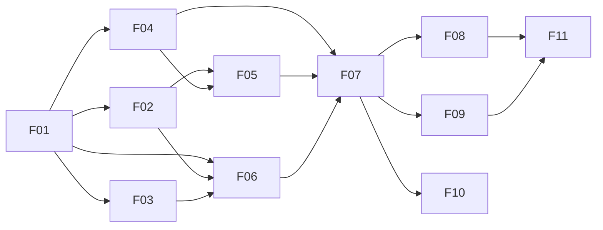

# troy-mode 需求文档

> 本文件是 [`requirements.md`](requirements.md) 的中文镜像，同步自英文版 1.4（2026-11-05）。两者如有出入，以英文版为准。

| | |
| --- | --- |
| 版本 | 1.4 |
| 日期 | 2026-11-05 |
| 状态 | Troy 已于 2026-11-05 批准。之后的版本加入了 Troy 同日批准的内容：F01 设计的 D1 和 D2（1.1），Q1 和 Q9 的回答（1.2），F02 设计的 D10、D11、D14 以及 Python 环境规则（1.3）。1.4 版更新了 F02 的状态。所有问题都已决定。 |
| 事实来源 | 英文版 [`requirements.md`](requirements.md)。本文件是中文镜像。 |

## 1. 目标

troy-mode 是 Troy 自己的 Claude Code 工作流。它让一个软件项目经过一条固定的角色流水线，从需求一直走到发布版本。每个角色在自己独立的上下文里工作，产出由另一个角色审查。规则由自动检查来执行，不依赖 Claude 记住它们。

它解决的是 Claude 在一个长对话里做完整个项目时常见的四个问题：

- 需求一直是隐含的，而且会悄悄变。
- 测试在代码之后才写，写成迎合代码的样子。
- 改动很大，难以审查。
- 写下的规则做到一半就被忘了。

troy-mode 作为新增文件放进 troy-pstack 插件。它不改任何 pstack 上游文件，也不改变 poteto-mode 的行为。

## 2. 用户

- 只有一个用户：Troy，独立开发者。
- 在 Windows 11 上使用 Claude Code 桌面应用（Code 标签页）和命令行。
- 项目放在 GitHub 上，大多是私有仓库。
- 中英文都能读写。

## 3. Troy 怎么使用

### 3.1 命令

| 命令 | 什么时候用 |
| --- | --- |
| `/troy-pstack:troy-mode <请求>` | troy-mode 项目里的任何工作：启动项目、做下一个功能、修 bug、改需求、发布版本，或者调查问题。 |
| `/troy-pstack:troy-init` | 每个项目运行一次，把 troy-mode 的文件和检查加进项目。 |

命令名是提议（待定问题 Q4）。

### 3.2 用 troy-mode 还是 poteto-mode

按项目选，不按任务选。

| 情况 | 用什么 |
| --- | --- |
| troy-mode 项目里，任何要合入 `main` 的改动 | troy-mode |
| troy-mode 项目里，调查问题或试一个想法 | troy-mode。它走轻量路径，不走 PR 流水线，借用 `how`、`why` 等 pstack 技能。 |
| 没用 troy-mode 的项目，或一次性脚本 | 任务需要严谨时用 poteto-mode |
| 简单问题或小改动 | 不用任何 mode |

在 troy-mode 项目里，不管改动是用哪种 mode 做的，CI 都会检查 PR 规则。

### 3.3 Troy 参与的环节

Troy 批准以下几项，其他环节都不等 Troy：

1. 每个项目的需求文档。
2. 每个项目的总体架构。
3. 前几个功能（Q2）的接口设计 PR 和测试方案 PR。Troy 通过合并这两个 PR 来批准。
4. 每个版本，方式是在自己的设备上测试。
5. 每一次升级上报（第 5.7 节）。

Troy 通过进度文件和需求文档里的功能状态表跟进进度。

### 3.4 交互原型

以下是文字模拟，实际措辞会不同。

**原型 A：启动项目。**

```text
Troy: /troy-pstack:troy-mode 我想做一个手机和电脑都能用的小习惯打卡应用。
产品经理: 我理解的目标：在两台设备上记录每天的习惯，并能看到连续天数。
      写需求之前，需要你回答这几个问题。
      1. 两台设备之间要同步吗，还是各自独立？
      2. 需要离线可用吗？
      3. ……
Troy: （回答）
产品经理: 需求草稿已写好：docs/requirements.md（英文）和
      docs/requirements.zh-CN.md（中文镜像）。
      共 14 个功能，依赖图没有循环。顺序：F01、F02、F04、F03……
      原型：docs/prototypes/F06-today-screen.html。
      版本计划：v0.1 = F01 到 F06，v0.2 = F07 到 F14。
      等待你批准。
Troy: 批准。
架构师: 架构草稿已写在 docs/architecture.md。等待你批准。
```

**原型 B：下一个功能。**

```text
Troy: /troy-pstack:troy-mode 下一个功能
troy-mode: 按顺序下一个是 F04"导出历史记录为 CSV"。它依赖 F02 和 F03，两者都已验收。
  [1/6] 接口设计 PR #41 已开。架构师在第 2 轮审查通过。
        这个由你合并（你负责的前 3 个功能中的第 2 个）。等你处理。
Troy: 已合并。
troy-mode: [2/6] 测试方案 PR #42 已开。等你处理。
Troy: 已合并。
troy-mode: [3/6] mock PR #43 已合并。CI 通过，代码审查通过。
  [4/6] 测试 PR #44 已合并。新增 9 个测试，对着 mock 全部失败，符合预期。
  [5/6] 实现 PR #45 已合并。9 个新测试全部通过，212 个已有测试全部通过。
        改动代码的覆盖率：行 94%，分支 86%。改动 310 行，涉及 4 个文件。
  [6/6] 验收 PR #46 已合并。F04 状态改为"在 main 上通过测试"。
        还没在你的设备上验证。
```

**原型 C：升级上报。**

```text
troy-mode: F07 停下了，需要你决定。
  原因：架构师连续 3 次驳回了接口设计。
  分歧：接口设计师想用一个 sync() 调用；架构师想拆成 push() 和 pull() 两个调用，
  让存储模块不包含任何网络代码。
  方案 A：一个 sync() 调用。调用方更简单，但存储模块依赖网络。
  方案 B：push() 和 pull()。保住模块边界，调用方要调两次。
  建议：B，因为架构规定存储模块不能依赖网络。
```

**原型 D：进度文件。**

```markdown
# 进度

- 当前版本：v0.2（F07 到 F14）
- 当前功能：F08 从 CSV 导入
- 阶段：第 4 步（共 6 步）。测试 PR #48 正在审查（代码审查员，第 1 轮）。
- 等 Troy 处理的：无
- 未解决问题：F05 有一处覆盖率排除（磁盘写满的分支），测试经理已批准。
- 最后更新：2026-11-12 14:05
```

## 4. 角色

| 角色 | 运行方式 | 负责产出 | 负责审查 | 禁止 |
| --- | --- | --- | --- | --- |
| 产品经理 | 主会话，因为只有主会话能和 Troy 对话 | 需求文档、功能列表、依赖图、功能顺序、原型、版本计划、状态表、验收、需求变更 | 每个完成的功能，对照需求验收 | 写代码或测试 |
| 架构师 | 子代理 | 总体架构、编码规范、模块依赖规则、架构决策记录（ADR）、审批新的第三方依赖 | 每份接口设计，按检查清单审 | 自己设计功能的接口 |
| 接口设计师 | 子代理 | 每个功能的对外接口设计 | 不审查。负责回答测试经理的问题。 | 修改总体架构。需要时向架构师提出。 |
| 测试经理 | 子代理 | 每个功能的测试方案、每个版本的测试方案，以及覆盖率缺口、bug 和有争议测试的分类裁定 | 每个测试 PR，对照测试方案 | 写测试代码 |
| 开发工程师 | 子代理 | mock PR、实现 PR、bug 修复 PR | 不审查 | 修改测试。未经架构师同意引入第三方依赖。 |
| 测试工程师 | 子代理 | 测试代码、bug 重现测试、测试经理要求的测试修正 | 不审查 | 修改源码 |
| 代码审查员 | 子代理 | 不产出 | mock、测试和实现 PR，看代码质量和安全，使用 Claude Code 的 `/code-review` 和 `/security-review` | 修改自己审查的代码 |

主会话同时承担项目经理的工作：挑下一个功能、启动各个角色、在角色之间传递审查意见、维护进度文件、向 Troy 升级上报。

每个角色用什么模型可以配置（Q3）。

### 4.1 troy-mode 复用的 pstack 技能

troy-mode 在合适的地方调用这些 troy-pstack 技能，不修改它们。

| 技能 | 用途 |
| --- | --- |
| `how`、`why` | 调查问题时和设计之前，读懂现有代码 |
| `interrogate` | 对有争议的设计做对抗式评审 |
| `benchmark-checklist` | 在相信性能数字之前先核对 |
| `technical-writing` | 写需求、设计和测试方案文档 |
| `correct`、`reflect` | 版本结束后，把重复出现的错误变成规则和检查 |

pstack 的规则和 troy-mode 的规则冲突时，在 troy-mode 项目里以 troy-mode 为准。注释就是一个例子：pstack 只为不明显的原因保留注释，troy-mode 要求每个函数都有 Google 风格的文档注释。

## 5. 流程

### 5.1 项目初始化（每个项目一次）

1. **需求。** 产品经理和 Troy 对话，直到需求明确。它用英文写需求文档，并附中文镜像。文档包括目标、用户、交互方式、非功能需求（含性能指标）、不做的范围、待定问题，以及以下几部分：
   - 功能点，拆得尽量细，每个有编号。
   - 依赖图。每条依赖分为硬依赖（没有 A 就做不了 B）和软依赖（B 可以先对着 A 的 mock 做）。
   - 拓扑排序。出现循环说明拆分有问题，产品经理要重新拆，通常是把共用部分拆成一个独立的功能点。
   - 原型。
   - 版本计划。

   如果某个功能的实现会超过 PR 规模限制（R03），就把它拆开。需求文档由 Troy 批准。
2. **初始化。** `troy-init` 加入标记文件夹、文档模板、规则表和进度文件。
3. **架构。** 架构师写总体架构：技术栈、模块划分及模块之间允许的依赖方向（不能有循环）、数据模型、错误处理、日志、命名和编码规范。由 Troy 批准。
4. **检查。** `troy-init` 为选定的技术栈加入对应语言的检查和 CI 工作流。

### 5.2 功能循环

功能按拓扑顺序一次做一个。每个功能分 6 个 PR，按顺序合入。每个 PR 只有一个 commit，只包含一个阶段的产出。


| PR | 内容 | 作者 | 审查 | 合入条件 | 谁来合并 |
| --- | --- | --- | --- | --- | --- |
| 1 | 接口设计（中英文）。每个对外接口写明：名称、功能、参数、返回值、错误，以及需求规定了性能指标时的指标。 | 接口设计师 | 架构师按下方清单审查，最多 3 轮 | 文档检查通过 | 前几个功能由 Troy 合并（Q2），之后由 Claude 合并 |
| 2 | 测试方案（中英文）。单元、功能、集成和性能用例，每个用例写明测什么。 | 测试经理 | 和接口设计师对齐，最多 3 轮 | 文档检查通过 | 前几个功能由 Troy 合并（Q2），之后由 Claude 合并 |
| 3 | mock。函数签名和完整的 Google 风格文档注释，不写函数体。 | 开发工程师 | 代码审查员 | 检查通过，已有测试全部通过 | Claude |
| 4 | 测试代码，每个测试标上功能编号。 | 测试工程师 | 测试经理（是否符合方案）和代码审查员 | 每个新测试对着 mock 都失败，已有测试全部通过 | Claude |
| 5 | 功能实现。 | 开发工程师 | 代码审查员 | 新测试和已有测试全部通过；有性能指标的接口通过性能测试；覆盖率满足 R11；满足规模规则 | Claude |
| 6 | 验收。中英文状态更新。本功能的测试改为必须通过。 | 产品经理 | 无 | 检查通过 | Claude |

**架构师的接口审查清单。**

- 符合模块划分和数据模型。
- 遵守错误处理和命名约定。
- 不和已有接口重复。
- 只依赖排序在前面的功能。
- 不在模块之间增加隐性耦合。
- 修改已实现的接口时，必须走需求变更流程（5.4）。

**有争议的测试。** 开发工程师提出，测试经理裁定。如果测试确实错了，由测试工程师单独提一个测试 PR 修正，并写明原因。测试改动永远不和源码放在同一个 commit 里。

**覆盖率缺口。** R11 不满足时，由测试经理判断没覆盖到的是什么代码。补测试只能从设计出发，不能对着没覆盖到的代码行凑测试。

| 没覆盖到的代码 | 原因 | 谁来改 |
| --- | --- | --- |
| 用不到的代码（没用的分支、提前写好的功能） | 开发写多了 | 开发工程师删掉 |
| 设计里有、测试方案漏掉的行为 | 测试方案不全 | 测试经理补用例，测试工程师单独提测试 PR 补上 |
| 设计里没有的行为 | 要么设计漏了，要么开发越界 | 接口设计师判断。设计漏了就先补设计再补测试，开发越界就删掉。 |
| 实际上测不了的代码（比如磁盘写满） | 难以构造 | 标记排除并写明原因，测试经理批准 |

### 5.3 修 bug

1. 测试经理对报告分类。如果是需求理解错了，转给产品经理按需求变更处理（5.4）。
2. PR A：测试工程师加一个能重现 bug 的测试，标上 bug 编号。测试失败。
3. PR B：开发工程师修复 bug。测试通过，并作为回归测试永久保留。

两个 PR 都由代码审查员审查。

### 5.4 需求变更

1. Troy 提出变更。产品经理更新需求文档，由 Troy 批准。
2. 产品经理根据依赖图列出受影响的功能：被改的功能本身，以及所有依赖它的功能。
3. 架构师决定哪些接口、测试和架构需要改。架构有变化时写一条 ADR。
4. 改动照常走功能循环的 PR。所有已有测试作为回归测试运行。

### 5.5 版本发布

1. 版本计划把排序中相邻的功能分组成版本。每个版本自身都能用。
2. 测试经理在规划版本时就写好版本测试方案，而不是到最后才写。
3. 版本测试在 Troy 的设备上运行：按需求里的用户场景做端到端测试，加上压力测试和性能测试。由 Troy 验收版本。
4. 发现的 bug 走修 bug 流程（5.3）。
5. 验收后，在 `main` 上打 `vMAJOR.MINOR.PATCH` 标签，并更新中英文更新日志。
6. 做一次复盘，把这个版本里重复出现的问题变成新的规则或检查（5.8）。

### 5.6 测试什么时候运行

| 时机 | 运行什么 | 谁负责 |
| --- | --- | --- |
| 每个阶段 | 当前功能的测试 | 自动 |
| 每个 PR | 全部单元、功能和集成测试，作为回归。目标是几分钟内跑完。 | CI |
| 每个版本 | 端到端、性能和压力测试，在 Troy 的设备上运行 | 测试经理设计，测试工程师实现，产品经理和 Troy 验收 |

**性能。** 指标来自需求。接口设计师把指标写进接口设计，测试经理在测试方案里设计性能用例。性能测试在实现之后运行，因为 mock 总是立即返回。只有带指标的接口才写性能测试。压力测试需要整个系统，所以只在版本层面运行。

### 5.7 升级上报

出现以下情况时，troy-mode 停下来找 Troy：

- 一个审查循环到 3 轮仍未达成一致。
- 某项改动需要修改需求或架构。
- 实现尝试 3 次后仍过不了测试。
- 需要引入新的第三方依赖。由架构师先审。
- 需要做合并权限之外的不可逆操作，比如强制推送或删除数据。

每次上报都写明：哪里停了、为什么、有哪些方案、建议选哪个（原型 C）。

### 5.8 新增或修改规则

1. Troy 说明规则内容，以及它适用于所有 troy-mode 项目还是某一个项目。
2. troy-mode 选最可靠的落实方式，从强到弱依次是：架构上让错误写法根本写不出来、lint 或 CI 检查、测试，最后才是写进角色说明。
3. 用一个 PR 同时更新规则表、检查配置和角色说明，中英文都改。
4. 如果已有代码不符合新规则，由 Troy 选择：在单独的整改 PR 里一次改完，或者只要求新增和修改的代码符合。

适用于所有项目的规则放在 troy-pstack 里，随新的插件版本发布。只适用于一个项目的规则放在那个项目的规则表里。

### 5.9 流水线之外的工作

在 troy-mode 项目里调查问题、回答问题、做试验，都不向 `main` 开 PR。试验代码只放在临时分支或单独的目录里。值得保留的代码要走功能循环。

### 5.10 跨会话接续

进度文件（原型 D）记录当前版本、当前功能、所处阶段、未合并的 PR、在等 Troy 处理的事项，以及未解决的问题。新会话先读它，不需要旧对话就能接着做。

## 6. 规则

**硬规则**：不满足就不能合入。**软规则**：PR 描述里写明原因就可以合入。**审查**：由某个角色检查。**流程**：由 troy-mode 自己遵守。Troy 用的是 GitHub 免费套餐，私有仓库没有分支保护，所以硬规则由 troy-mode 的合并步骤执行：检查失败的 PR 一律不合并（F02 设计 D14）。

| 编号 | 规则 | 类型 | 由什么保证 |
| --- | --- | --- | --- |
| R01 | 每个 PR 只有一个 commit。审查后的修改通过修改那个 commit 完成，或者用 squash 合并。 | 硬 | CI |
| R02 | 每个 PR 只包含一个阶段的产出：文档、源码或测试之一。 | 硬 | CI |
| R03 | 源码 PR 最多改动 500 行（新增加删除，不算锁文件和自动生成的文件），最多涉及 5 个文件。测试 PR 不限。只拆分文件的 PR 可以超限，但要写明。 | 软 | CI |
| R04 | 函数体最多 50 行，不算注释、文档注释和空行。复杂的对外接口调用多个功能单一的内部函数。 | 硬 | Lint |
| R05 | 文档注释使用 Google 风格。代码注释只用英文。 | 硬 | Lint |
| R06 | 源码文件最多 500 行（总行数，含注释）。超过就拆分文件。 | 软 | Lint |
| R07 | 模块之间只能按架构允许的方向依赖，只通过对外接口调用，不能有循环。 | 硬 | 依赖检查工具 |
| R08 | 开发工程师永远不改测试文件。 | 硬 | Hook 和 CI |
| R09 | 测试 PR 里的每个新测试对着 mock 都失败。 | 硬 | CI |
| R10 | 每个测试都标上所属的功能或 bug 编号。尚未验收的功能、尚未修复的 bug，它们的测试失败记为预期失败。其余测试必须通过。 | 硬 | 测试运行器配置和 CI |
| R11 | 实现 PR 中，改动代码的行覆盖率不低于 90%，分支覆盖率不低于 80%。95% 是目标，不是门槛。排除的代码行必须写明原因，并经测试经理批准。 | 硬 | CI |
| R12 | 英文文档是事实来源。改英文文档的 PR 必须同时更新中文镜像。中文镜像的开头注明它对应的英文版本。 | 硬 | CI |
| R13 | 状态标签要如实说明功能做到哪一步，比如"在 main 上通过测试"和"在 Troy 的设备上可用"要区分开。 | 审查 | 产品经理 |
| R14 | 只有带性能指标的接口才写性能测试。在固定的机器上运行，留出余量，和上一次的基线比较。 | 审查 | 测试经理 |
| R15 | 每个修过的 bug 都保留它的重现测试。 | 审查 | 测试经理 |
| R16 | 引入新的第三方依赖需要架构师批准。 | 审查 | 架构师。CI 会标出所有依赖文件的改动。 |
| R17 | 审查循环最多 3 轮，之后升级上报。 | 流程 | troy-mode |
| R18 | 前几个功能（Q2）的 PR 1 和 PR 2 由 Troy 合并。其他 PR 在检查和审查都通过后由 Claude 合并。什么时候全部交给 Claude 合并，由 Troy 决定。 | 流程 | troy-mode |
| R19 | commit 使用 Troy 全局 CLAUDE.md 里规定的邮箱。commit 信息、PR 标题和 PR 描述不带任何 Claude 署名，默认也完全不提 Claude 或 Anthropic（F02 设计 D10）。 | 硬 | Hook 和 CI |
| R20 | 合并的文档和 PR 描述里没有模板标记或填写说明（F01 设计 D2、F02 设计 D11）。 | 硬 | CI |

## 7. 功能点

### 7.1 状态标签

| 标签 | 含义 |
| --- | --- |
| 未开始 | 还什么都没有。 |
| 已编写 | 文件已存在，但从未运行过。 |
| 在示例项目上跑通 | 在一个临时的示例项目上跑过。 |
| 在真实项目上使用 | Troy 在自己的某个项目上用过。 |

### 7.2 功能列表

编号已经按拓扑顺序排好。

| 编号 | 功能 | 依赖 | 状态 |
| --- | --- | --- | --- |
| F01 | 模板和规则表。需求、架构、接口设计、测试方案、ADR、进度文件、更新日志和升级上报消息的模板。中英文成对文件的格式及同步标注。规则表，初始内容取自第 6 节。PR 标题和描述模板（[F01 设计](design/F01-templates.zh-CN.md) D1）。 | 无 | 已编写 |
| F02 | 与语言无关的检查：R01、R02、R03、R12、R16、R19、R20，运行这些检查的 GitHub Actions 工作流，以及供 F05 的 hook 检查 R19 用的 `commit` 子命令。检查从 PR 标题读取它所属的阶段（F01 设计 D1）。R20 拒绝仍残留模板标记的文档和 PR 描述（F01 设计 D2）。 | F01 | 已编写 |
| F03 | 语言包。每种语言提供 R04、R05、R06、R07、R10、R11 的配置及其测试运行器配置。先做 Python 和 C/C++，TypeScript/JavaScript 也要支持，优先级较低（Q1）。Python 语言包遵守第 8 节的 Python 环境规则。 | F01 | 未开始 |
| F04 | 角色定义。6 个子代理，以及主会话中产品经理的说明，每个都包括职责说明、工具限制和模型。 | F01 | 未开始 |
| F05 | Hooks。用标记文件夹做开关，在非 troy-mode 项目里什么都不做。阻止开发工程师修改测试（R08）。阻止违反 R19 的 commit。 | F02、F04 | 未开始 |
| F06 | 项目初始化（`troy-init`）。标记文件夹、文档骨架、规则表和进度文件。架构批准后，加入语言包和 CI 工作流。 | F01、F02、F03 | 未开始 |
| F07 | 入口技能（`troy-mode`）。把每个请求分到对应流程（5.1 到 5.10），运行功能循环，在角色之间传递审查意见，升级上报，执行合并权限，维护进度文件。 | F04、F05、F06 | 未开始 |
| F08 | 版本发布流程（5.5）。 | F07 | 未开始 |
| F09 | 规则变更流程（5.8）。 | F07 | 未开始 |
| F10 | troy-pstack 文档。README 新增一节、中英文使用指南，并注明 troy-mode 是 Troy 自己的作品。 | F07 | 未开始 |
| F11 | 试点。用 troy-mode 带一个小的真实项目走完一个版本。 | F08、F09 | 未开始 |



F02、F03、F04 都只依赖 F01，可以并行开发。

## 8. 非功能需求

- **不影响 troy-pstack 原有内容。** troy-mode 不改任何上游文件。它只改动三个共用文件：`README.md`、`.claude-plugin/plugin.json`、`.claude-plugin/marketplace.json`。所有新增的技能、代理和脚本名都以 `troy-` 开头。所有新技能只在 Troy 手动输入时运行（`disable-model-invocation: true`）。在非 troy-mode 项目里，hook 立即退出。
- **继续方便合并上游更新。** README 里合并上游的步骤照常可用，不需要改。
- **平台。** 以 Windows 11 为主，通过 Git Bash 和 PowerShell 运行。CI 在 GitHub 托管的 Linux 机器上运行。脚本在 macOS 和 Linux 上也能运行。文件使用 LF 换行。
- **速度。** hook 不能带来 Troy 能察觉的延迟，目标是每次调用 200 毫秒以内。每个 PR 的回归测试在几分钟内跑完。
- **成本。** 每个角色的模型都可以配置。检查在推送前先在本地跑一遍，这样 CI 很少失败，私有仓库的 Actions 分钟数够用。
- **隐私。** 除 GitHub 和 Anthropic 外不使用任何其他服务。任何密钥都不写进文档、日志或进度文件。
- **可接续。** 任何新会话都能从进度文件接着做。
- **语言。** 文档用英文写，附中文镜像。代码和代码注释用英文。
- **Python 环境。** Python 项目用 mamba 创建和管理项目环境，用 uv 往环境里安装包。troy-mode 从不创建 `.venv` 文件夹。F03 的 Python 语言包负责在 Troy 的电脑和 CI 上配好这一套。troy-mode 自己的检查（F02）只用标准库，不需要环境。
- **可追溯。** 每个角色的产出都是一个 PR 或一条审查意见，历史记录能看出谁改了什么。

## 9. 不做的范围（第 1 版）

- 团队：多于一个人，或者把角色分配给真人。
- GitHub 以外的代码托管平台。
- 修改 pstack 上游技能或 poteto-mode。
- 部署到生产环境、应用商店或服务器。troy-mode 到打好标签、验收通过的版本为止。
- 图形化的仪表盘。状态都记在 Markdown 文件里。
- Python、C/C++、TypeScript/JavaScript 以外的语言（Q1）。
- 改写已有项目的 git 历史。

## 10. 待定问题

Troy 已于 2026-11-05 批准本文档，即接受 Q2 到 Q10 的提议。Troy 于同日回答了 Q1，并扩展了 Q9（1.2 版）。

| 编号 | 问题 | 提议 |
| --- | --- | --- |
| Q1 | 先支持哪些语言？每种语言都需要自己的语言包（F03）。 | Troy 已决定：先做 Python 和 C/C++。TypeScript/JavaScript 也要支持，优先级较低。 |
| Q2 | Troy 负责合并前几个功能的 PR 1 和 PR 2？ | 每个项目前 3 个功能，之后由 Troy 决定。 |
| Q3 | 每个角色用什么模型？ | 架构师、接口设计师、测试经理、代码审查员用 opus。开发工程师和测试工程师用 sonnet。产品经理使用主会话的模型。 |
| Q4 | 命名。 | `troy-mode`、`troy-init`。代理：`troy-architect`、`troy-interface-designer`、`troy-test-manager`、`troy-developer`、`troy-test-engineer`、`troy-code-reviewer`。标记文件夹：项目根目录下的 `.troy-mode/`。 |
| Q5 | R08 需要 hook 知道当前在改文件的是开发工程师。Claude Code 是否会告诉 hook 是哪个子代理发起的调用，要在设计时核实。 | 如果做不到，就由 CI 在每个 PR 上检查 R08，并在开发工程师的说明里禁止。 |
| Q6 | 已有项目（比如 troy-voice）接入 troy-mode 时，旧代码也要符合规则吗？ | 不需要。只要求新增和修改的代码符合。旧代码在被改动时再整改。 |
| Q7 | 性能测试在哪台机器上跑？ | 版本发布时在 Troy 的电脑上本地跑。不放在 CI 上，因为 CI 机器的性能波动太大。 |
| Q8 | 进度文件要提交到仓库吗？提交的话每次更新都要一个 PR，在 R01 和 R02 下会很繁琐。 | 只放在本地，加入 git 忽略列表。需要长期保存的状态记在状态表里，由 PR 6 更新。 |
| Q9 | 项目原型用什么格式？ | 可点击的 HTML 线框图，放在 `docs/prototypes/`，文档里再配 Mermaid 图。命令行项目也可以用 Markdown 文件写一段终端交互的文字记录做原型，同样放在 `docs/prototypes/`（Troy 在 1.2 版加入）。 |
| Q10 | troy-mode 本身怎么开发？在 F07 完成之前，流水线还不存在。 | 在 troy-pstack 上每个功能（F01 到 F10）一个 PR，每个 PR 一个 commit。检查脚本先写测试再实现。试点（F11）是流水线的第一次完整运行。 |

## 11. 修改记录

| 版本 | 日期 | 修改 |
| --- | --- | --- |
| 0.1 | 2026-11-05 | 初稿，根据 Troy 与 Claude 在 2026-11-05 的讨论整理。 |
| 1.0 | 2026-11-05 | Troy 批准。接受 Q2 到 Q10 的提议。Q1 仍待定。 |
| 1.1 | 2026-11-05 | F01 加入 PR 标题和描述模板（D1）。F02 从 PR 标题读取阶段，并拒绝残留的模板标记（D2）。两项都随 F01 设计由 Troy 批准。另有措辞修改：用 Troy 的名字代替代词。 |
| 1.2 | 2026-11-05 | Troy 回答了 Q1：先做 Python 和 C/C++，TypeScript/JavaScript 优先级较低。Troy 扩展了 Q9：命令行项目可以用 Markdown 写终端交互的文字记录做原型。需求模板随之更新。 |
| 1.3 | 2026-11-05 | Troy 批准 F02 设计。R19 默认还禁止提到 Claude 或 Anthropic（D10）。新增规则 R20，检查模板标记（D11）。第 6 节写明硬规则由 troy-mode 的合并步骤执行，因为 Troy 的 GitHub 套餐对私有仓库没有分支保护（D14）。Troy 加入 Python 环境规则：用 mamba 和 uv，不用 `.venv`（第 8 节）。F01 状态：已编写。 |
| 1.4 | 2026-11-05 | F02 状态：已编写。单元测试在 Troy 的电脑上通过，还没在项目的 PR 上运行过。 |
